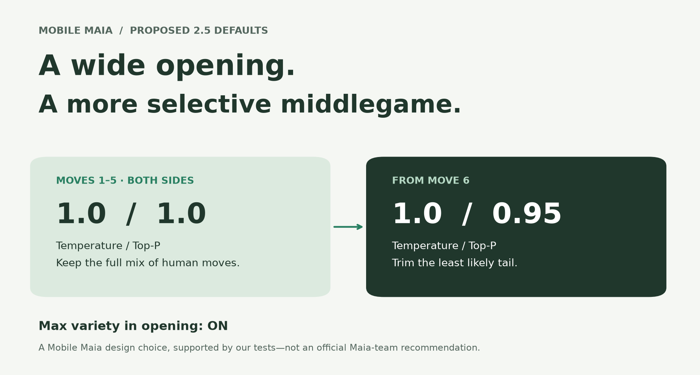
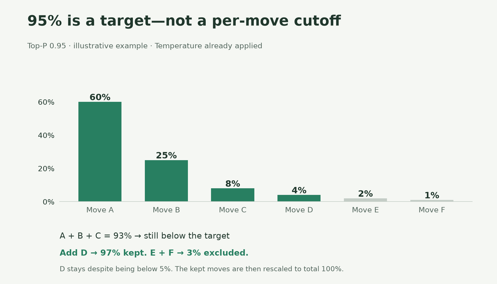
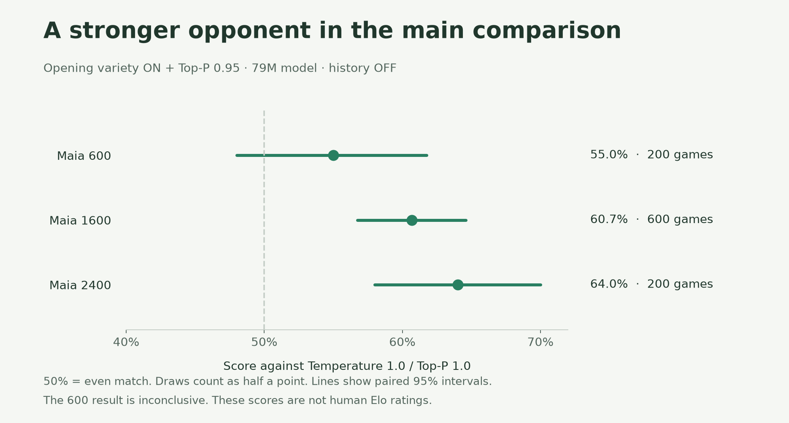
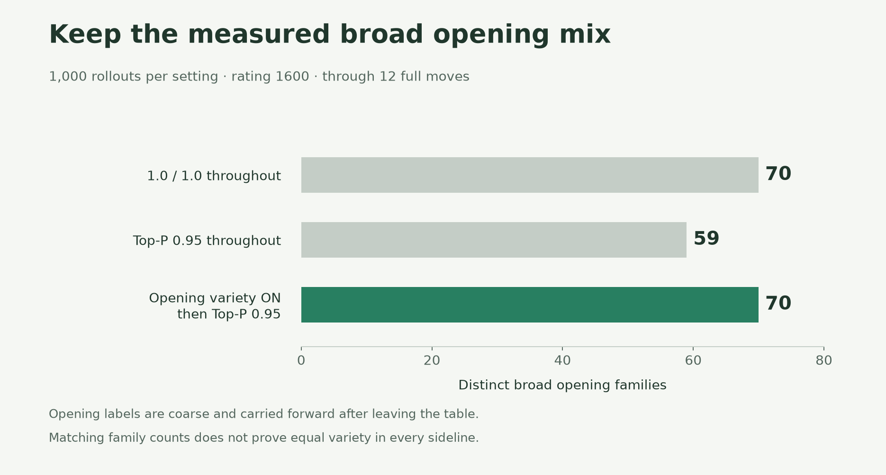

# Choose the kind of Maia you want to play

**A broad opening, then a little more restraint.** That is our proposed balance for Mobile Maia 2.5: **Temperature 1.0, Top-P 0.95, Max variety in opening on**. This guide explains the choice and the research behind it. These are proposed defaults, not a claim that an unreleased app version is available. Existing saved preferences are preserved.

Maia predicts the moves people at a chosen rating are likely to play. It does not search for the objectively best move like Stockfish. A move's probability tells us how likely a human is to choose it—not how good it is.

[The two controls](#two-controls-two-jobs) · [What we measured](#what-we-measured) · [Choose-your-settings guide](#choose-your-settings) · [Evidence and limitations](#what-this-does-and-does-not-prove)

## Two controls, two jobs

**Temperature changes the odds.** At **1.0**, Maia keeps the model's original mix. Lower it and the more likely moves take a larger share. At **0**, Maia always chooses a most likely move: *argmax*. Top-P then has no effect. The app disables that slider without erasing its saved value.

**Top-P trims the candidate list.** At **1.0**, all legal candidates remain. Lower it and the least likely tail is removed. The remaining moves share the chance of being selected. At **0**, one highest-probability candidate remains.

You can think of Temperature as a player's willingness to consider unusual ideas, and Top-P as an angel on their shoulder urging restraint. But neither control judges whether a sacrifice is brilliant or a blunder. At 1.0 / 1.0, an unusual move is possible, not as likely as a popular one.

**Top-P 0.95 does not remove every move with less than a 5% chance.** It keeps enough candidates to reach at least 95% of the total probability, after Temperature is applied. In this example, the first three total only 93%, so the fourth must stay. Its new chance is 4/97, or about 4.1%.

## Why let the opening breathe?

Our [earlier study](../../studies/maia3-sampling/REPORT.md) showed the tradeoff. Lower settings made Maia harder to beat, but also removed less common openings. Without an opening book, Maia's own sampling has to supply the variety.

**Max variety in opening** gives Maia 1.0 / 1.0 for the first five moves by each side, then applies your settings from move 6. It uses the position's actual move number: resuming a game or choosing “Continue from here” does not restart the opening period. Unusual choices—and mistakes—remain possible in the opening.

Five moves is a practical design choice. We tested this choice; we did not establish that five is better than four, six or another boundary. Credit to [maia3-tauri](https://github.com/outusuke/maia3-tauri) for the opening-variety idea.

## What we measured

The [18 October study](../../studies/opening-variety-2026-10-18/REPORT.md) ran **3,000 full games, 5,400 opening rollouts and 180 diagnostic positions**, with the Maia-3 79M model and move history off. The figures below use its recorded results; no new matches were run for this guide.

### A stronger opponent in the primary comparison

At **1600**, opening variety plus Top-P 0.95 won **345**, drew **38** and lost **217** of 600 games against 1.0 / 1.0. That is **60.7% of the available points**, with draws worth half a point. Its 95% interval is **56.8–64.6%**. At 600 the interval includes an even result, so that comparison is inconclusive.

This is evidence of a useful strength gain in these matches, not a promise that your human rating or Maia's displayed rating rises by a fixed amount. The earlier study found an approximately **300-Elo matchup advantage for argmax** at 1600; it was strongest among those tested settings, not proven strongest in every setup. It was a separate experiment without the new opening override.

### Broad opening choices were retained

In the 1600 sample, the opening override retained the same **70 broad opening families** as full sampling, versus **59** when Top-P 0.95 was used from the start. The same-seed opening pairs matched through the first five moves by construction. Later sequences diverged.

These labels are coarse. The last recognized opening family is carried forward after a game leaves the opening table. Equal family counts are **not proof that every sideline remains equally common**. The detailed report checks exact move prefixes, table coverage and cross-rating results too.

### Fewer poor choices on average, not mistake-proof chess

In 60 selected middlegame positions at rating 1600, the mean chance assigned to moves at least two pawns worse than the best evaluated legal move fell from **8.89% to 7.99%** after trimming. The evaluation used a fixed, shallow Stockfish 18 search for every legal move. This is a diagnostic on selected positions, **not an observed whole-game blunder rate**.

Across all 180 positions, expected evaluation loss fell in 163, rose in 12 and stayed the same in five. Filtering can discard good moves too. [Diagnostic details](../../studies/opening-variety-2026-10-18/REPORT.md#completed-quality-diagnostic).

## Choose your settings

| The experience you want | Temperature | Top-P | Opening variety |
| --- | ---: | ---: | --- |
| Our proposed balance | **1.0** | **0.95** | **On** |
| Full human-move variety throughout | 1.0 | 1.0 | Not needed |
| A more predictable, tougher opponent after the opening | 0 | Not used | On |
| Always choose a most likely move, including the opening | 0 | Not used | Off |

The **Maia rating** is a separate control: it conditions the model on a human rating level. The new proposed play and primary analysis default is **1500**, and the optional second analysis engine defaults to **2600**. These are product choices; the main research comparison used **1600**, not 1500 or 2600. The second engine remains off until enabled.

The **analysis board's percentages** show the model's original move probabilities. They do not become the sampling odds used after Temperature and Top-P. The **sampling report** records the effective play settings and selection probabilities, including the opening override.

## What this does and does not prove

The new study tested the 79M model with history off at rating inputs 600, 1600 and 2400. It supports the proposed balance in that setup. It does not calibrate human Elo, prove an ideal opening length, or establish that filtered play better predicts human moves. We did not rerun the human-reference comparison in the new study. The earlier Lichess comparisons remain useful historical evidence, but should not be presented as a new validation of this combined policy.

This is independent **Mobile Maia** research, not an official recommendation from the Maia team or Lichess. Maia is developed by the [University of Toronto CSS Lab and collaborators](https://www.maiachess.com/). Source pins, model hashes, methods and limitations are recorded in the linked studies.

### Inspect or reproduce

- [New study: methods, results and limitations](../../studies/opening-variety-2026-10-18/REPORT.md)
- [New study: data, code and replay verification](../../studies/opening-variety-2026-10-18/README.md)
- [Earlier study: Temperature, Top-P and Lichess opening comparisons](../../studies/maia3-sampling/REPORT.md)
- [Figure source values](figure-values.json) · [Figure generator](make_figures.py) · [Pinned plotting dependencies](requirements.txt)

To regenerate the four figures, install `requirements.txt` into a temporary Python environment and run `python make_figures.py`. The generator reads the archived study summaries; it never runs an engine or modifies study evidence. Illustrative probabilities are explicitly marked and separate from measured results.
