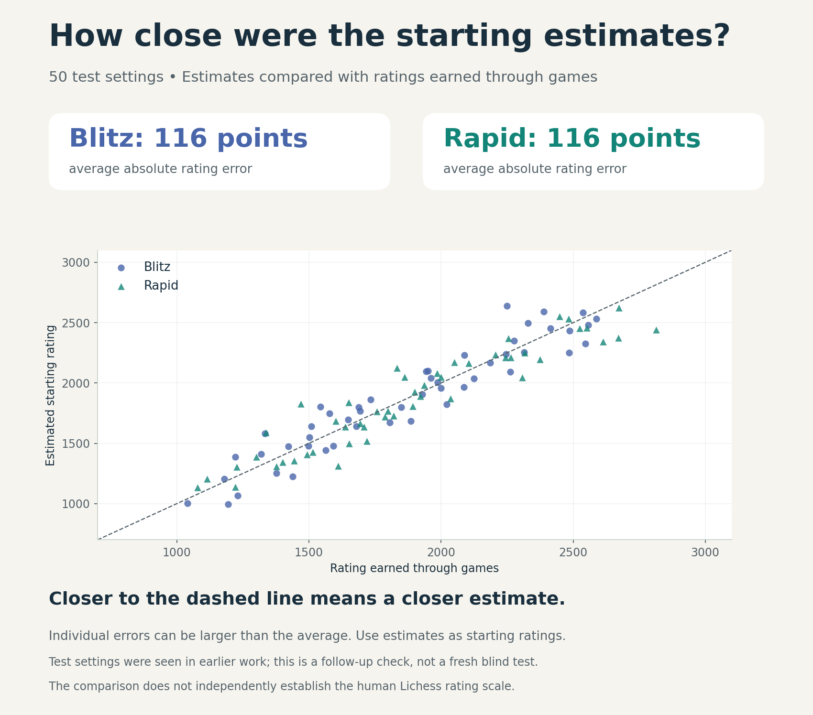

# How should a new Maia bot get its rating?

Mute Chess is a chess site where you can play bots powered by **Maia**, a model
that predicts human moves. Different settings produce different opponents,
from varied to predictable. Their ratings should help you find a matched game.

**How do we give a new bot a sensible rating before it has played?** Our approach
is to use a varied set of bots' settings and earned ratings as a reference.

We now have **250 reference bots with established Blitz and Rapid ratings**.
A fitted formula estimates ratings from settings. On the 50 test configurations,
its estimates differed from the final earned ratings by about **116 points on
average** in each speed. This gives us a measured error scale for judging
these starting estimates.

[Why settings matter](#how-settings-change-playing-strength) ·
[Rating reference](#a-reference-set-of-250-bots) ·
[Results](#how-close-were-the-estimates) · [Data and methods](README.md)

## How settings change playing strength

Maia's **rating input**, also called its *conditioning input*, tells the model
which level of human play to imitate. It is not a measurement of how well the
resulting bot will score. The other settings matter too.

| Setting | What it changes |
| --- | --- |
| **Rating input: 600–2600** | The level of human play Maia is asked to imitate. |
| **Temperature: 0–1** | Lower values concentrate choices on Maia's most likely moves. |
| **Top-P: 0–1** | Lower values remove more unlikely moves from the available choices. |
| **Move history: on or off** | Whether Maia receives preceding positions alongside the current board. |
| **Opening rule** | When the assigned sampling settings begin to apply. |

Two bots can both have a rating input of 1600 while one samples the full range
of moves and the other repeatedly chooses its favorite. Our
[sampling study](../maia3-sampling/REPORT.md) found that narrowing those choices
could make Maia substantially harder to beat. After any opening override, setting either
Temperature or Top-P to zero selects the most likely move.

We call the complete move-selection setup a **policy**. Each reference bot keeps
one policy throughout its games. Another name using the same settings can benefit from that evidence.

## Where does the rating scale come from?

**The starting reference comes from observed Maia accounts on Lichess.** The
original Mute Chess roster used historical ratings from public Maia3-79M
accounts, with an approximate adjustment for differences in sampling settings.

The bots then played rated games in Mute Chess using **Lichess's Glicko-2 rating
system**. Results update ratings and their uncertainty; existing histories were retained.
[Starting-reference evidence](../bot-strength-seeding-2026-10-31/REPORT.md#why-these-starting-priors-require-a-test).

The aim is for Mute Chess ratings to roughly correspond to Lichess strength in
the same speed category. Games among these bots improve their **relative
ratings**, but cannot independently prove that the entire pool matches the
human Lichess scale. A shared offset could remain even if the bots were ordered
well.

## A reference set of 250 bots

The reference uses **Maia3-79M** with varied inputs, sampling settings and fixed
history modes. The published calibration dataset contains
**3,449 rated games**, alongside the bots’ existing rating histories.

| Reference at the end of the studies | Blitz | Rapid |
| --- | ---: | ---: |
| Time control | 5 minutes + 3 seconds per move | 10 minutes + 5 seconds per move |
| Bots with established ratings | **250 of 250** | **250 of 250** |
| Earned rating range, rounded | 771–3,043 | 835–2,813 |
| Highest rating deviation | 109.91 | 109.97 |

**Rating deviation, or RD, measures the rating system's uncertainty.** Every bot
finished below the 110-point provisional boundary in both speeds. All 500
ratings therefore became *established*. Established does not promise accuracy within 110 points of true strength.

The spread illustrates why the whole policy matters. It reflects both different
settings and remaining rating uncertainty; it does not isolate the effect of
any one slider.

## Turning settings into a starting estimate

We used **200 bots to fit the formula and 50 to check its predictions**, with
separate fits for Blitz and Rapid. Equivalent training policies are grouped together when comparing candidate
formulas.

Once the 200 training bots had established ratings in both speeds, we fitted
the predetermined procedure using only those ratings. Its predictions
were saved and fixed before the new test games began. Those results did not
change the formula or its predictions.

**The 50 test policies had been observed in the earlier study.** Their earlier
games also influenced training opponents' ratings. This checks fixed predictions
against later evidence from known configurations; it is not a fresh blind test
of previously unseen policies.

## How close were the estimates?

The chart compares fixed predictions with earned ratings. Points on the
diagonal would be exact matches.

We measure each error as the distance between prediction and earned rating,
ignoring whether it was too high or too low. Averaging those distances gives
**mean absolute error**, or MAE.

| Prediction check | Blitz | Rapid |
| --- | ---: | ---: |
| Test policies | 50 | 50 |
| Average error, rating points | **115.8** | **116.0** |
| 95% interval for average error | 94.1–138.5 | 91.8–143.1 |

The intervals describe uncertainty in the **average error across this sample**,
not a prediction range for a new bot. Individual errors can be much larger.
The earned ratings are themselves estimates, and these intervals do not include
uncertainty in the shared Lichess-derived scale.

## What this means for a new bot

**Choose an informed starting estimate from the policy, then let games take
over.** An established reference bot supplies direct evidence for matching
settings. The formula supplies an approximate estimate for other combinations
within the tested domain.

A new name still needs its own provisional rating history. It should not inherit
another account's completed games, low RD or established status. The benefit is
that every future name does not need a separate tournament just to get an
informed starting point.

For players, the **earned playing rating is more informative than the Maia input
alone**. A new bot's rating can move as it plays. These results cover the recorded
79M policies in Blitz and Rapid; they do not establish ratings for other models,
speeds or independently varied opponent-conditioning inputs. Nor do they prove
accuracy for every unmeasured combination.

---

The [evidence and reproduction guide](README.md) contains protocols, source pins,
all games, verification and detailed limitations. The
[settings](data/configurations.json), [earned ratings](data/ratings.csv),
[frozen predictions](data/frozen-predictions-v2.csv) and
[per-bot evaluation](data/evaluation.json) make the comparisons inspectable.

This is independent Mobile Maia/Mute Chess research, built on
[Maia/CSSLab](https://github.com/CSSLab/maia3),
[Lichess/Lila](https://github.com/lichess-org/lila) and earlier Mobile Maia and
[En Croissant](https://github.com/franciscoBSalgueiro/en-croissant) work.
These are project choices, not upstream recommendations.
