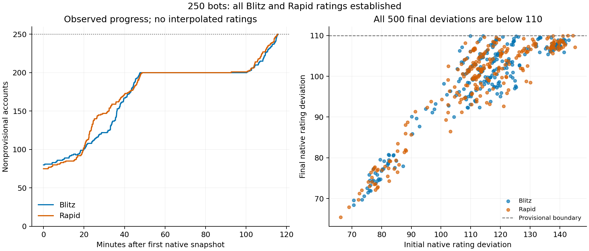
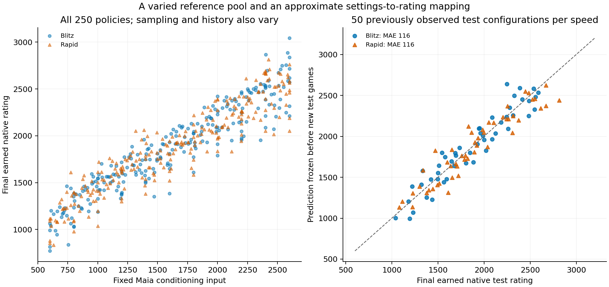
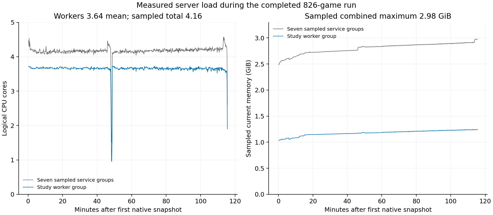

# Established reference ratings for a varied Maia bot pool

**October 31, 2026: 826 additional native rated games; all 250 bots finished with
nonprovisional Blitz and Rapid ratings.**

The follow-up reached its main goal: all 500 bot/speed ratings became established
under native Lichess Glicko, with final rating deviations below 110. It stopped
normally at 17:32:09 UTC, before the fixed deadline and after 826 of the permitted
3,000 additional games. Every admitted study game finished with a native rated
update. The roster, Maia policies, previous results and Lichess-derived rating
anchor were retained.

This gives Mute Chess an established reference roster for seeding new bot
identities. A new name can reuse evidence about its playing policy; every name
does not need a separate calibration tournament before receiving an informed
starting estimate. The new account still needs its own native rating history.
Established reference ratings and predicted starting ratings are different
things, and the evidence below keeps them separate.

The fixed settings-to-rating predictor was frozen after 349 training games,
at about 16:25 UTC, before 477 new test-phase games. Its average absolute error
against the final native test ratings was about **116 points in each speed**.
That is a useful scale for judging these starting estimates, rather than a bound
on every bot's error. The stricter 100-point target was not met; native
establishment and predictor accuracy are reported as separate results.

## What the starting anchor means

The roster's original priors were based on public Lichess Maia3-79M accounts,
with the documented sampling-policy correction and all later earned native
updates retained. This experiment did not put every bot back at its original
seed, shift the whole pool again, or ask closed-pool games to discover an
absolute rating origin.

Each bot kept its current native rating, rating deviation (RD), volatility,
completed-game count and full history. RD describes the rating system's remaining
uncertainty. More games reduce that uncertainty and let the relative ordering
respond to actual results. The earlier −75 anchor correction was already in
the baseline and was not applied a second time. Glicko updates are not generally
zero-sum, so a cohort's mean movement is not a new common-offset estimate.

The practical project goal is for an established human Mute Chess rating to
roughly translate to Lichess strength in the same speed pool. Retaining a
Lichess-derived anchor is useful for that goal; the new games improve the
relative calibration around it. Native establishment is not an independent
measurement of the pool's absolute human Lichess scale.

## Why another run

The [first report](../bot-strength-seeding-2026-10-31/REPORT.md) remains unchanged.
It completed 2,623 public games but left every test identity provisional, with
only 6–7 study appearances per speed. Its fitted procedures missed their
100-point native-label error target. Those measurements were useful, but they
were not sufficiently precise final labels for the intended reference roster.

The owner authorized a new bounded follow-up under
[Mute Chess issue #163](https://github.com/Dash1971/mute-chess/issues/163) and
[research issue #9](https://github.com/Dash1971/mobile-maia-research/issues/9).
The same 250 bots continued from earned ratings; no earlier study was reopened.
The original report's negative predictor result, procedures and deadlines are
preserved rather than rewritten using this follow-up.

## Fixed design and limits

The [dated protocol](https://github.com/Dash1971/mute-chess/blob/8930c60cced8d85d9aec770dcb0a022a8709a07c/docs/overnight-rating-establishment.md)
and [scheduler](https://github.com/Dash1971/mute-chess/blob/8930c60cced8d85d9aec770dcb0a022a8709a07c/lila-adapter/establishment-schedule.mjs)
were fixed before the new public admissions.

| Commitment | Value |
| --- | --- |
| New run / profile | `r20261031n163` / `rating-establishment-v1` |
| Preparation-inclusive window | October 31, 13:30–21:30 UTC |
| Admission cutoff | October 31, 21:00 UTC / November 1, 06:00 JST |
| Hard game stop | October 31, 21:30 UTC / November 1, 06:30 JST |
| Additional admission ceiling | 3,000; actual final admissions 826 |
| Roster | Same 250 identities: 200 training, including original 44, and 50 test |
| Controls | Native 5+3 Blitz and 10+5 Rapid |
| Managed concurrency | At most 22 including human games; one game per bot |
| Study inference | Two server workers, combined 400% logical CPU / 2,000 MiB |
| Success stop | All 500 native flags nonprovisional, then drain admitted games |

Preparation counted inside the eight hours. No cutoff was extended. A public
driver or integrity failure would stop the run without automatic retry. Repaired
pre-public preparation problems and isolated qualification fixtures are not
public strength or capacity observations. The goal was reached early, so there
was no reason to consume the remaining game budget.

Conditioning, history, temperature, top-p and opening rules stayed fixed per
identity. Conditioning spans 600–2600, temperature and top-p span 0–1 inclusive,
and history is on/off. Self and opponent conditioning inputs both equal the
bot's own fixed input; neither follows the opponent's current Glicko rating.
Opening overrides, deterministic endpoint aliases and the original 44 policies
retain their meanings from the first report. Its logical roster checksum binds
the same 196 effective training configurations and 50 distinct test configurations.

Added human timing waits are disabled only for study games. Production timing
personalities are unchanged. Native rules, history, clocks, completion and Glicko
updates remain authoritative. The scheduler preserves ±200 native-rating
eligibility and shared busy/capacity checks. It does not replace normal public
quick-pair selection or widen bands when an opponent is unavailable.

## Training establishment, drain and prediction freeze

The scheduler first targets provisional training bot/speed pairs. It prioritizes
fewer new-run appearances, then greater current native RD, breaking ties
randomly. Opponents are chosen uniformly among available eligible training bots;
colors are balanced using recorded new-run appearances.

After all 400 training ratings were nonprovisional, training study admissions
paused and in-flight study games drained. The exact native snapshot was saved,
the fixed V2 procedure was fitted using only the 200 training rows per speed,
and predictions were durably frozen before a new test game was admitted.
Ordinary public games are a separate activity, not silently included in that
study-drain claim.

| Freeze evidence | Verified value |
| --- | --- |
| Completed/admitted training games at freeze | 349 |
| Exact freeze timestamp | 16:25:06.245 UTC; freeze event recorded at 16:25:06.248 |
| First new test admission and ordering | Admission 350 at 16:25:06.383 UTC, after the durable freeze |
| New test-phase games after freeze | 477 |

The immutable commitments are:

- Exact training-snapshot SHA-256:
  `eafdf58962686810a0938fde34272f11214e71f235158c422b4d6453b9cc42cc`.
- Original frozen fitted-artifact SHA-256:
  `f108a6a5957ab8df39bb67b1725ccdf6e97946cd3946a45c857dc2dd4bf2eeeb`.
- Predictor-source SHA-256:
  `f35c16b5c504abc48ca0b9d7e15bf1f5720f7c271d3ca6a7716186c0152474b1`.

The fitted coefficient artifact is omitted from the public bundle. Its hash is
a provenance commitment, not a claim that the public verifier can hash absent
bytes. Public frozen prediction tables and exact training-only source/data allow
a separate numerical reproduction without publishing fitted coefficients.

The fixed procedure is
[`strength137-ridge-rbf-effective-cv-v2`](https://github.com/Dash1971/mute-chess/blob/8930c60cced8d85d9aec770dcb0a022a8709a07c/lila-adapter/strength_predictor.py).
Blitz and Rapid are fitted separately to native training rating estimates.
Weights are `1/(RD²+50²)`, normalized to mean 1. Features, five-fold grouping by
effective configuration, ridge penalties 0.1/1/10/100 and the simpler-model
preference within five validation-error points are unchanged. Endpoint aliases
share a group. Final labels are not substituted for the frozen training snapshot.

After freezing, provisional test bot/speed pairs play eligible training
opponents. Training-only maintenance can occur if needed, without refitting
predictions. No training-maintenance games were needed in this run. Fitting never
writes a native rating, RD, game count or provisional flag.

These are the same 50 test configurations observed in the first study. Training
native ratings also retain the influence of earlier games against those bots.
Selecting only training rows does not erase that history. This is a fixed-method
follow-up with prospective new game forecasts, not a fresh blind validation of
previously unseen configurations. No procedure is selected from follow-up test
errors.

## Establishment and earned rating changes

All 250 bots finished nonprovisional in both speeds. The table reports the
actual new-run initial and final snapshots, including the original 44, newly
added training identities and test identities separately. Historical raw seeds
are not substituted for the new run's earned starting values.

| Final result | Blitz | Rapid |
| --- | ---: | ---: |
| Nonprovisional bot ratings, initial→final | 80→250 of 250 | 75→250 of 250 |
| Original 44: initial→final established count | 43→44 of 44 | 44→44 of 44 |
| New 156 training: initial→final established count | 37→156 of 156 | 31→156 of 156 |
| Test 50: initial→final established count | 0→50 of 50 | 0→50 of 50 |
| Median / maximum final RD | 101.79 /109.91 | 102.00 /109.97 |
| Final native rating range, rounded | 771–3,043 | 835–2,813 |
| Total earned games per identity, range | 10–32 | 10–35 |
| Mean absolute initial→final rating change | 36.4 | 38.5 |
| Mean signed initial→final rating change | +0.10 | −0.16 |
| NEW-run test appearances per identity | 4–6 | 3–6 |

The left panel shows observed native flags; it does not interpolate hidden
ratings. The right panel shows all 500 final deviations below the native
provisional boundary. [SVG version](figures/rating-establishment.svg).

The native nonprovisional rule is the operational stopping criterion. Lower RD
provides more precise relative labels within this pool; it is not a guarantee
that each estimate is within 110 points of true strength. The first observed
goal event and final drained native state are reported separately.

The first saved native observation with all 500 flags established was at
17:32:08.372 UTC. The goal event was recorded at 17:32:08.536 UTC; the worker
ended normally at 17:32:09.094 UTC. These changes start from the earned overnight baseline, not
the bots' raw historical seeds. Average movement was modest relative to the
rating range, while individual policies still need their own recorded values.
Pool means near zero are not proof of absolute calibration and were not used
to apply another rating correction. The minimum observed ten total games is
a result of this roster's histories and pairings, not a universal ten-game rule.

## What the settings predict

The [frozen V2 prediction table](data/frozen-predictions-v2.csv) accompanies the established reference ratings.
The point errors and intervals below use all 50 test policies per speed and
their final earned native labels. They assess this fixed policy mapping;
they do not turn its estimates into replacement native ratings.

The useful output is a policy-to-rating reference by speed: conditioning,
history, temperature, top-p and opening scope, with the measured or predicted
rating and its uncertainty clearly identified. For an exact measured policy,
the established reference account's rating is direct evidence. For an unmeasured
combination, V2 supplies a starting estimate within the tested domain, whose
reliability is assessed by the recorded errors and coverage below.

The conditioning input is not itself a calibrated playing rating. History and
sampling can change strength at the same input, so using the whole policy is
more informative than assigning the conditioning number as Elo. The mapping
supports these tested Blitz/Rapid policies; it does not independently validate
Bullet, Classical or separately varied opponent-conditioning inputs.

| Frozen predictor diagnostic | Blitz | Rapid |
| --- | ---: | ---: |
| Test cells with at least one NEW-run result / zero new results | 50 /0 | 50 /0 |
| Native-label MAE, 95% configuration-bootstrap interval | 115.8 (94.1–138.5) | 116.0 (91.8–143.1) |
| Frozen expected-score Brier | 0.1654 | 0.2110 |
| Frozen expected-score cross-entropy | 0.6285 | 0.7303 |
| New test outcome denominator | 241 | 236 |

At the same conditioning input, history and sampling also vary. The right panel
uses predictions frozen before the new test games; the diagonal marks equality
with final native labels. [SVG version](figures/settings-and-ratings.svg).

The evaluator includes a test identity whenever its total native game count is
positive. Every test bot inherits earlier games, so `configurations=50` alone
does not demonstrate new exposure. Total histories and NEW-run appearances are
reported separately. Every test cell has a new result; some already-established
training cells needed none. The evaluator's 100-point
native-label target is a recorded predictor diagnostic; it is not the 500-flag
establishment goal.

For new finished test-phase outcomes, both seats use frozen predicted ratings:
White expected score is `1/(1+10^(-(Rwhite−Rblack)/400))`, compared with 1/0.5/0
for win/draw/loss. This is a rating forecast, not Maia's neural score head.
Configuration bootstrap intervals and native RD describe different uncertainty;
neither validates the shared absolute anchor. The approximate predictive SD is
a heuristic residual/design-matrix scale, not a calibrated confidence interval.

The intervals resample the 50 configurations with the unchanged evaluator's
1,000 bootstrap draws and seed 137. They describe average error against this
sample's native labels; they do not include common-anchor uncertainty. The
training-only grouped-CV MAE was 99.3 in Blitz and 105.8 in Rapid. CV selected
the fixed candidate fit using training data; it is not a substitute for the
new test metrics or evidence that the 100-point test target was met.

For a new identity, use the policy's supported estimate as a prior, retain the
normal native provisional mechanism, and let its own games update it. Do not
copy another account's game count, RD or established flag. This is the practical
benefit of measuring configurations rather than every future bot name. It does
not authorize the untested 10,000-account rollout or a new common rating shift.

## Game integrity, execution and capacity

All 826 admitted study games finished with native rated updates: 420 Blitz and
406 Rapid. The independent native audit found exactly 1,652 BOT player-result
increments, with no other public games or unrelated perf changes. These are
operator-observed database/API reconciliation facts. All 826 PGNs passed full
legal replay and matched 71,287 unique acknowledged plies, with no duplicate
acknowledged game/ply positions, aborted or unfinished study games. The first
2,623-game study and private qualification games are excluded from new-run
counts and throughput. The [public verifier](verify_public.py) independently
checks saved projections; the [operational audit](data/operational-audits.json)
separately records the native database/API observations.

The worker ran from 15:36:25.565 to 17:32:09.094 UTC. Verified cleanup at
17:41:31 UTC found study processes and recursive cgroups removed, no owned or
ordinary active games, and the exact normal configuration restored and loaded
by a fresh application process. All nine public roles were active; public HTTPS,
native WebSocket, static/animated GIF and protected Maia health checks passed.
No database restore occurred. The normal managed-game cap returned to 2.

Throughput uses actual game/ACK measurement windows, not the preparation-inclusive
budget. Inference time, queue/native round trip and turn-to-commit latency remain
separate. Resource telemetry covers the study worker and sampled app, ordinary
adapter, WebSocket, Mongo, Redis and gateway services. It does not measure all
nine public roles or the entire machine.

| Observed measurement | Result |
| --- | ---: |
| Unique ACK throughput over the observed progress window | 10.27 moves/second |
| Inference p50 /p95 | 0.184 /0.260 seconds |
| Full turn-to-commit p50 /p95 | 2.102 /2.482 seconds |
| Study-worker mean logical CPU cores | 3.64 |
| Seven sampled groups' mean logical CPU cores | 4.16 |
| Maximum sampled current memory, worker /seven groups | 1.25 /2.98 GiB |

[SVG version](figures/measured-capacity.svg). CPU rates use adjacent active,
numeric, nondecreasing counters with bounded sampling gaps: 664 complete
seven-group samples and three masked intervals. These estimates are conditional
on continuous counters. The resource projection lacks PID/start/invocation IDs
and does not independently prove every process's continuity. GIF, cloudflared,
isolation and operating-system activity are outside the sampled sum.

The throughput denominator is the 6,940.079-second observed native-progress
window. It includes the recorded workload and is not pure neural inference
speed. Applying illustrative 20% headroom gives about 8.22 reply requests/second.
If the mean interval between **bot reply requests per active human-versus-bot
game** is 2, 5 or 10 seconds, that corresponds to roughly 16, 41 or 82 active games.
This assumes one bot inference per request and no competing analysis traffic;
it is a workload scenario, not a tested admission setting or merely a human
thinking-time calculation. Production capacity remains 2.

These observations can inform a rough VPS budget with stated move-frequency,
latency and headroom assumptions. They do not guarantee equal performance on a
different CPU. A 6-vCPU/8-GiB machine is a reasonable initial benchmark candidate;
a 4-vCPU plan would face more CPU pressure at this recorded load. These are
hardware-sizing hypotheses to test, not a requirement to buy that specification
or authorization to raise normal production capacity.

## Provenance and attribution

Source main: `8930c60cced8d85d9aec770dcb0a022a8709a07c`; native patch SHA-256:
`af80d43f093e47f68148ff4f4c893f5070ac85522b034374013e82cd853a6c11`.
Lila base: `b551752d2a0e7a63459d9812825d95a633a98737`; WebSocket base:
`5089b84b5fe2da3f3e9e69d29363115cfddfc758`. Maia-3 79M ONNX SHA-256:
`3454b03ae78baa64a87b345fdb1a457265d912caec531039b074f07eda0d8010`.
The [integrity lineage](data/integrity-lineage.json),
[native count audit](data/native-count-audit.json),
[execution summary](data/execution-summary.json) and
[reproduction guide](README.md) provide the recorded commitments and checks.
The exact frozen training-only refit reproduced all 500 prediction-table values
within 1e-7, with maximum difference 3.18e-11 using NumPy 2.3.5. It read no final
outcomes and wrote no fitted coefficients; see the
[refit receipt](data/refit-verification.json). Source dependency declarations are
distinct from an independently verified installed inference environment.
The public bundle omits original per-game sampling seeds, so exact fresh neural
replay of the sampled trajectories is not claimed.

This independent research relies on [Lichess/Lila](https://github.com/lichess-org/lila)
for native games and Glicko, [Maia/CSSLab](https://github.com/CSSLab/maia3) for
the model/encoder, and earlier Mobile Maia and
[En Croissant](https://github.com/franciscoBSalgueiro/en-croissant) work for
analysis integration. Project seeding/scheduling choices are not upstream
recommendations. Preserve applicable AGPL and third-party terms. No weights,
fitted coefficient files, private environments, credentials or database dumps
belong in the public bundle.
