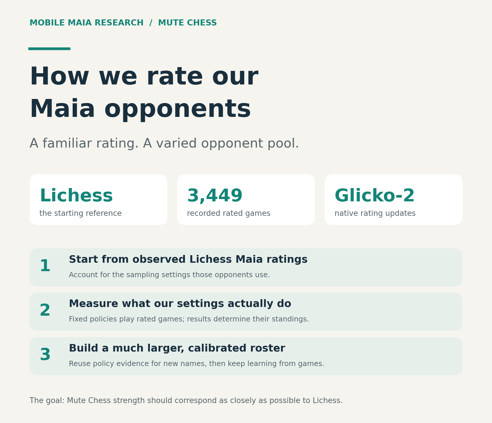
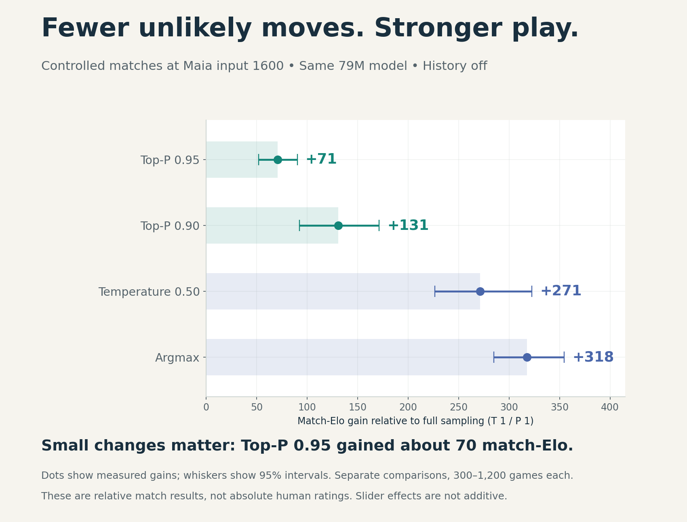
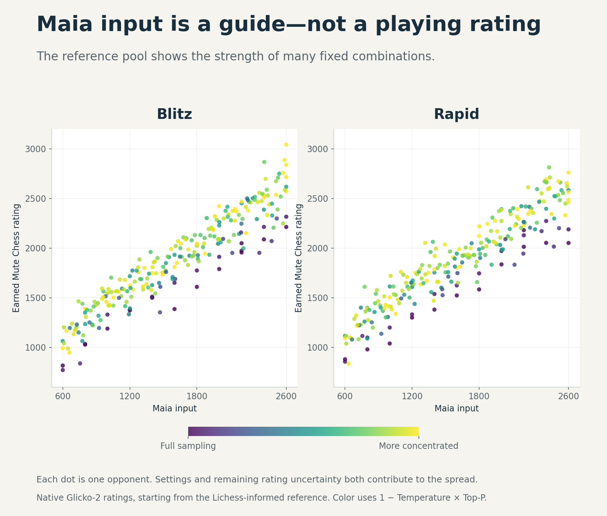
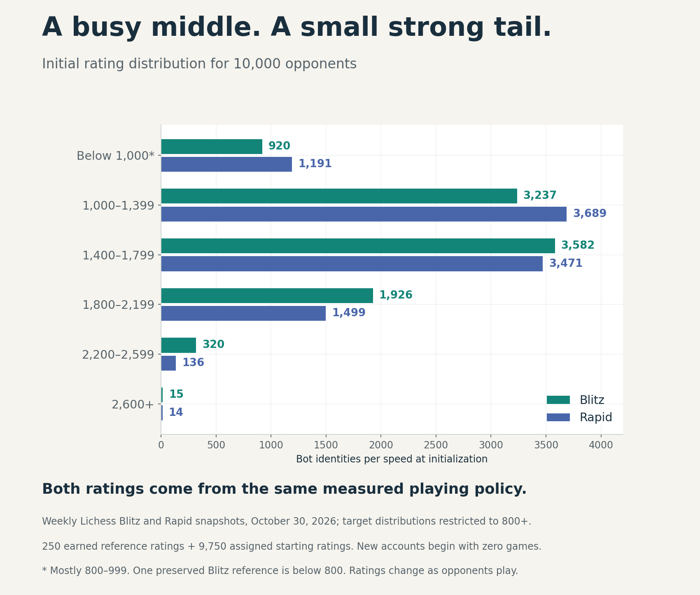

# How we rate the bots in Mute Chess



[Mute Chess](https://mutechess.org) brings Maia opponents into the Lichess playing
experience. Our goal is straightforward: **a rating here should mean roughly
the same playing strength as it does on Lichess**, at the same time control.

Maia's settings let us create many different opponents. This report explains
how we turn those settings into useful ratings—and how that research supports
the pool of **10,000 opponents now live on Mute Chess**.

## 1. How did we come up with the bot ratings?

**We started with Lichess, then let the bots earn their ratings through games.**

Public Maia3-79M accounts on Lichess supplied our starting reference. We checked
their sampling settings and adjusted the starting estimates to account for
the difference between those settings and ours. The
[source record](../bot-strength-seeding-2026-10-31/REPORT.md#why-these-starting-priors-require-a-test)
documents that reference and adjustment.

We then played **3,449 recorded rated games** across a varied reference roster,
using the **native Lichess Glicko-2 rating system**. Each bot kept its assigned
Maia input, Temperature, Top-P and move-history setting. Games changed their
ratings in the normal way; we retained their existing results and histories.

The result is **250 reference opponents with established ratings in both Blitz
and Rapid**. Their measured ratings cover roughly **800–3,000 in Blitz** and
**800–2,800 in Rapid**. This gives us evidence about actual playing policies,
rather than assuming that Maia's input of “1600” automatically produces a
1600-rated opponent.

## 2. Are they close to Lichess ratings?

**They have a Lichess-based starting anchor, and keeping that correspondence is
a central goal of the site.** The games refine the relative strength of the
opponents around that anchor.

That gives us a reasoned starting point, not a guarantee that a Mute Chess
rating already equals a human's Lichess rating. Some reference bots still have
relatively short histories. Playing only one another also cannot reveal a
shared offset affecting the whole pool.

We will monitor ratings as people play, compare further Lichess evidence as it
becomes available, and document any adjustments. **Established means the native
rating system has enough confidence to remove its provisional mark; ratings
can still change with more games.**

## 3. How do the engine settings affect strength?

**The Maia input sets the broad strength level. Sampling settings can make the
same model considerably stronger.**

| Setting | What it does | What our evidence supports |
| --- | --- | --- |
| **Maia input** | Chooses the level of human play the model tries to imitate. | Higher inputs generally produced stronger opponents. Input and earned rating are different numbers. |
| **Temperature** | Lower values favor the model's most likely moves more strongly. | Lowering it substantially improved results in our controlled comparisons. |
| **Top-P** | Removes unlikely moves from the available choices. | Narrowing the choices improved results, including the small change from 1.00 to 0.95. |
| **Argmax** | Always chooses the most likely legal move. | It was about 320 match-Elo stronger than full sampling in the controlled 1600-input comparison. |
| **Move history** | Gives Maia previous positions as well as the current board. | The generated roster reuses the reference policy’s fixed history mode. We apply no universal history bonus or penalty. |



These comparisons hold the **79M model and 1600 input fixed**, with history off.
They measure gains against full sampling, not absolute human ratings. The whiskers
show 95% uncertainty intervals. Settings interact: their gains should not be
added together or assumed identical at every Maia input.
[Controlled sampling results](../maia3-sampling/strength.md) ·
[Top-P 0.95 comparison](../maia3-sampling/followup/strength/SUMMARY.md)

Our broader bot pool tests many combinations of these settings. The chart below
shows the resulting native ratings, including the remaining variation between
opponents.



## 10,000 opponents, now live

**Mute Chess now offers 10,000 opponents: the 250 reference bots and 9,750 new
identities using measured playing policies.** The supported range is roughly
**800–3,000 in Blitz and 800–2,800 in Rapid**. New accounts are labeled
**Research-seeded**, making their starting assignment distinct from an earned
game history.

Each new identity keeps its settings and personality. A new name does not need
another tournament to rediscover the strength of a policy already represented
in the research. The original 250 retain their earned ratings and game
histories, including the one Blitz reference slightly below 800.

### How a new identity gets its rating

For this release, the assignment rule is simple:

```text
New bot rating = reference estimate for the same playing policy and speed
```

A matching policy uses the same Maia inputs, Temperature, Top-P, opening rule
and fixed history mode. Where several reference accounts share an equivalent
policy, we combine their ratings into a weighted estimate that gives more
weight to lower rating uncertainty. The [method note](CATALOG-METHOD.md)
provides the calculation and source records.

This uses direct policy evidence. The earlier smooth formula remains available
as a separate [planning approximation](PLANNING-APPROXIMATION.md), but it does
not assign the generated roster's ratings. Nor do we add a strength bonus to
put a favorite character at the top of the list.

Each new bot was initialized with **RD 100 and zero completed games**. That made
its assigned native rating nonprovisional under the normal 110-point boundary. It is an informed starting assignment, not a claim that the
new account has already played calibration games. Native Glicko continues
updating the rating and its uncertainty; no game count or history is copied.
The rating rules for human accounts are unchanged.

### A pool shaped by Lichess

Most identities sit in the busy middle of the rating range, with fewer at
either extreme. The generator uses archived weekly **Blitz and Rapid** player
distributions from Lichess, restricted to the supported range of 800 and above.
It matches both together because every policy has a paired Blitz/Rapid rating.



| Rating band | Blitz identities | Rapid identities |
| --- | ---: | ---: |
| Below 1,000, mostly 800–999 | 920 | 1,191 |
| 1,000–1,399 | 3,237 | 3,689 |
| 1,400–1,799 | 3,582 | 3,471 |
| 1,800–2,199 | 1,926 | 1,499 |
| 2,200–2,599 | 320 | 136 |
| 2,600+ | 15 | 14 |
| **Total** | **10,000** | **10,000** |

These are the **initial roster counts**, including the preserved reference
accounts. Ratings change as opponents play; the chart is not a live rating feed
or 10,000 independently measured strengths. The [dated sources and allocation audit](CATALOG-METHOD.md#distribution-and-reproduction)
show how the counts follow the Lichess distributions while retaining the actual
policy ratings. The strongest Rapid tail is slightly larger than the target
because the existing accounts are preserved.

**We offer the range supported by the measured Maia policies.** New
policies with reference estimates below 800 are excluded rather than relabeled.
The upper range comes from the observed reference opponents. Names, extra
identities and a desired histogram do not make a policy stronger or weaker.

The live pool brings together persistent personalities,
ratings grounded in measured policies, and normal rating updates as people
play. Keeping those ratings close to Lichess strength remains the goal.

---

[Data and reproduction](README.md) · [Catalog method and chart sources](CATALOG-METHOD.md) ·
[All reference settings](data/configurations.json) · [Earned ratings](data/ratings.csv)

Built on [Lichess/Lila](https://github.com/lichess-org/lila),
[Maia/CSSLab](https://github.com/CSSLab/maia3), and earlier Mobile Maia and
[En Croissant](https://github.com/franciscoBSalgueiro/en-croissant) work.
This is independent project research, not an upstream endorsement.
