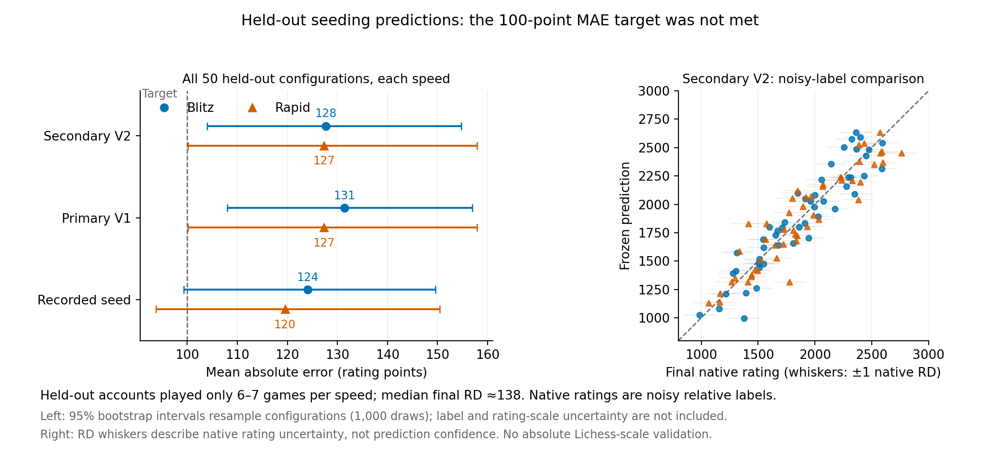
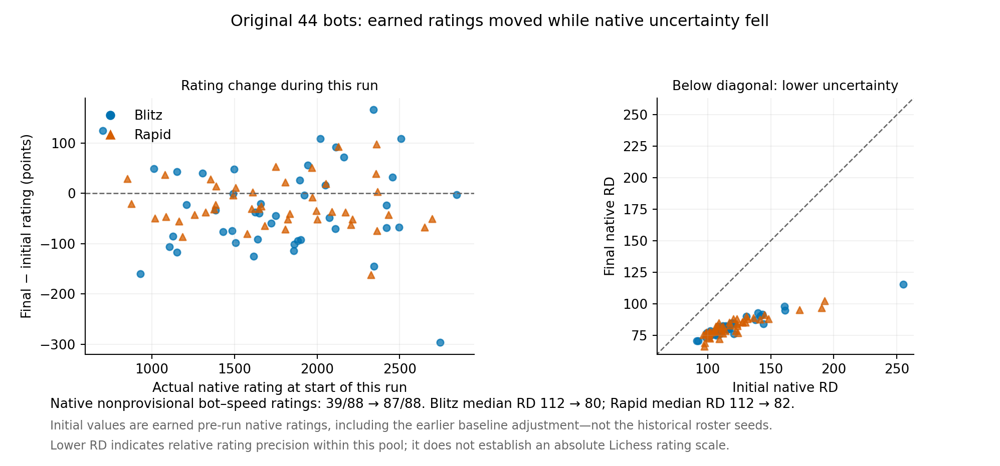
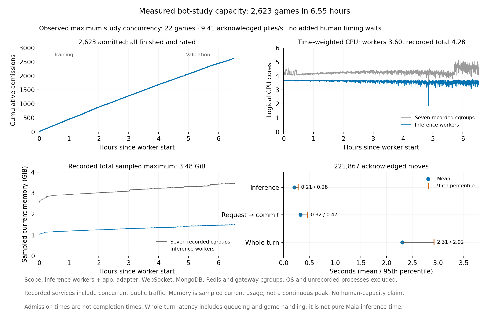

# Predicting starting ratings for a varied Maia bot pool

**October 31, 2026: 2,623 public games, 623 held-out games and two fixed prediction procedures.**

**The target of at most 100 rating points of held-out error was not met.**
The primary predictor's native-label MAE was 131.4 in Blitz and 127.3 in Rapid.
The preregistered secondary procedure gave 127.7 and 127.3; the original seed
baseline gave 124.0 and 119.5. Each held-out identity played only 6–7 games per
speed and remained provisional. These are errors against uncertain native
ratings, not measured errors against true strength or human Lichess ratings.

This study asks whether a representative set of Maia policies can support
informed starting ratings for new bot identities. Its inputs are conditioning,
fixed move-history mode, temperature and top-p. Many names could then share a
supported policy without every name first playing a calibration tournament.
Native Lichess Glicko-2 remains authoritative after games. This first study did
not establish that the tested fitted procedures improve on the existing seed
heuristic for assigning such priors.

The wider project goal is for an established human Mute Chess rating to roughly
translate to established Lichess strength in the same speed pool. Closed-pool
bot games supply relative evidence; they cannot establish the external scale.
That remains a separate human/reference validation task.

The [recorded evaluation](data/evaluation.json),
[execution summary](data/execution-summary.json),
[operational audits](data/operational-audits.json) and
[prediction-refit check](data/refit-verification.json) accompany this report.
The cached verification commands are in the [reproduction guide](README.md).

## Recorded scope and prospective boundary

The [original protocol](https://github.com/Dash1971/mute-chess/blob/f656d5c22b062646cc48c54feced50cb2c6710f6/docs/strength-experiment.md)
specified a maximum of **3,000 public admissions**, including a 200-game
top-up for the existing 44. It uses 200 training identities and 50 held-out
identities. Actual games update the public bots' native ratings and remain in
their histories. The study does not reset existing earned ratings or manufacture
completed games, uncertainty or nonprovisional status.

| Execution limit | Original segment | Conditionally authorized validation tail |
| --- | --- | --- |
| Admission cutoff, October 31 UTC | 10:04:39 | 12:30:00 |
| Admission cutoff, Japan time | 19:04:39 | 21:30:00 |
| Hard simulation stop, UTC | 10:34:39 | 13:00:00 |
| Hard simulation stop, Japan time | 19:34:39 | 22:00:00 |
| Aggregate admission ceiling | 3,000 across the whole experiment | The same 3,000, including all original games |

The original eight-hour limit included preparation beginning 02:34:39 UTC.
At 07:04:31 UTC, before held-out study admission or inspection of validation
results, the owner authorized the later overall window. The
[dated amendment](https://github.com/Dash1971/mute-chess/issues/137#issuecomment-6540414502)
and [continuation issue](https://github.com/Dash1971/mute-chess/issues/147)
retain the original limits rather than rewriting them. This was an execution
timing amendment; feature selection, fitting rules, held-out split and acceptance
target stayed fixed.

The first segment stays on its original source and deadlines. A tail can start
only after normal original completion, verified cleanup, zero active games,
qualification and deployment of its separately reviewed source. A failed or
aborted study is not automatically restarted. Both segments share the same
native study records and aggregate admission limit; the tail writes separate
evidence and uses the already frozen primary predictions without refitting.

### Actual execution and final stop decision

The original segment completed 2,623 admitted public games, all with native
rated updates: 1,306 Blitz and 1,317 Rapid. Its worker window was 03:34:14.124
through 10:07:12.148 UTC. The supervisor ended at 10:07:16.861 UTC and restored
normal configuration, before the original 10:34:39 hard stop.

The final sample contains the 200-game top-up, 1,800 additional training games
and 623 held-out-versus-training games: 310 Blitz and 313 Rapid. The remaining 377
admissions were not used. Pre-activation checks caught a candidate file-permission
problem, documented in [issue #160](https://github.com/Dash1971/mute-chess/issues/160)
and [PR #161](https://github.com/Dash1971/mute-chess/pull/161). Subsequent isolated
qualification startup failed. At 11:09 UTC, before offline held-out evaluation,
the final decision was to omit the continuation and not retry it. **No public
tail games were admitted.** A build or qualification candidate is not part of
the strength/capacity sample.

All 2,623 final PGNs passed legal move/result checks, and 221,867 final plies
matched the unique acknowledged sequences with zero duplicate acknowledgment
positions. Independent native count reconciliation found 5,246 player results
across 250 BOT identities, with no mismatch or extra native result increments.
There were no aborted or unfinished study games. Terminations were 2,058 mates,
91 stalemates and 474 draws.

The [operational audit receipt](data/operational-audits.json) records the
independent native count check and final cleanup: original workers stopped,
private qualification cgroups/listeners absent, no active public/study games,
normal public configuration restored, and the public release unchanged. That
receipt is a sanitized operator observation; the public verifier independently
checks the published game/acknowledgment/snapshot projections, not a live database.
Integrity/accounting of recorded games does not validate a rating predictor.

## Policies and population

The original 44 identities and effective production policies remain fixed.
The design adds 156 training and 50 held-out identities, making 250 identities
in total. The published fixed seed is
`mute-continuous-strength-20261031-v1`. Independently shuffled strata spread the
new configurations across the input space, with balanced history modes and
explicit endpoint/reference cases. The
[design generator](https://github.com/Dash1971/mute-chess/blob/f656d5c22b062646cc48c54feced50cb2c6710f6/deploy/study/design.py)
records the exact design; these are space-filling randomized samples, rather
than a promise of independent uniform draws or a representative human population.

| Input | Fixed study domain and interpretation |
| --- | --- |
| Conditioning | Integer 600–2600; each bot's self and opponent conditioning inputs are equal to its own fixed value |
| Temperature | 0–1 inclusive |
| Top-p | 0–1 inclusive |
| History | On/off, fixed per identity |
| New-policy opening | Full 1/1 sampling through each side's first five moves; fixed assigned sampling thereafter |
| Existing-policy opening | Original recorded policy, retained and included as a predictor feature |
| Time controls | Native 5+3 Blitz and 10+5 Rapid |
| Added human waits | Disabled for study games; persistent production timing personality unchanged |

The conditioning input is an input to the network, not measured playing Elo.
Opponent conditioning does not follow the current opponent's Glicko rating.
This experiment does not independently vary the two conditioning inputs.

Temperature zero or top-p zero selects the highest-logit legal move after any
opening override. Those two slider endpoints describe the same effective
post-opening choice; they cannot identify separate top-p and temperature
effects there. An argmax policy with a five-move sampling override still has
a stochastic opening. The generator therefore provides explicit endpoint
controls. Fresh per-game sampling seeds were recorded operationally; the public
projections do not include the complete original sampling-policy/seed stream,
so they do not provide an exact neural-inference rerun of the sampled games.

The 200 training identities represent 196 known effective configurations. The 50
held-out identities represent 50 unique effective configurations, with no exact
effective-policy alias shared between training and held-out sets. Exact alias
checks do not establish that nearby slider settings are meaningfully different.

History on supplies the current board and up to seven prior positions, padded
at the beginning of a game. History off repeats the current board in all eight
slots. Native game history, repetition and legal rules remain present in both
cases. Sampling, history and timing attributes persist per identity; the study
does not redraw a history mode each game. Timing randomness is separate from
the move-sampling stream.

Sci-fi names, including Wintermute and Neuromancer, identify some configurations
from [issue #92](https://github.com/Dash1971/mute-chess/issues/92). They do not
provide evidence of strength. No identity is forced to have the highest earned
rating, and this study does not authorize creation of the eventual 10,000-name
population.

## Model, encoder and sampling provenance

| Component | Pin or status |
| --- | --- |
| Maia model | Maia-3 79M ONNX export, 316,034,244 bytes |
| ONNX SHA-256 | `3454b03ae78baa64a87b345fdb1a457265d912caec531039b074f07eda0d8010` |
| Maia source used for encoder/vocabulary | CSSLab/maia3 revision `1e13597c42d4858b7cfd7cfdae01e297263364b2` |
| Encoder identifier | `CSSLab-1e13597c-numpy-history-v1` |
| Sampler identifier | `softmax-categorical-numpy-pcg64-inclusive-nucleus-v1` |
| Original Mute Chess source | `f656d5c22b062646cc48c54feced50cb2c6710f6` |
| Original native patch SHA-256 | `76b36854ca5a45c2b915ebaebaab129e8ed47a01d2f2bac7000dc97c56f484a7` |
| Lila base | `b551752d2a0e7a63459d9812825d95a633a98737` |
| Lila WebSocket base | `5089b84b5fe2da3f3e9e69d29363115cfddfc758` |
| V2 secondary-analysis source | `0e237532c4c0272026e6e2af60d35336cdf08ca3` |
| Continuation native build candidate | `401ec08cfbcc9c6c704e6dcf2593ec1f5f557672`; native patch `bbaa9881129d4950c9390fa159d4c2f0d9ef31187357026c65a6ac629c4dcde8` |
| Continuation final public release | None: no public validation tail ran |

The continuation candidate's runtime packaging checks counted 263 application
jars and 83 WebSocket jars. Its later qualification did not permit a public tail.
The completed games all use the original source/runtime; candidate build facts
are retained only as operational provenance, not a second capacity measurement.

The [original worker](https://github.com/Dash1971/mute-chess/blob/f656d5c22b062646cc48c54feced50cb2c6710f6/lila-adapter/maia_worker.py)
applies a legal-move mask, temperature-adjusted softmax, inclusive nucleus
truncation and renormalization, then samples with the recorded per-move seed.
Inclusive truncation retains the move crossing the requested cumulative mass.
Legal-move order and tied values follow the pinned implementation/runtime.
The history encoder and move vocabulary are attributed to the pinned
[Maia source](https://github.com/CSSLab/maia3/tree/1e13597c42d4858b7cfd7cfdae01e297263364b2).

The adapter's pinned [requirements source](https://github.com/Dash1971/mute-chess/blob/f656d5c22b062646cc48c54feced50cb2c6710f6/worker/requirements.txt)
declares ONNX Runtime 1.31.1, NumPy 2.5.4 and chess 1.11.2. These are source
dependency declarations, not an independently captured proof of the installed
inference environment. A provider, platform or library change can affect close
numerical choices and later trajectories.

Cached statistical/refit verification used NumPy 2.3.5, Python 3.12.14 and
chess 1.11.2; it requires no ONNX Runtime, neural weights or inference. The
separate [refit receipt](data/refit-verification.json) reproduces all 500 frozen
predictions per procedure within the declared 1e-7 tolerance: maximum difference
about 2.8e-11 for V1 and zero for V2. These are numerical prediction-table checks,
not byte-identical recreation of an omitted fitted-artifact file.

## Why these starting priors require a test

The original roster borrowed historical ratings from public Lichess Maia3-79M
reference accounts. The owner supplied the reference operator's confirmation of
Temperature 1 / Top-p 0.95, recorded in the
[reference-policy audit](https://github.com/Dash1971/mute-chess/blob/f656d5c22b062646cc48c54feced50cb2c6710f6/docs/sampling-reference-audit.md);
some initial full-sampling assumptions were therefore mismatched. A documented
[one-time October 30 anchor correction](https://github.com/Dash1971/mute-chess/blob/f656d5c22b062646cc48c54feced50cb2c6710f6/docs/data/rating-anchor-applied-2026-10-30/README.md)
translated earned ratings by −75 without changing earned game counts, RD or
volatility. It was an external-prior adjustment, not a Glicko discovery or
proof of exact human Lichess alignment.

The previous independent
[Top-p 0.95 comparison](https://github.com/Dash1971/mobile-maia-research/blob/a2d90a94aac930fe17109f5e7e1b2e351c18b4fd/studies/maia3-sampling/followup/README.md)
measured a relative matchup gain near 71 points under its fixed 1600/history-off
conditions. The
[opening-variety study](https://github.com/Dash1971/mobile-maia-research/blob/a2d90a94aac930fe17109f5e7e1b2e351c18b4fd/studies/opening-variety-2026-10-18/REPORT.md)
supports the first-five-moves override as a balanced project policy while
recording its limits. These measurements do not establish a universal additive
offset over conditioning, history, openings and all sampling settings. The
[history study](https://github.com/Dash1971/mobile-maia-research/blob/a2d90a94aac930fe17109f5e7e1b2e351c18b4fd/studies/move-history-2026-10-09/README.md)
evaluated prediction/copying behavior and explicitly did not establish a
full-game Elo change.

For the 206 new identities, the initial heuristic is:

`interpolated original Full-policy roster seed −75 +300×(1−temperature×topP)`

Their initial RD is 300. This formula is explicitly **unvalidated**; it is a
baseline to compare against the fitted procedures. It is not a measured slider
law. The−75 adjustment is already represented in the experiment's relevant
starting priors and must not be applied again to earned ratings.

The original 44 have earlier earned games and the documented correction. Report
their raw historical seeds, correction provenance, actual pre-run native perfs
and final perfs separately. This experiment's rating drift uses the actual
initial native snapshot, never a raw roster seed substituted for that snapshot.

## Games and native ratings

The stages are capped at 200 original-roster games, 1,800 additional training
games and 1,000 held-out-versus-training games. The first 2,000 admissions supply
the training stage. Before the first held-out study admission, training games
drain and the primary predictions and exact training snapshot are frozen.

Study scheduling balances scarce identity/speed appearances and colors, with
random eligible opponents. It preserves native ±200 eligibility, one game per
bot, native rules, clocks, completion and Glicko/provisional safeguards. Human
games remain supported and count toward the 22-game managed ceiling. The study
scheduler is not claimed to be an unmodified sample of public human matching
or a representative distribution of human results.

The training freeze occurred at 08:25:32.396 UTC, at 2,000 admissions. The first
held-out study admission was ordinal 2,001 at 08:25:32.502 UTC. The
[freeze receipt](https://github.com/Dash1971/mute-chess/issues/137#issuecomment-6541218090)
records:

- Original primary artifact SHA-256:
  `822decace6b245b895304203a40611e9ad4787c4cbda9d4ffbb33b554eb3f186`.
- Immutable training-snapshot SHA-256:
  `4a88c1dd54420b81237f4323b52f328330bd46494866bc890daf9581522fe436`.

Held-out opponents can continue to receive native Glicko updates. Research
predictions remain frozen. Any public activity between the original and tail
segments is reconciled separately through original-final and resume-initial
perfs and recorded public-game references. No old ratings are imported to undo
intervening earned results.

## Primary and preregistered secondary predictors

The primary procedure is
[`strength137-ridge-rbf-v1`](https://github.com/Dash1971/mute-chess/blob/f656d5c22b062646cc48c54feced50cb2c6710f6/lila-adapter/strength_predictor.py).
It fits Blitz and Rapid separately to native training rating estimates, with
weights proportional to `1/(RD²+50²)` normalized to mean 1. It is a fit to noisy
native rating labels, not a direct fit of true strength or a replacement Glicko
calculation.

The fixed feature choices are an additive model and an interaction model. Both
include normalized conditioning, temperature, top-p, history, deterministic
endpoint and opening-policy terms. The interaction model adds nonlinear and
history/slider interactions, conditioning polynomial terms and seven fixed
Gaussian conditioning features. Endpoint aliases are canonicalized in the
features. Ridge penalties are 0.1, 1, 10 and 100; the intercept is effectively
unpenalized. Five-fold training-only validation selects among these candidates,
preferring an additive model when its validation MAE is within five rating
points of the best candidate.

V1 assigns folds by identity. The implementation audit found that two exact
alias groups span its training folds, so its CV is not wholly
unseen-effective-policy evidence and can be optimistic. It remains the
predeclared primary; the experiment did not replace it after seeing test data.

Before held-out study outcomes existed, the
[secondary procedure](https://github.com/Dash1971/mute-chess/blob/0e237532c4c0272026e6e2af60d35336cdf08ca3/docs/strength-secondary-analysis.md)
was preregistered in
[issue #144](https://github.com/Dash1971/mute-chess/issues/144) and
[its dated note](https://github.com/Dash1971/mute-chess/issues/137#issuecomment-6539860661).
V2 groups CV by the canonical tuple of self/opponent conditioning, history,
temperature, top-p and opening policy. Temperature-zero/top-p-zero aliases and
ineffective full-sampling opening overrides map to the same group.

V2 used **the exact original frozen V1 training snapshot**, with the same
features, weighting, penalty grid and selection rule. Its numerical fit was
computed after the run under the already fixed procedure, without held-out
labels for fitting or selection. Final training perfs, affected by later
held-out games, were not substituted for that snapshot. Both procedures are
reported on the same test evidence; neither is relabeled as primary because
of its test score.

The training-only selection was:

| Procedure | Blitz choice / CV MAE | Rapid choice / CV MAE |
| --- | --- | --- |
| Primary V1 | Interaction, penalty 1 /107.3 | Additive, penalty 1 /110.6 |
| Preregistered V2 | Interaction, penalty 0.1 /104.5 | Additive, penalty 1 /113.8 |

V1's CV values retain the alias limitation above. Both procedures chose the
same Rapid fit on the full frozen training data; their Rapid predictions match
to numerical rounding. CV values are training-selection diagnostics, not the
held-out test or a guarantee of true strength.

The fitted artifact's approximate predictive SD combines its training residual
scale and ridge design-matrix term, with a 50-point residual floor. It is a
heuristic error scale, not a demonstrated confidence bound. Any empirical
coverage check must be labeled and must not silently turn it into a calibrated
confidence interval.

## Held-out results

The practical target was native-label MAE at most 100 rating points, with all 50
held-out configurations represented in each speed. Both fitted procedures
missed that point-estimate target. Every held-out identity has a study result,
but all remain provisional, with 6–7 appearances per speed. The native-label
criterion cannot establish an error bound for true strength.

| Completed test evidence | Blitz | Rapid |
| --- | ---: | ---: |
| Held-out games | 310 | 313 |
| Held-out identities represented | 50/50 | 50/50 |
| Study appearances per held-out identity | 6–7 | 6–7 |
| Median final native RD | 138.4 | 137.8 |
| Nonprovisional held-out ratings | 0/50 | 0/50 |
| Historical-seed baseline MAE, 95% configuration interval | 124.0 (99.3–149.6) | 119.5 (93.8–150.5) |
| Primary V1 MAE, 95% configuration interval | 131.4 (108.0–156.9) | 127.3 (100.2–157.9) |
| Preregistered V2 MAE, 95% configuration interval | 127.7 (104.0–154.8) | 127.3 (100.2–157.9) |

The left intervals resample configurations; the right horizontal whiskers show
native RD, not prediction confidence. [SVG version](figures/heldout-seeding-error.svg).

These intervals resample the 50 held-out configurations with 1,000 draws from
NumPy's default RNG, seed 137. They describe the mean error against this noisy
native-label sample. They do not include uncertainty in the common external
anchor or turn native labels into true strengths.

The baseline uses the unchanged roster `ratings[speed].initial_rating` for
every identity. For held-out identities these are the generated heuristic priors.
For original44 opponents, they are historical seeds, not the corrected/earned
native starting ratings. Its outcome-forecast comparison is therefore a
historical-seed reference rather than an optimized native pregame forecast.

Neither fitted model improved on that baseline's native-label point MAE here.
The error intervals overlap substantially, and the final labels retain uncertain
prior information. This is not proof that the heuristic is a universally better
strength law. It means the proposed fitted replacement did not demonstrate the
intended practical improvement on this test. V2's Rapid metrics match V1 to
rounding; both procedures remain reported without selecting a test winner.

### Prospective outcome forecasts

For these forecasts, both participants' ratings come from the frozen procedure,
transformed as `1/(1+10^(-(Rwhite−Rblack)/400))`. Results are1/0.5/0 for a White
win/draw/loss. This evaluates expected score from the rating predictor, not
Maia's neural expected-score head or a win/draw/loss probability model.

| Frozen forecast | Blitz Brier | Rapid Brier | Blitz cross-entropy | Rapid cross-entropy |
| --- | ---: | ---: | ---: | ---: |
| Historical-seed baseline | 0.2189 | 0.1941 | 0.7619 | 0.7373 |
| Primary V1 | 0.2060 | 0.1918 | 0.7264 | 0.7298 |
| Preregistered V2 | 0.2082 | 0.1918 | 0.7318 | 0.7298 |

Lower is better for these metrics. Both procedures improve on the seed reference
on these aggregates, but that alone does not establish useful calibrated forecasts.
As an additional **post hoc descriptive reference**, a constant 50% expected-score
forecast has cross-entropy `ln(2)≈0.6931`, including fractional draw targets.
Every fitted cross-entropy above is worse than that constant reference. The
reference was not used to choose a model, adjust predictions or admit games.
No outcome-metric confidence interval or calibrated predictive bound is claimed.

### Relative rating progress and connectivity

| Cohort | Blitz nonprovisional before→after | Rapid nonprovisional before→after | Median final RD, Blitz/Rapid |
| --- | ---: | ---: | ---: |
| Original 44 | 20→43 of 44 | 19→44 of 44 | 79.7 /81.5 |
| New 156 training identities | 0→37 of 156 | 0→32 of 156 | 115.4 /113.4 |
| Held-out 50 | 0→0 of 50 | 0→0 of 50 | 138.4 /137.8 |

The starting values are actual earned native perfs after the earlier anchor
correction. [SVG version](figures/original44-rating-stability.svg).

The original 44's median absolute change from their actual pre-run native ratings
was 69.2 points in Blitz and 39.7 in Rapid; mean absolute changes were 75.1
and 44.7. Their signed mean changes were −30.2 and −21.8, with individual ranges
−296.5 to +167.0 and −162.1 to +97.9. This starts after the documented anchor
correction and earlier earned games; it is not another −75 adjustment or a
comparison with raw historical seeds. Native Glicko updates are not generally
zero-sum, and cohort means do not identify a new common anchor correction.

Both completed-game opponent graphs are connected across all 250 identities:
1,183 distinct pair edges in Blitz and 1,175 in Rapid. Training-only graphs also
connect all 200 training identities. Connectivity removes an exact disconnected-
component ambiguity in this sample, but does not prove adequate information
in every region, uniformly strong bridges between bands or absolute scale
alignment. No subgroup-specific strength recommendation is established here.

The heuristic predictive SD remains unvalidated as a confidence interval. The
report does not claim nominal interval coverage or pretend that low native RD
alone proves accuracy.

## Capacity interpretation

The study host exposes an Intel Core i7-3720QM with four physical cores/eight logical
CPUs and about 15 GiB RAM. Two inference workers share a 400% logical-CPU quota
and 2,000 MiB study-worker memory limit. Each inference session uses two intra-op
threads. Native application, database, WebSocket and gateway services run
outside that worker quota, so total measured stack CPU can exceed four logical
cores. Normal public-play capacity remains two managed games unless separately
authorized; a research ceiling is not a production-limit change.

The table separates inference, request/commit and turn-to-commit latency.
Useful throughput uses unique acknowledged final game/ply pairs; duplicate
acknowledgments are counted separately. These logs do not enumerate every failed
HTTP attempt or inference call. The audits reconcile acknowledged sequences,
final legal PGNs and persisted native result counts.

Only the original worker window contributes capacity measurements. Candidate
compilation, private qualification and idle time are excluded; no restart or
second source is pooled into the measured rate. Resource evidence contains
samples, so sampled memory maxima are not continuous peaks. CPU
intervals use their actual durations; reset/missing counters and sample coverage
remain explicit. Recorded native services include concurrent public activity
and exclude the OS and unrecorded processes.

For an initial human-versus-bot capacity estimate, let `q` be measured sustained
bot replies per second, and `H` the average seconds between bot-turn requests
within one live human game, including human thinking and the bot reply cycle.
Then the average-load relation is approximately `concurrent games ≈ q×H`.
This is an interpretation formula, not a measured user count. No human timing
distribution was measured by disabling study waits. Use explicit assumed `H`
values and the measured latency, burst behavior, memory and public-service
health to discuss hosting ranges. A human with several open games is also
different from one concurrently active player.

An old laptop CPU under a logical-time quota is not equivalent to a named VPS
core count. CPU generation, vector instructions, sustained CPU entitlement and
shared-host contention can change throughput. Any suggested VPS range must
state those assumptions and require a short comparable deployment check,
rather than presenting this hardware's result as a portable hosting guarantee.

| Completed capacity evidence | Original worker segment |
| --- | ---: |
| Worker observed time | 23,578.024 seconds (about 6 h 33 m) |
| Committed unique plies | 221,867 |
| Unique committed plies per worker second | 9.41 |
| Inference mean / p95 | 206.2 /279.1 ms |
| Request-to-commit mean / p95 | 324.2 /468.3 ms |
| Turn-to-commit mean / p95 | 2,305.8 /2,923 ms |
| Maximum observed study concurrency at submission | 22 games |
| Time-weighted worker CPU | 3.60 logical cores |
| Time-weighted recorded full-stack CPU | 4.28 logical cores |
| Sampled worker / recorded full-stack memory maxima | 1.51 /3.48 GiB |
| Included health samples | 2,246, all HTTP 200 |
| Health-endpoint latency p95 / maximum | 4.92 /55.50 ms |

The recorded service totals exclude OS/unrecorded usage. Turn latency includes
queueing and native handling. [SVG version](figures/measured-capacity.svg).

The included resource samples span 03:34:25.720–10:07:02.201 UTC, not the entire
worker lifetime. Their intervals range about 10.1–13.0 seconds; no CPU reset or
missing-counter interval was dropped. Sampled database storage grew 3.77 MiB
within its separately observed database window. That does not include study
logs/PGN archives or claim byte-exact whole-run storage growth. Health checks
exercise their recorded endpoint; this is not a load test of every page,
Nostr sign-in or many real browser WebSocket clients.

Using `q≈9.41`, assumed 5- and 10-second human-game request cycles would give
about 47 and 94 concurrently active games under the average-load formula. These
are arithmetic planning scenarios, **not measured human concurrency**: the
experiment tested at most 22 managed games and disabled added human waits.
They do not raise the normal public cap of two. Latency bursts, browser traffic,
production timing and a comparable VPS benchmark must be checked before a
production capacity increase. The recorded 3.48 GiB service peak also excludes
OS/unrecorded usage, making 4 GiB total RAM a tight planning envelope; a modern
four-vCPU/eight-GiB instance is a reasonable benchmark candidate, not a guaranteed
user count or provider recommendation.

There is no second public capacity segment to combine. Candidate compilation,
private qualification and the idle gap are excluded from all measurements above.

## Limits on a seeding recommendation

Final native labels share the initial external anchor and remain uncertain.
Native ±200 matching can leave disconnected or weakly connected strength bands;
this sample's graphs are connected, while their information strength still
requires care. A closed system
cannot discover and remove a common absolute rating offset by playing itself.
Neither a small observed MAE nor low RD resolves that identification problem.

This first study covers the pinned 79M model, equal self/opponent conditioning,
the recorded history/opening policies and 0–1 sampling inputs in Blitz/Rapid.
It does not validate independently chosen opponent conditioning, Bullet or
Classical strength,1+0 clock pressure, all production human-timing styles,
other models, arbitrary opening overrides or an unseen hardware capacity claim.
History and sampling effects need not be additive or monotonic.

The present evidence does not justify claiming that the fitted predictor can
seed 10,000 new identities within 100 points of true strength. Keep existing
earned native ratings, retain broad and honest uncertainty for unvalidated priors,
and do not copy established RD/game counts to new names. A future separately
budgeted study can add more informative results, test alternative outcome-based
fits and seek independent human/reference anchors, with fresh prospective
validation. This report does not authorize further games or select a new formula
using the observed test set.

## Evidence, reproduction and attribution

The [evidence/reproduction guide](README.md) identifies the public projections,
source pins, checksums and cached commands. The public verifier legally replays
all 2,623 PGNs, checks 221,867 acknowledgment/UCI positions with zero duplicates,
reconciles native snapshot counts and recomputes baseline/V1/V2 errors and
configuration-bootstrap intervals. Those numerical outputs were independently
compared with the original saved evaluator outputs. The separate refit recipe
uses only the original frozen training snapshot and fixed source procedures;
it reproduces all 500 prediction-table entries per procedure within 1e-7 without
reading held-out outcomes or writing coefficients.

Published [projection lineage](data/projection-lineage.json) retains the original
raw-artifact hashes and explains the sanitized extraction. Frozen prediction
tables and deterministic refit recipes are included; ONNX weights and fitted
coefficient files are excluded. The omitted original fitted artifact's SHA is
a provenance commitment, not a claim that a reader hashed its absent bytes.
Private operational configurations, environments, keys, database dumps and
backup material are excluded. Projected resource samples and operator audit
receipts retain their separately stated measurement scopes.

This is independent Mobile Maia/Mute Chess research, not an official Maia or
Lichess publication. Credit
[Maia/CSSLab](https://github.com/CSSLab/maia3/tree/1e13597c42d4858b7cfd7cfdae01e297263364b2),
[Lichess/Lila](https://github.com/lichess-org/lila/tree/b551752d2a0e7a63459d9812825d95a633a98737),
[Lila WebSocket](https://github.com/lichess-org/lila-ws/tree/5089b84b5fe2da3f3e9e69d29363115cfddfc758),
and the earlier [Mobile Maia research](https://github.com/Dash1971/mobile-maia-research/tree/a2d90a94aac930fe17109f5e7e1b2e351c18b4fd).
Preserve AGPL-3.0-only notices for copied application/research code and the
attributions for upstream-derived encoder code. Third-party software, models
and datasets retain their original terms. Project seeding choices are not
presented as upstream recommendations.
