# Classical games: complete results

Appendix to [Finding more brilliant moves](REPORT.md). Nine famous games and fourteen published Brilliant moves.

## What the tests found

In Fast analysis, the En Croissant (adapted) found **9/14** frozen published!! landmarks. Open Brilly Finder found **10/14**. It recovered 2 and lost 1 at those landmarks. These are final app awards after its normal confirmation policy, not raw model predictions.

| Game | Published!! landmarks | En Croissant (adapted) Fast | Open Brilly Finder Fast |
| --- | ---: | ---: | ---: |
| Opera Game (1858) | 1 | 1 | 1 |
| Byrne–Fischer (1956) | 2 | 2 | 2 |
| Immortal Game (1851) | 1 | 0 | 1 |
| Evergreen Game (1852) | 2 | 2 | 1 |
| Rotlewi–Rubinstein (1907) | 3 | 2 | 2 |
| Levitsky–Marshall (1912) | 1 | 0 | 1 |
| Lasker–Thomas (1912) | 1 | 1 | 1 |
| Kasparov–Topalov (1999) | 2 | 1 | 1 |
| Short–Timman (1991) | 1 | 0 | 0 |

### All three prespecified modes

| Mode | En Croissant (adapted) finds | Open Brilly Finder finds | En Croissant (adapted) awards | Open Brilly Finder awards |
| --- | ---: | ---: | ---: | ---: |
| Fast | 9/14 | 10/14 | 19 | 20 |
| Balanced | 8/14 | 10/14 | 16 | 19 |
| Thorough | 9/14 | 11/14 | 19 | 20 |

Additional awards are listed below and in the data. A move without a recorded!! is not automatically a false positive: some are explicitly!, and the source excerpts are not exhaustive labels for every move.

## Walk through the games

### Opera Game · 1858

[Chosen annotation](https://www.chess.com/article/view/the-best-chess-games-of-all-time)

**16.Qb8+**

Queen sacrifice deflects the knight so the remaining rook mates on d8.

**Published annotation: Brilliant !!**

Chess.com staff: [The Best Chess Games Of All Time](https://www.chess.com/article/view/the-best-chess-games-of-all-time) — Opera Game section.

| Analysis mode | En Croissant (adapted) | Open Brilly Finder |
| --- | --- | --- |
| Fast | Brilliant !! | Brilliant !! |
| Balanced | Brilliant !! | Brilliant !! |
| Thorough | Brilliant !! | Brilliant !! |

Both detectors label this move Brilliant in all three modes.

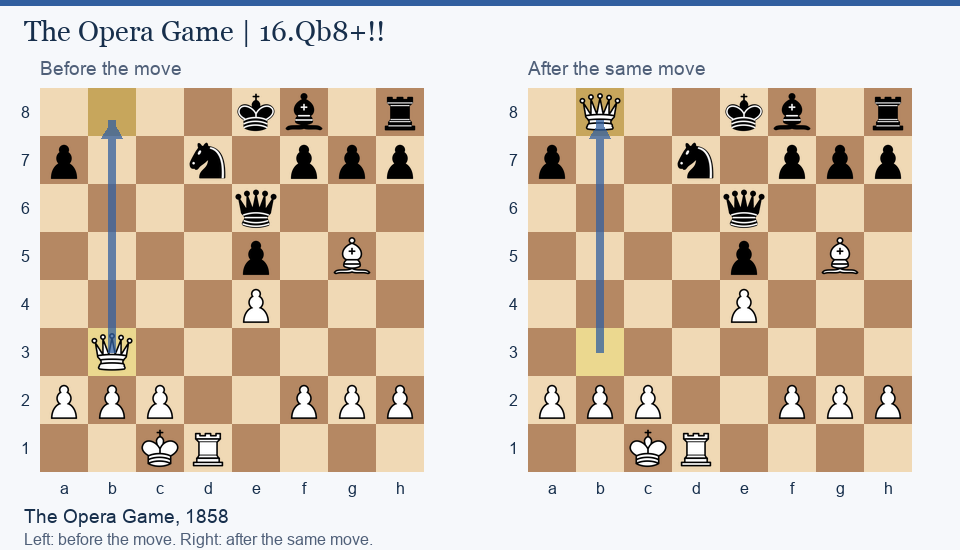

Left: before 16.Qb8+. Right: after the same move.

Awarded and source-listed moves across all modes; Fast grades shown

| Move | Selected source mark | En Croissant (adapted) Fast | Open Brilly Finder Fast |
| --- | --- | --- | --- |
| 10.Nxb5 | ! | Brilliant !! | Brilliant !! |
| 13.Rxd7 | ! | Unmarked | Brilliant !! |
| 15.Bxd7+ | Not listed | Blunder ?? | Blunder ?? |
| 16.Qb8+ | !! | Brilliant !! | Brilliant !! |

### Byrne–Fischer · 1956

[Chosen annotation](https://en.chessbase.com/post/the-game-that-shook-the-world-2)

**11...Na4**

The knight is offered because accepting it allows decisive attacks on White’s other pieces.

**Published annotation: Brilliant !!**

Frederic Friedel · ChessBase: [The game that shook the world](https://en.chessbase.com/post/the-game-that-shook-the-world-2) — Published game commentary.

| Analysis mode | En Croissant (adapted) | Open Brilly Finder |
| --- | --- | --- |
| Fast | Brilliant !! | Brilliant !! |
| Balanced | Interesting !? | Brilliant !! |
| Thorough | Brilliant !! | Brilliant !! |

En Croissant (adapted) labels it Brilliant in Fast and Thorough only. Open Brilly Finder labels it Brilliant in all three modes.

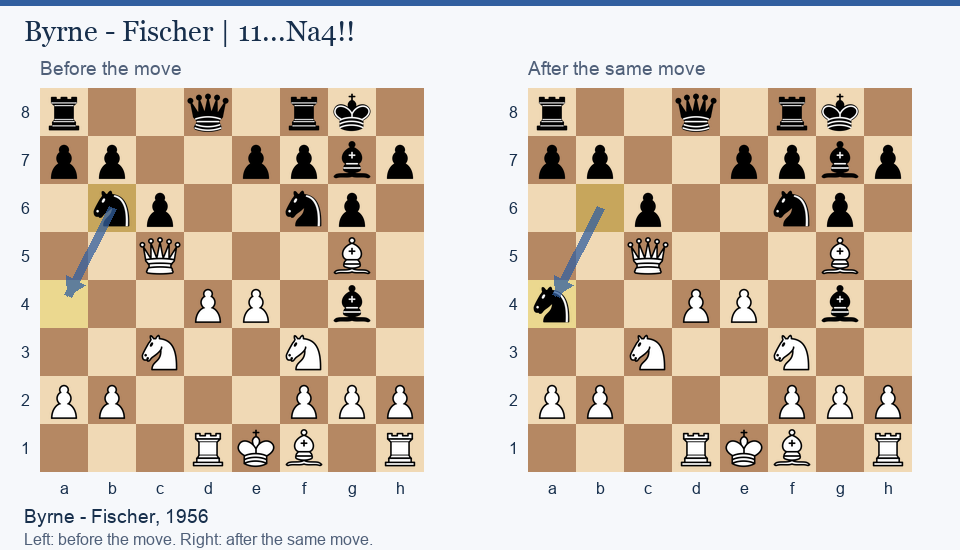

Left: before 11...Na4. Right: after the same move.

**17...Be6**

Fischer leaves his queen to be captured while his remaining pieces launch the winning attack.

**Published annotation: Brilliant !!**

Frederic Friedel · ChessBase: [The game that shook the world](https://en.chessbase.com/post/the-game-that-shook-the-world-2) — Published game commentary.

| Analysis mode | En Croissant (adapted) | Open Brilly Finder |
| --- | --- | --- |
| Fast | Brilliant !! | Brilliant !! |
| Balanced | Brilliant !! | Brilliant !! |
| Thorough | Brilliant !! | Brilliant !! |

Both detectors label this move Brilliant in all three modes.

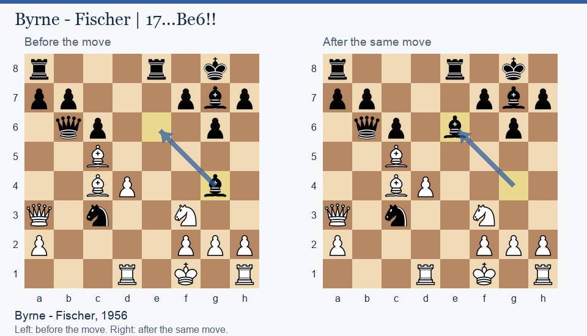

Left: before 17...Be6. Right: after the same move.

Awarded and source-listed moves across all modes; Fast grades shown

| Move | Selected source mark | En Croissant (adapted) Fast | Open Brilly Finder Fast |
| --- | --- | --- | --- |
| 11...Na4 | !! | Brilliant !! | Brilliant !! |
| 13...Nxe4 | ! | Unmarked | Unmarked |
| 15...Nxc3 | ! | Interesting !? | Brilliant !! |
| 17...Be6 | !! | Brilliant !! | Brilliant !! |
| 19...Ne2+ | Not listed | Brilliant !! | Interesting !? |

### Immortal Game · 1851

[Chosen annotation](https://www.chess.com/terms/immortal-game-chess)

**22.Qf6+**

The queen offer diverts the g8 knight from guarding e7, enabling the bishop mate.

**Published annotation: Brilliant !!**

NM Sam Copeland · Chess.com: [Immortal Game — Anderssen vs Kieseritzky (1851)](https://www.chess.com/terms/immortal-game-chess) — Chess.com Terms.

| Analysis mode | En Croissant (adapted) | Open Brilly Finder |
| --- | --- | --- |
| Fast | Interesting !? | Brilliant !! |
| Balanced | Interesting !? | Brilliant !! |
| Thorough | Interesting !? | Brilliant !! |

En Croissant (adapted) does not label this move Brilliant. Open Brilly Finder labels it Brilliant in all three modes.

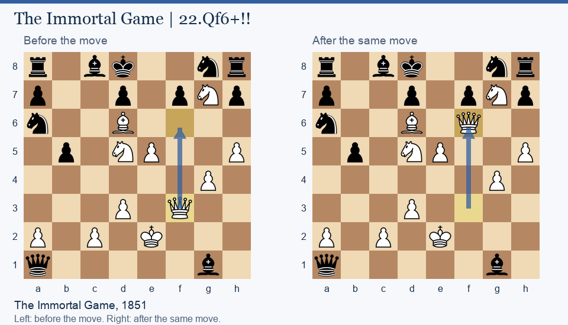

Left: before 22.Qf6+. Right: after the same move.

Awarded and source-listed moves across all modes; Fast grades shown

| Move | Selected source mark | En Croissant (adapted) Fast | Open Brilly Finder Fast |
| --- | --- | --- | --- |
| 18.Bd6 | ?! | Blunder ?? | Blunder ?? |
| 22.Qf6+ | !! | Interesting !? | Brilliant !! |

### Evergreen Game · 1852

[Chosen annotation](https://uscf1-nyc1.aodhosting.com/CLK-ALL/2015/2015.10.pdf)

**20.Rxe7+**

Rook sacrifice draws the defending knight away so the queen can be offered with check.

**Published annotation: Brilliant !!**

US Chess: [Chess Life for Kids, October 2015](https://uscf1-nyc1.aodhosting.com/CLK-ALL/2015/2015.10.pdf) — End of the Line solutions, page 23.

| Analysis mode | En Croissant (adapted) | Open Brilly Finder |
| --- | --- | --- |
| Fast | Brilliant !! | Interesting !? |
| Balanced | Brilliant !! | Interesting !? |
| Thorough | Brilliant !! | Interesting !? |

En Croissant (adapted) labels it Brilliant in all three modes. Open Brilly Finder does not label this move Brilliant.

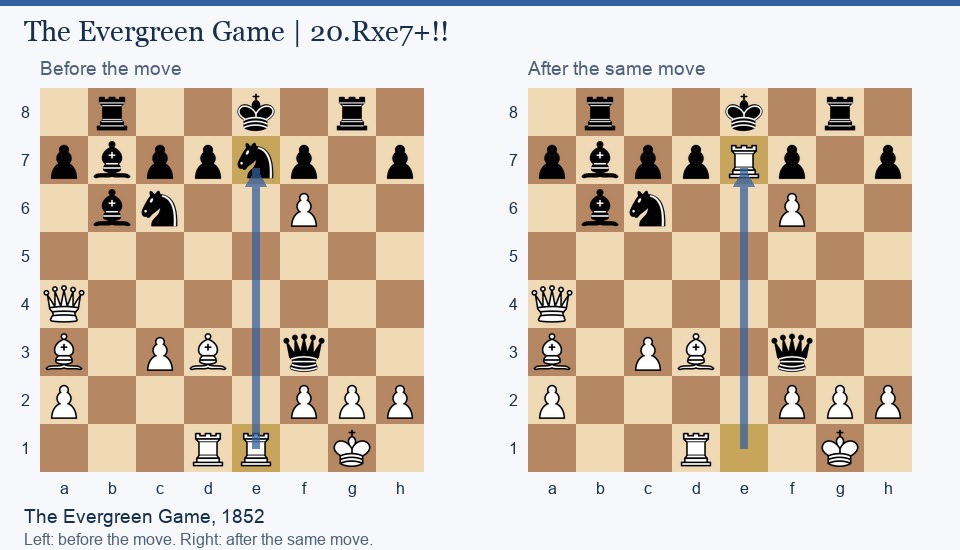

Left: before 20.Rxe7+. Right: after the same move.

**21.Qxd7+**

Queen sacrifice draws the king into a forced mating net with the two bishops.

**Published annotation: Brilliant !!**

US Chess: [Chess Life for Kids, October 2015](https://uscf1-nyc1.aodhosting.com/CLK-ALL/2015/2015.10.pdf) — End of the Line solutions, page 23.

| Analysis mode | En Croissant (adapted) | Open Brilly Finder |
| --- | --- | --- |
| Fast | Brilliant !! | Brilliant !! |
| Balanced | Brilliant !! | Brilliant !! |
| Thorough | Brilliant !! | Brilliant !! |

Both detectors label this move Brilliant in all three modes.

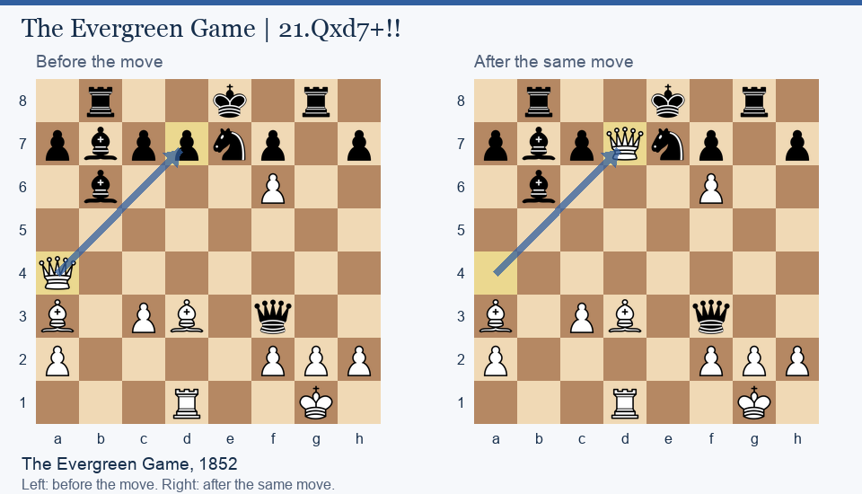

Left: before 21.Qxd7+. Right: after the same move.

Awarded and source-listed moves across all modes; Fast grades shown

| Move | Selected source mark | En Croissant (adapted) Fast | Open Brilly Finder Fast |
| --- | --- | --- | --- |
| 19.Rad1 | ! | Mistake ? | Mistake ? |
| 20.Rxe7+ | !! | Brilliant !! | Interesting !? |
| 21.Qxd7+ | !! | Brilliant !! | Brilliant !! |

### Rotlewi–Rubinstein · 1907

[Chosen annotation](https://www.chess.com/article/view/the-best-chess-games-of-all-time)

**22...Rxc3**

The rook removes a defender while the queen is offered to the g-pawn.

**Published annotation: Brilliant !!**

Chess.com staff: [The Best Chess Games Of All Time](https://www.chess.com/article/view/the-best-chess-games-of-all-time) — Rotlewi–Rubinstein section.

| Analysis mode | En Croissant (adapted) | Open Brilly Finder |
| --- | --- | --- |
| Fast | Brilliant !! | Brilliant !! |
| Balanced | Brilliant !! | Brilliant !! |
| Thorough | Brilliant !! | Brilliant !! |

Both detectors label this move Brilliant in all three modes.

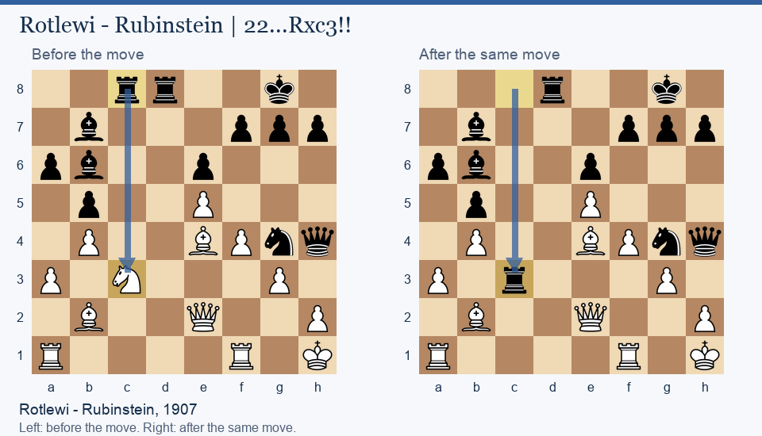

Left: before 22...Rxc3. Right: after the same move.

**23...Rd2**

A second rook offer diverts the white queen from its defensive role.

**Published annotation: Brilliant !!**

Chess.com staff: [The Best Chess Games Of All Time](https://www.chess.com/article/view/the-best-chess-games-of-all-time) — Rotlewi–Rubinstein section.

| Analysis mode | En Croissant (adapted) | Open Brilly Finder |
| --- | --- | --- |
| Fast | Brilliant !! | Brilliant !! |
| Balanced | Brilliant !! | Brilliant !! |
| Thorough | Brilliant !! | Brilliant !! |

Both detectors label this move Brilliant in all three modes.

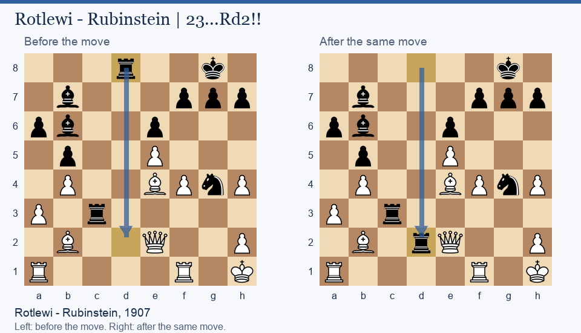

Left: before 23...Rd2. Right: after the same move.

**25...Rh3**

Quiet rook move seals the mating attack; check need not be immediate.

**Published annotation: Brilliant !!**

Chess.com staff: [The Best Chess Games Of All Time](https://www.chess.com/article/view/the-best-chess-games-of-all-time) — Rotlewi–Rubinstein section.

| Analysis mode | En Croissant (adapted) | Open Brilly Finder |
| --- | --- | --- |
| Fast | Interesting !? | Interesting !? |
| Balanced | Interesting !? | Interesting !? |
| Thorough | Interesting !? | Interesting !? |

Neither detector labels this move Brilliant in any mode.

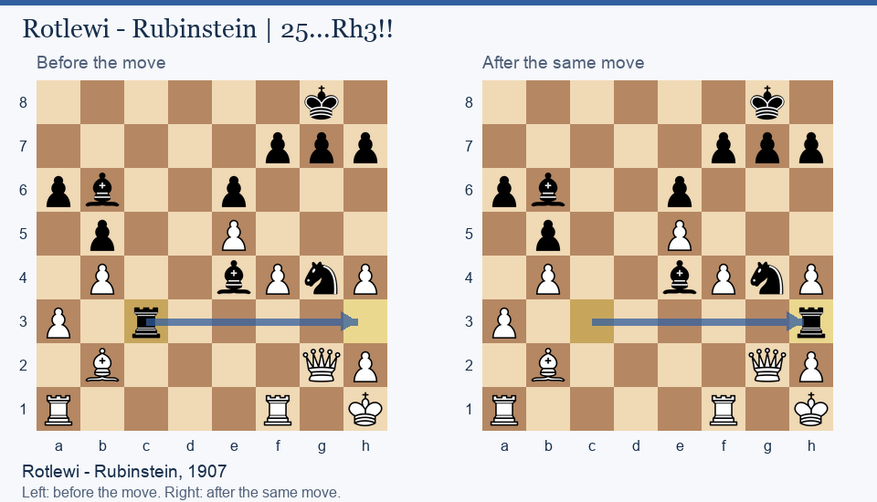

Left: before 25...Rh3. Right: after the same move.

Awarded and source-listed moves across all modes; Fast grades shown

| Move | Selected source mark | En Croissant (adapted) Fast | Open Brilly Finder Fast |
| --- | --- | --- | --- |
| 22...Rxc3 | !! | Brilliant !! | Brilliant !! |
| 23...Rd2 | !! | Brilliant !! | Brilliant !! |
| 25...Rh3 | !! | Interesting !? | Interesting !? |

### Levitsky–Marshall · 1912

[Chosen annotation](https://www.chess.com/article/view/throwing-away-your-queen)

**23...Qg3**

The queen can be taken three ways, but each loses to knight and rook tactics.

**Published annotation: Brilliant !!**

IM Jeremy Silman · Chess.com: [Throwing Away Your Queen](https://www.chess.com/article/view/throwing-away-your-queen) — Levitsky–Marshall section.

| Analysis mode | En Croissant (adapted) | Open Brilly Finder |
| --- | --- | --- |
| Fast | Interesting !? | Brilliant !! |
| Balanced | Interesting !? | Brilliant !! |
| Thorough | Interesting !? | Brilliant !! |

En Croissant (adapted) does not label this move Brilliant. Open Brilly Finder labels it Brilliant in all three modes.

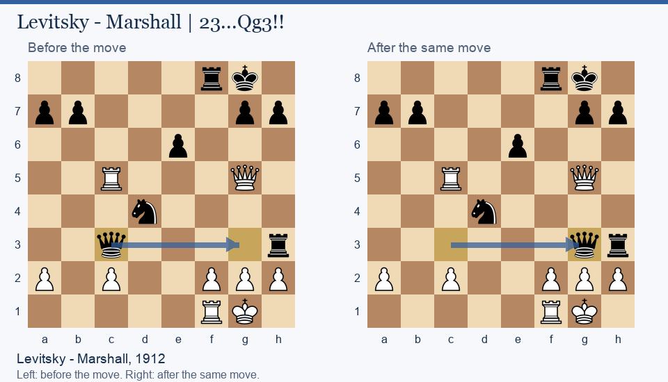

Left: before 23...Qg3. Right: after the same move.

Awarded and source-listed moves across all modes; Fast grades shown

| Move | Selected source mark | En Croissant (adapted) Fast | Open Brilly Finder Fast |
| --- | --- | --- | --- |
| 19.Rxd5 | Not listed | Good ! | Brilliant !! |
| 22...Rxh3 | Not listed | Interesting !? | Brilliant !! |
| 23...Qg3 | !! | Interesting !? | Brilliant !! |

### Lasker–Thomas · 1912

[Chosen annotation](https://uscf1-nyc1.aodhosting.com/CLK-ALL/2020/4-August%202020%20CLK.pdf)

**11.Qxh7+**

The queen offer draws the king out; a discovered double check begins the long forced king hunt.

**Published annotation: Brilliant !!**

John Hartmann · US Chess: [Chess Life for Kids, August 2020](https://uscf1-nyc1.aodhosting.com/CLK-ALL/2020/4-August%202020%20CLK.pdf) — Page 4.

| Analysis mode | En Croissant (adapted) | Open Brilly Finder |
| --- | --- | --- |
| Fast | Brilliant !! | Brilliant !! |
| Balanced | Brilliant !! | Brilliant !! |
| Thorough | Brilliant !! | Brilliant !! |

Both detectors label this move Brilliant in all three modes.

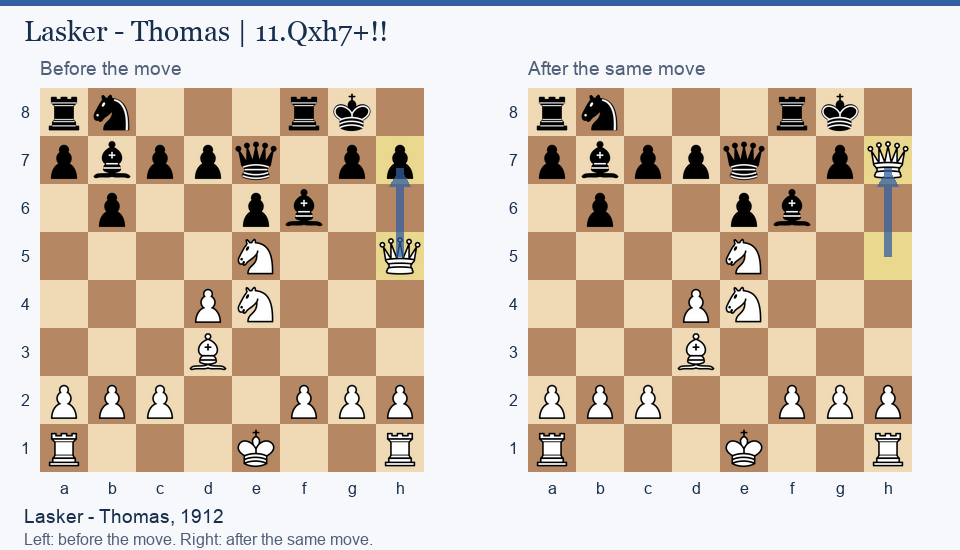

Left: before 11.Qxh7+. Right: after the same move.

Awarded and source-listed moves across all modes; Fast grades shown

| Move | Selected source mark | En Croissant (adapted) Fast | Open Brilly Finder Fast |
| --- | --- | --- | --- |
| 11.Qxh7+ | !! | Brilliant !! | Brilliant !! |

### Kasparov–Topalov · 1999

[Chosen annotation](https://www.chess.com/article/view/the-best-chess-games-of-all-time)

**24.Rxd4**

Rook offer opens the position for a long attack against the black king.

**Published annotation: Brilliant !!**

Sam Copeland · Chess.com: [The Best Chess Games Of All Time](https://www.chess.com/article/view/the-best-chess-games-of-all-time) — Kasparov–Topalov section.

| Analysis mode | En Croissant (adapted) | Open Brilly Finder |
| --- | --- | --- |
| Fast | Interesting !? | Interesting !? |
| Balanced | Interesting !? | Interesting !? |
| Thorough | Interesting !? | Brilliant !! |

En Croissant (adapted) does not label this move Brilliant. Open Brilly Finder labels it Brilliant in Thorough only.

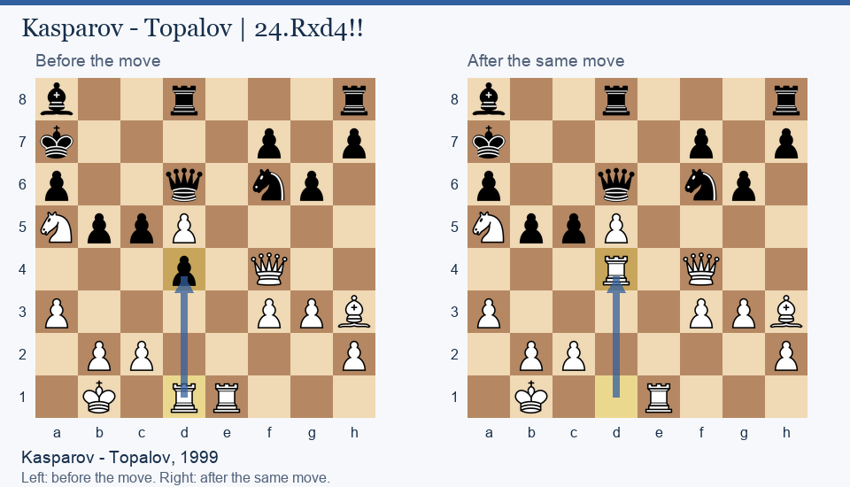

Left: before 24.Rxd4. Right: after the same move.

**25.Re7+**

The second rook joins the king hunt and cannot safely be captured.

**Published annotation: Brilliant !!**

Sam Copeland · Chess.com: [The Best Chess Games Of All Time](https://www.chess.com/article/view/the-best-chess-games-of-all-time) — Kasparov–Topalov section.

| Analysis mode | En Croissant (adapted) | Open Brilly Finder |
| --- | --- | --- |
| Fast | Brilliant !! | Brilliant !! |
| Balanced | Brilliant !! | Brilliant !! |
| Thorough | Brilliant !! | Brilliant !! |

Both detectors label this move Brilliant in all three modes.

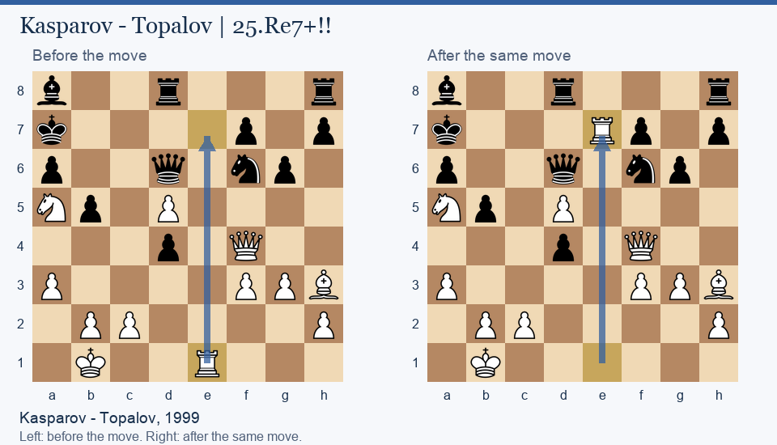

Left: before 25.Re7+. Right: after the same move.

Awarded and source-listed moves across all modes; Fast grades shown

| Move | Selected source mark | En Croissant (adapted) Fast | Open Brilly Finder Fast |
| --- | --- | --- | --- |
| 24.Rxd4 | !! | Interesting !? | Interesting !? |
| 25.Re7+ | !! | Brilliant !! | Brilliant !! |
| 25...Kb6 | Not listed | Brilliant !! | Interesting !? |
| 26.Qxd4+ | Not listed | Dubious ?! | Dubious ?! |
| 28.Qc3 | Not listed | Interesting !? | Brilliant !! |
| 28...Qxd5 | Not listed | Brilliant !! | Interesting !? |
| 29.Ra7 | Not listed | Brilliant !! | Interesting !? |
| 29...Bb7 | Not listed | Brilliant !! | Interesting !? |
| 30.Rxb7 | Not listed | Interesting !? | Brilliant !! |
| 36.Bf1 | ! | Brilliant !! | Brilliant !! |
| 37.Rd7 | Not listed | Good ! | Brilliant !! |
| 37...Rxd7 | Not listed | Brilliant !! | Unmarked |
| 38...bxc4 | Not listed | Brilliant !! | Unmarked |

### Short–Timman · 1991

[Chosen annotation](https://rafaelleitao.com/short-x-timman-2/)

**31.Kh2**

The king leaves safety to join the mating attack while many pieces remain. This is a quiet non-sacrificial plan, testing the model’s conceptual scope.

**Published annotation: Brilliant !!**

GM Rafael Leitão: [Chess game: Short x Timman](https://rafaelleitao.com/short-x-timman-2/) — Published annotated game.

| Analysis mode | En Croissant (adapted) | Open Brilly Finder |
| --- | --- | --- |
| Fast | Dubious ?! | Dubious ?! |
| Balanced | Unmarked | Unmarked |
| Thorough | Unmarked | Unmarked |

Neither detector labels this move Brilliant in any mode.

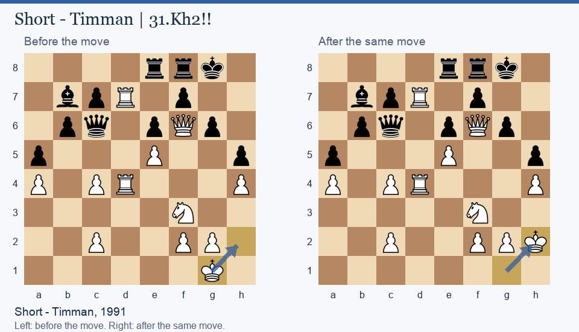

Left: before 31.Kh2. Right: after the same move.

Awarded and source-listed moves across all modes; Fast grades shown

| Move | Selected source mark | En Croissant (adapted) Fast | Open Brilly Finder Fast |
| --- | --- | --- | --- |
| 13...e6 | ?! | Unmarked | Unmarked |
| 17.Bc4 | ! | Unmarked | Unmarked |
| 18.b3 | ! | Unmarked | Unmarked |
| 24.Rd8 | ! | Unmarked | Unmarked |
| 25...Bg7 | !? | Mistake ? | Mistake ? |
| 26.R8d7 | ! | Unmarked | Unmarked |
| 30.h4 | ! | Mistake ? | Mistake ? |
| 31.Kh2 | !! | Dubious ?! | Dubious ?! |
| 32.Kg3 | ! | Unmarked | Unmarked |
| 33.Kf4 | ! | Unmarked | Unmarked |
| 34.Kg5 | ! | Brilliant !! | Brilliant !! |

## What this can establish

The source registry and plan were committed before fresh analysis. Both classifiers saw the same baseline Stockfish 18 output; each retained its own normal provisional/confirmation/final behavior. Every position in all nine games was evaluated in all three modes. No model weights, thresholds or app rules were changed after results.

The nine games are deliberately famous, not a random sample. Opera and Fischer were already development examples. Training membership was not audited. Human! and!! judgments vary; this is a comparison with a fixed chosen set of annotations, not objective ground truth or a recreation of a private commercial classifier. No precision, false-positive rate or population accuracy is claimed.

Short–Timman tests quiet brilliance, not just sacrifices. Its inclusion and any misses stay in the denominator. Immortal18.Bd6?! is retained separately as a famous but questioned sacrifice. The results include every final award, even outside the selected annotation marks.

[Plan](PLAN.md) · [Data and reproduction](README.md) · [Full engine evidence](data/engine-runs.json) · [Viewer data](web/results.json) · [Artwork notices](THIRD_PARTY.md)
