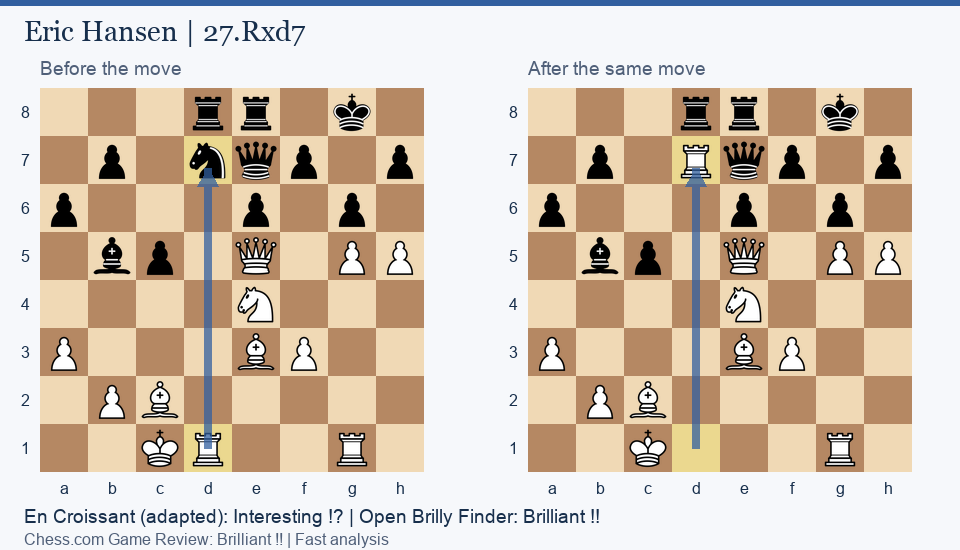
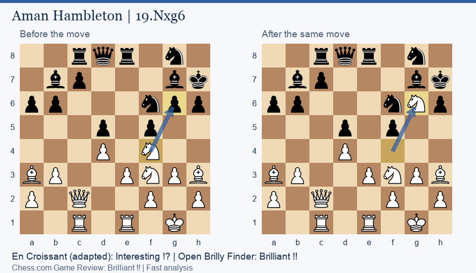

# Finding more brilliant moves

Mobile Maia is a free, offline chess app for Android. Its game analysis marks brilliant moves with !!, the chess symbol for an exceptional idea. We want it to recognize more of those moves.

Our existing detector uses rules adapted from En Croissant, an open-source chess analysis app. We tested a replacement from our Open Brilly Finder project on classical games and two sets of online games.

Planned for Mobile Maia 2.7; not yet in a published Android release.

## The two detectors

**En Croissant (adapted).** The En Croissant (adapted) detector looks for a sacrifice that doesn’t significantly worsen the position, is the Stockfish chess engine’s best move, and stands clearly above the alternatives. These rules catch many good combinations, but can miss a brilliant sacrifice when another move also works.

**New: Open Brilly Finder.** Open Brilly Finder is our open-source research project for recognizing Brilliant moves. Its Mute Exchange model was trained using recorded Chess.com game-review labels. It first checks for a piece offer, allowing for the captures and recaptures on that square. A small trained model then uses the position and Stockfish’s analysis to decide whether that offer deserves !!.

The model is about half a megabyte and runs entirely on the device. It uses Mobile Maia’s existing Stockfish analysis; it needs no online service or extra chess engine.

Both detectors received the same Stockfish analysis for each game. We counted their final Brilliant awards after the app’s normal checks.

## First, the classics: a small improvement

We started with nine famous games, including Morphy’s Opera Game and Byrne–Fischer. Before running the comparison, we chose fourteen moves explicitly marked !! in published annotations. In Fast analysis, the existing detector found nine; Open Brilly Finder found ten.

Both find the Opera Game’s 16.Qb8+ and Fischer’s 11...Na4 and 17...Be6. Open Brilly Finder also recognizes the Immortal Game’s 22.Qf6+ and Marshall’s 23...Qg3. That is a small improvement: it finds most of our selected classical brilliancies, with two gains and one loss.

Both detectors recognize Morphy’s queen sacrifice.

| Game | Published !! | En Croissant (adapted) | Open Brilly finds |
| --- | --- | --- | --- |
| Opera Game | 1 | 1 | 1 |
| Byrne–Fischer | 2 | 2 | 2 |
| Immortal Game | 1 | 0 | 1 |
| Evergreen Game | 2 | 2 | 1 |
| Rotlewi–Rubinstein | 3 | 2 | 2 |
| Levitsky–Marshall | 1 | 0 | 1 |
| Lasker–Thomas | 1 | 1 | 1 |
| Kasparov–Topalov | 2 | 1 | 1 |
| Short–Timman | 1 | 0 | 0 |

The loss is Evergreen’s 20.Rxe7+, which the existing detector finds and the new one misses. Neither finds Short’s quiet 31.Kh2. Deeper analysis helps with Kasparov’s 24.Rxd4: the new detector finds it in Thorough, but misses it in Fast and Balanced. These exceptions remain in the results.

| Analysis mode | En Croissant (adapted) / 14 | Open Brilly finds / 14 |
| --- | --- | --- |
| Fast | 9 | 10 |
| Balanced | 8 | 10 |
| Thorough | 9 | 11 |

[All classical moves, diagrams and sources](CLASSICS.md)

## Next, online games: 33 more brilliancies found

Next we tested 42 online games from Open Brilly Finder’s public collection: six each from seven titled-player accounts. The games were selected by a fixed selection rule before either detector ran. We analyzed every move, then counted how many of Chess.com’s recorded Brilliant moves each detector recognized on the selected players’ moves.

This gives us 1,692 scored moves, including 51 marked Brilliant in those reviews. These games were collected for their Brilliant moves; they are not a random sample of online chess. Thirty-six selected games were used in the model’s development; six Witty_Alien games were kept out of the model’s training games. This checks the integration on that collection, rather than establishing accuracy for all players.

The En Croissant (adapted) detector found 11 of those 51 moves. Open Brilly Finder found 44: 33 more. It retains all 11 moves the old rules recognized.

| Player / account | Recorded !! | En Croissant (adapted) | Open Brilly finds |
| --- | --- | --- | --- |
| Eric Hansen | 6 | 1 | 6 |
| Aman Hambleton | 7 | 2 | 6 |
| nelsi | 7 | 0 | 4 |
| GothamChess | 9 | 2 | 8 |
| Hikaru | 7 | 2 | 6 |
| MagnusCarlsen | 9 | 1 | 8 |
| Witty_Alien | 6 | 3 | 6 |
| Total | 51 | 11 | 44 |

In the six games kept out of the model’s training games, Open Brilly Finder found all six recorded Brilliants, versus three previously.

On the scored moves, every Brilliant award from either detector matched a recorded Brilliant label.

| Recorded Brilliant moves | En Croissant (adapted) | Open Brilly Finder |
| --- | --- | --- |
| Found | 11 | 44 |
| Missed | 40 | 7 |
| Awards outside those labels | 0 | 0 |
| All Brilliant awards | 11 | 44 |

## Two games from Chessbrah

### Eric Hansen: a rook sacrifice sets up a fork

hansen – DAESDO · 2026/06/06 · 27.Rxd7

Hansen plays 27.Rxd7, giving up a rook for a knight. After 27...Rxd7, 28.Nf6+ forks the black king and both rooks. The game continues 28...Kf8 29.Bxc5. The existing detector gives no Brilliant award; Open Brilly Finder recognizes the sacrifice, matching the recorded review.

En Croissant (adapted): **Interesting !?**. Open Brilly Finder: **Brilliant !!**. Recorded Chess.com review: **Brilliant**.

[Original game](https://www.chess.com/game/live/169812769348)

### Aman Hambleton: a knight offer leads to mate

KNVB – Cocolino31 · 2026/06/10 · 19.Nxg6

Hambleton offers his knight with 19.Nxg6. Black accepts: 19...Kxg6 20.Bxf5+ Kf7 21.Bg6+ Ke6 22.Qf5#. The existing detector misses the Brilliant label; Open Brilly Finder finds it, matching the recorded review. Stockfish’s first choice before the move was 19.Bxf5, so the old best-move rule excludes the played sacrifice.

En Croissant (adapted): **Interesting !?**. Open Brilly Finder: **Brilliant !!**. Recorded Chess.com review: **Brilliant**.

[Original game](https://www.chess.com/game/live/170012492008)

## An independent check: Ginger

We then tested 27 games from grandmaster Simon Williams (Ginger_GM), outside the published development data. Before analysis, we excluded three games that repeated training positions and moves. None of the retained games or their played position-and-move pairs matches the published candidate data.

Gallery brillies found, out of the same 32 moves in 27 games.

| Analysis mode | En Croissant (adapted) | Open Brilly Finder | Outside gallery: En Croissant / Open Brilly |
| --- | --- | --- | --- |
| Fast | 7 / 32 | 20 / 32 | 5 / 1 |
| Balanced | 6 / 32 | 23 / 32 | 4 / 1 |
| Thorough | 8 / 32 | 24 / 32 | 6 / 1 |

Open Brilly Finder finds more gallery brillies in every mode. Each mode loses one move the old rules recognized.

These games were selected for their gallery brillies. Awards outside the gallery are disagreements, not automatically errors. Both detectors receive the same analysis within each mode; the model and cutoff are unchanged.

[All Ginger games, moves and training-overlap audit](ginger/REPORT.md) · [Results by analysis mode](ginger/modes/REPORT.md)

## Our decision: Open Brilly Finder for 2.7

We have chosen to adopt Open Brilly Finder for Mobile Maia 2.7. The gains are modest on the classics and larger in both online samples. It still misses some brilliant moves.

## How we tested

Classical games: 492 mainline moves, nine games, all three modes. Online games: 3,364 mainline moves, 42 games, Fast. The independent Ginger follow-up adds 1,837 mainline moves across 27 games, in all three modes. The paired classifiers share baseline Stockfish 18 evidence and keep their normal evidence and confirmation checks. No model, cutoff or classification-rule changes were made for this study.

The original 42-game online sample contains development games and titled players. Six selected Witty_Alien games were kept out of training, although other games from that account were used in training. The separate Ginger sample has no matching games or candidate position-and-move pairs in the published development data. Both samples were selected for their brillies; neither estimates accuracy for all players.

Chess.com’s recorded labels and human annotations are references, not a universal definition of brilliance. Review labels can change. The new detector was trained to recognize piece offers, so quiet brilliancies remain difficult.

The tests use native Stockfish 18 on a Mac with Mobile Maia’s actual analyzer and classifiers. Android performance and release checks remain separate. No Android builds or LFS downloads were used.

Both detectors also show a shared shallow-search inconsistency at Opera 15.Bxd7+: Fast calls it a Blunder and Balanced a Mistake; Thorough leaves it unmarked. That is separate from the Brilliant model.

[Fixed online plan](online/PLAN.md) · [Selection](online/selection.json) · [All game-level results](online/summary.json) · [Online raw evidence](online/engine-runs.json.gz) · [Data and reproduction](README.md)

[Recorded reference PGN](online/review-labels.pgn) · [En Croissant (adapted) PGN](online/old-awards.pgn) · [Open Brilly Finder PGN](online/new-awards.pgn). The detector PGNs include awards for both players; tables score only the selected account.

## Sources and credits

[En Croissant](https://github.com/franciscoBSalgueiro/en-croissant) · [Open Brilly Finder](https://github.com/Dash1971/open-brilly-finder) · [Chessbrah player identities](https://www.chess.com/tv/shows/chessbrahs) · [Classical annotations](CLASSICS.md) · [Artwork notices](THIRD_PARTY.md)

[Interactive report on mobilemaia.org](https://mobilemaia.org/research/brilliant-moves/)
