# Can an offline model spot a masterpiece?

Nine famous games. Fourteen published Brilliant landmarks. Two classifiers.

**Release target:** Open Brilly Finder is a Preview draft aiming for Mobile Maia 2.7. This study is not an Android release qualification.

## Verdict

Fast analysis finds 10 of 14 published landmarks, up from 9. Balanced and Thorough also find more, but all three lose the Evergreen Game’s 20.Rxe7+. The evidence supports more testing, not a clean replacement sign-off.

We’re aiming for Mobile Maia 2.7. Open Brilly Finder remains a draft; the Evergreen regression and broader quality checks need review before promotion.

**Opera: a new award, not a new landmark hit.** Both classifiers find 16.Qb8+!!. The new one also awards 13.Rxd7, which our chosen annotation marks !. That is a generous promotion, not an extra match to its published !!.

**Fischer: the total stays three in Fast.** The new list keeps 11...Na4 and 17...Be6, adds 15...Nxc3 and drops 19...Ne2+. Balanced also recovers Na4. These changes make the emphasis different; they do not turn three awards into five.

**Two famous queens are recovered.** The Immortal Game’s 22.Qf6+ and Marshall’s 23...Qg3 gain Brilliant in every mode. Both are explicit !! landmarks in the frozen sources.

**Evergreen is the counterexample.** The old classifier finds 20.Rxe7+!!; the new one gives Interesting in every mode. Its model score is about 0.021, far below the fixed 0.8193 cutoff. This is a model rejection, not an unfinished confirmation search.

**Kasparov needs the deeper run.** The new model finds 24.Rxd4 only in Thorough. Fast and Balanced still call it Interesting. The headline uses Fast, as planned, rather than selecting the most flattering mode.

**A quiet king walk still escapes.** Neither classifier finds Short’s 31.Kh2!! in any mode. Both award the later 34.Kg5, marked ! by the chosen grandmaster. Finding sacrificial ideas does not cover every human use of Brilliant.

**Extra awards still need judgment.** Fast produces 19 total Brilliant awards before and 20 after. Ten in each list lie outside the fourteen frozen landmarks. Some are source ! moves; others are not listed in that source scope. Those counts cannot establish a false-positive rate.

## What the tests found

In Fast analysis, the previous classifier found **9/14** frozen published!! landmarks. Open Brilly Finder found **10/14**. It recovered 2 and lost 1 at those landmarks. These are final app awards after its normal confirmation policy, not raw model predictions.

| Game | Published!! landmarks | Previous Fast | Open Brilly Finder Fast |
| --- | ---: | ---: | ---: |
| Opera Game (1858) | 1 | 1 | 1 |
| Byrne–Fischer (1956) | 2 | 2 | 2 |
| Immortal Game (1851) | 1 | 0 | 1 |
| Evergreen Game (1852) | 2 | 2 | 1 |
| Rotlewi–Rubinstein (1907) | 3 | 2 | 2 |
| Levitsky–Marshall (1912) | 1 | 0 | 1 |
| Lasker–Thomas (1912) | 1 | 1 | 1 |
| Kasparov–Topalov (1999) | 2 | 1 | 1 |
| Short–Timman (1991) | 1 | 0 | 0 |

### All three prespecified modes

| Mode | Previous landmarks | New landmarks | Previous total awards | New total awards |
| --- | ---: | ---: | ---: | ---: |
| Fast | 9/14 | 10/14 | 19 | 20 |
| Balanced | 8/14 | 10/14 | 16 | 19 |
| Thorough | 9/14 | 11/14 | 19 | 20 |

Additional awards are listed below and in the data. A move without a recorded!! is not automatically a false positive: some are explicitly!, and the source excerpts are not exhaustive labels for every move.

## Walk through the games

### Opera Game · 1858

[Chosen annotation](https://www.chess.com/article/view/the-best-chess-games-of-all-time)

**16.Qb8+ — published!!**

Queen sacrifice deflects the knight so the remaining rook mates on d8.

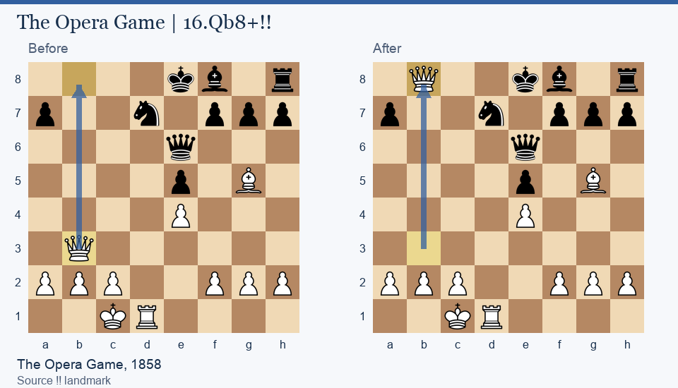

Fast: Brilliant !! → Brilliant !!. Awarded Brilliant after the app’s normal evidence checks.

Awarded and source-listed moves across all modes; Fast grades shown

| Move | Selected source mark | Previous Fast | New Fast |
| --- | --- | --- | --- |
| 10.Nxb5 | ! | Brilliant !! | Brilliant !! |
| 13.Rxd7 | ! | Unmarked | Brilliant !! |
| 16.Qb8+ | !! | Brilliant !! | Brilliant !! |

### Byrne–Fischer · 1956

[Chosen annotation](https://en.chessbase.com/post/the-game-that-shook-the-world-2)

**11...Na4 — published!!**

The knight is offered because accepting it allows decisive attacks on White’s other pieces.

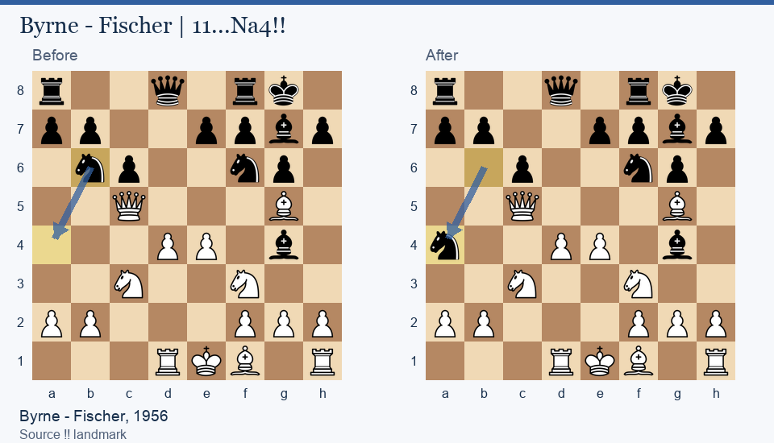

Fast: Brilliant !! → Brilliant !!. Awarded Brilliant after the app’s normal evidence checks.

**17...Be6 — published!!**

Fischer leaves his queen to be captured while his remaining pieces launch the winning attack.

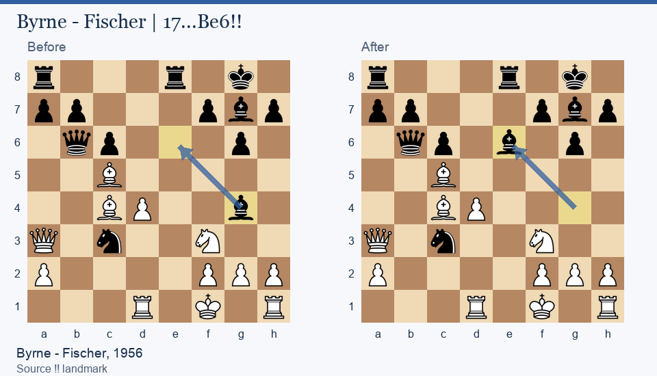

Fast: Brilliant !! → Brilliant !!. Awarded Brilliant after the app’s normal evidence checks.

Awarded and source-listed moves across all modes; Fast grades shown

| Move | Selected source mark | Previous Fast | New Fast |
| --- | --- | --- | --- |
| 11...Na4 | !! | Brilliant !! | Brilliant !! |
| 13...Nxe4 | ! | Unmarked | Unmarked |
| 15...Nxc3 | ! | Interesting !? | Brilliant !! |
| 17...Be6 | !! | Brilliant !! | Brilliant !! |
| 19...Ne2+ | Not listed | Brilliant !! | Interesting !? |

### Immortal Game · 1851

[Chosen annotation](https://www.chess.com/terms/immortal-game-chess)

**22.Qf6+ — published!!**

The queen offer diverts the g8 knight from guarding e7, enabling the bishop mate.

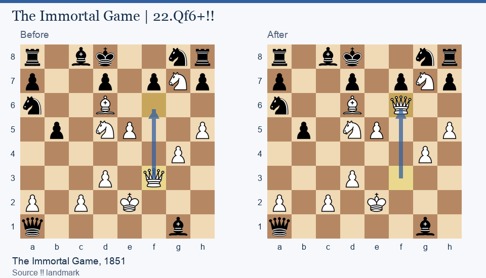

Fast: Interesting !? → Brilliant !!. Awarded Brilliant after the app’s normal evidence checks.

Awarded and source-listed moves across all modes; Fast grades shown

| Move | Selected source mark | Previous Fast | New Fast |
| --- | --- | --- | --- |
| 18.Bd6 | ?! | Blunder ?? | Blunder ?? |
| 22.Qf6+ | !! | Interesting !? | Brilliant !! |

### Evergreen Game · 1852

[Chosen annotation](https://uscf1-nyc1.aodhosting.com/CLK-ALL/2015/2015.10.pdf)

**20.Rxe7+ — published!!**

Rook sacrifice draws the defending knight away so the queen can be offered with check.

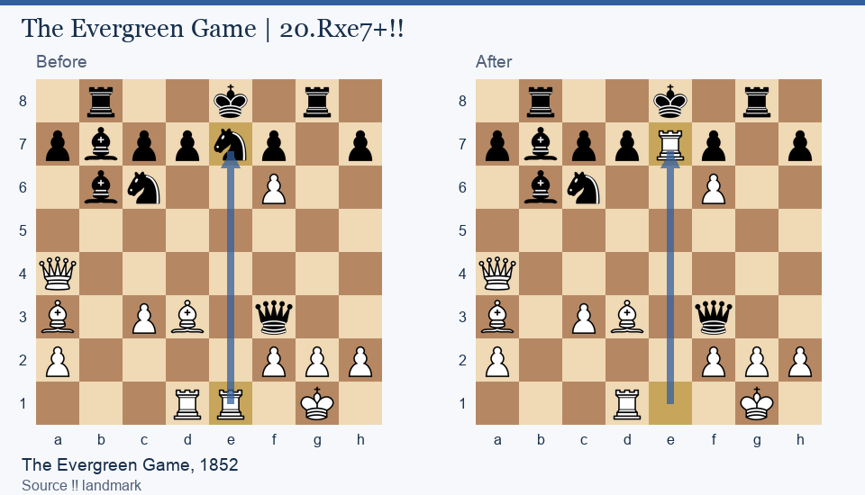

Fast: Brilliant !! → Interesting !?. The model score is below its fixed Brilliant cutoff.

**21.Qxd7+ — published!!**

Queen sacrifice draws the king into a forced mating net with the two bishops.

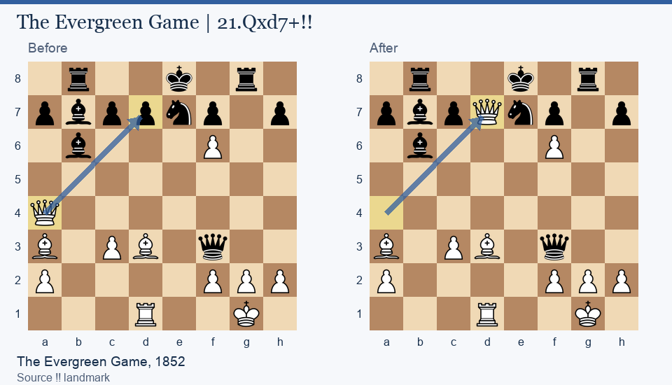

Fast: Brilliant !! → Brilliant !!. Awarded Brilliant after the app’s normal evidence checks.

Awarded and source-listed moves across all modes; Fast grades shown

| Move | Selected source mark | Previous Fast | New Fast |
| --- | --- | --- | --- |
| 19.Rad1 | ! | Mistake ? | Mistake ? |
| 20.Rxe7+ | !! | Brilliant !! | Interesting !? |
| 21.Qxd7+ | !! | Brilliant !! | Brilliant !! |

### Rotlewi–Rubinstein · 1907

[Chosen annotation](https://www.chess.com/article/view/the-best-chess-games-of-all-time)

**22...Rxc3 — published!!**

The rook removes a defender while the queen is offered to the g-pawn.

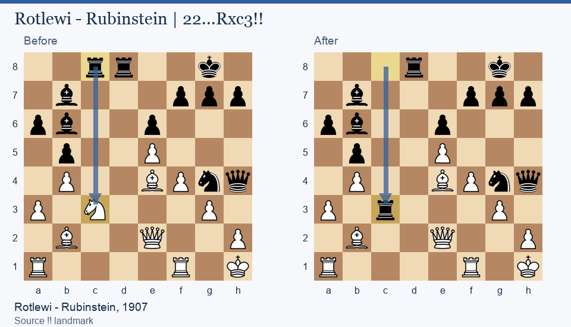

Fast: Brilliant !! → Brilliant !!. Awarded Brilliant after the app’s normal evidence checks.

**23...Rd2 — published!!**

A second rook offer diverts the white queen from its defensive role.

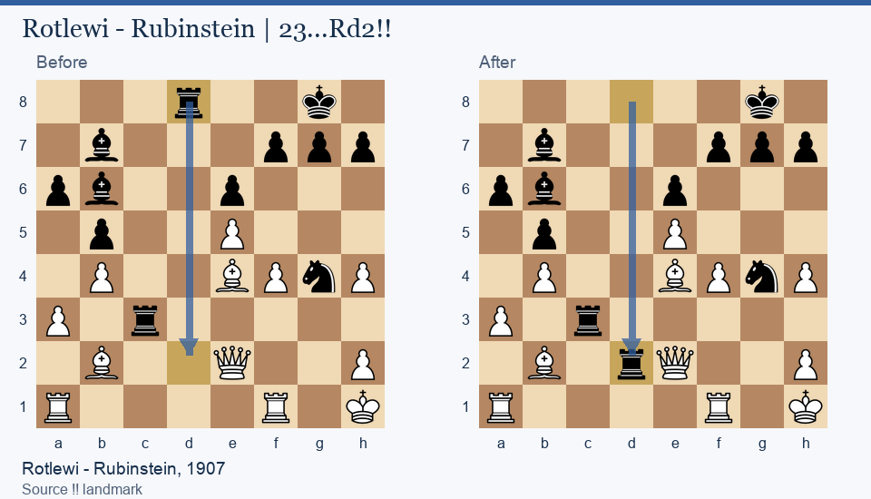

Fast: Brilliant !! → Brilliant !!. Awarded Brilliant after the app’s normal evidence checks.

**25...Rh3 — published!!**

Quiet rook move seals the mating attack; check need not be immediate.

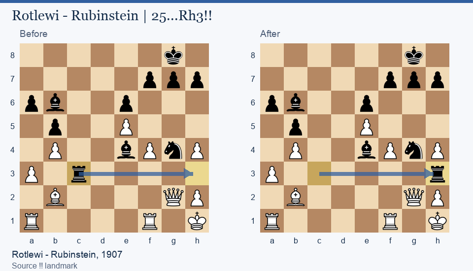

Fast: Interesting !? → Interesting !?. The model score is below its fixed Brilliant cutoff.

Awarded and source-listed moves across all modes; Fast grades shown

| Move | Selected source mark | Previous Fast | New Fast |
| --- | --- | --- | --- |
| 22...Rxc3 | !! | Brilliant !! | Brilliant !! |
| 23...Rd2 | !! | Brilliant !! | Brilliant !! |
| 25...Rh3 | !! | Interesting !? | Interesting !? |

### Levitsky–Marshall · 1912

[Chosen annotation](https://www.chess.com/article/view/throwing-away-your-queen)

**23...Qg3 — published!!**

The queen can be taken three ways, but each loses to knight and rook tactics.

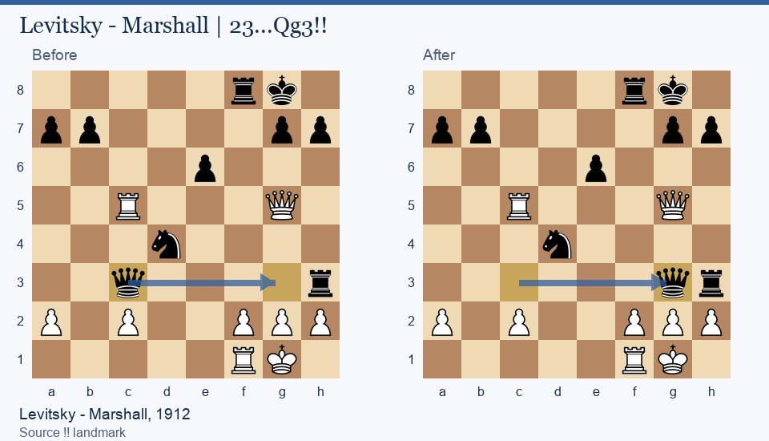

Fast: Interesting !? → Brilliant !!. Awarded Brilliant after the app’s normal evidence checks.

Awarded and source-listed moves across all modes; Fast grades shown

| Move | Selected source mark | Previous Fast | New Fast |
| --- | --- | --- | --- |
| 19.Rxd5 | Not listed | Good ! | Brilliant !! |
| 22...Rxh3 | Not listed | Interesting !? | Brilliant !! |
| 23...Qg3 | !! | Interesting !? | Brilliant !! |

### Lasker–Thomas · 1912

[Chosen annotation](https://uscf1-nyc1.aodhosting.com/CLK-ALL/2020/4-August%202020%20CLK.pdf)

**11.Qxh7+ — published!!**

The queen offer draws the king out; a discovered double check begins the long forced king hunt.

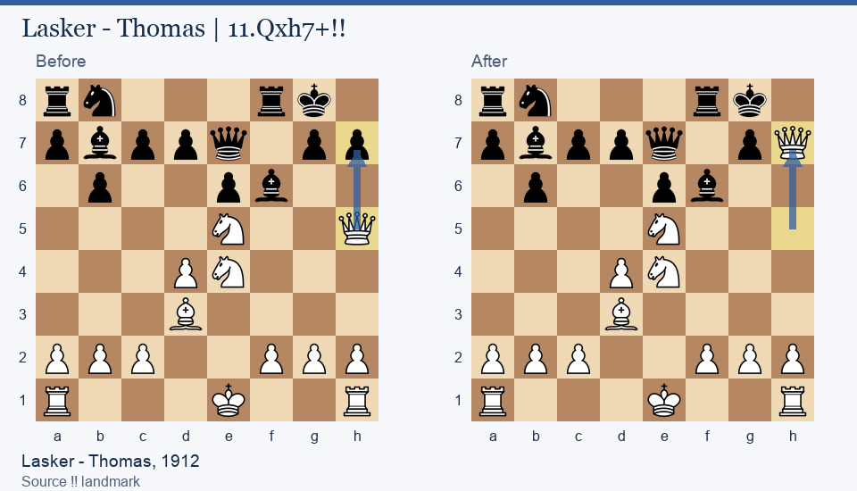

Fast: Brilliant !! → Brilliant !!. Awarded Brilliant after the app’s normal evidence checks.

Awarded and source-listed moves across all modes; Fast grades shown

| Move | Selected source mark | Previous Fast | New Fast |
| --- | --- | --- | --- |
| 11.Qxh7+ | !! | Brilliant !! | Brilliant !! |

### Kasparov–Topalov · 1999

[Chosen annotation](https://www.chess.com/article/view/the-best-chess-games-of-all-time)

**24.Rxd4 — published!!**

Rook offer opens the position for a long attack against the black king.

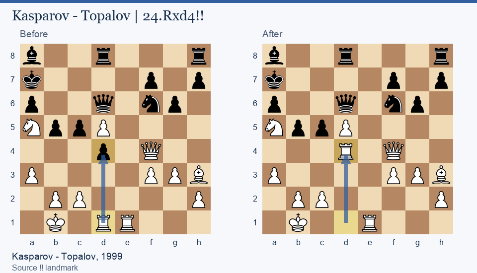

Fast: Interesting !? → Interesting !?. The model score is below its fixed Brilliant cutoff.

**25.Re7+ — published!!**

The second rook joins the king hunt and cannot safely be captured.

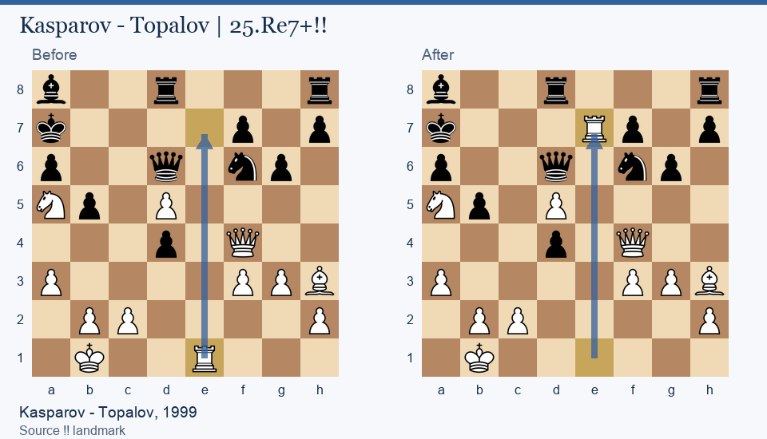

Fast: Brilliant !! → Brilliant !!. Awarded Brilliant after the app’s normal evidence checks.

Awarded and source-listed moves across all modes; Fast grades shown

| Move | Selected source mark | Previous Fast | New Fast |
| --- | --- | --- | --- |
| 24.Rxd4 | !! | Interesting !? | Interesting !? |
| 25.Re7+ | !! | Brilliant !! | Brilliant !! |
| 25...Kb6 | Not listed | Brilliant !! | Interesting !? |
| 26.Qxd4+ | Not listed | Dubious ?! | Dubious ?! |
| 28.Qc3 | Not listed | Interesting !? | Brilliant !! |
| 28...Qxd5 | Not listed | Brilliant !! | Interesting !? |
| 29.Ra7 | Not listed | Brilliant !! | Interesting !? |
| 29...Bb7 | Not listed | Brilliant !! | Interesting !? |
| 30.Rxb7 | Not listed | Interesting !? | Brilliant !! |
| 36.Bf1 | ! | Brilliant !! | Brilliant !! |
| 37.Rd7 | Not listed | Good ! | Brilliant !! |
| 37...Rxd7 | Not listed | Brilliant !! | Unmarked |
| 38...bxc4 | Not listed | Brilliant !! | Unmarked |

### Short–Timman · 1991

[Chosen annotation](https://rafaelleitao.com/short-x-timman-2/)

**31.Kh2 — published!!**

The king leaves safety to join the mating attack while many pieces remain. This is a quiet non-sacrificial plan, testing the model’s conceptual scope.

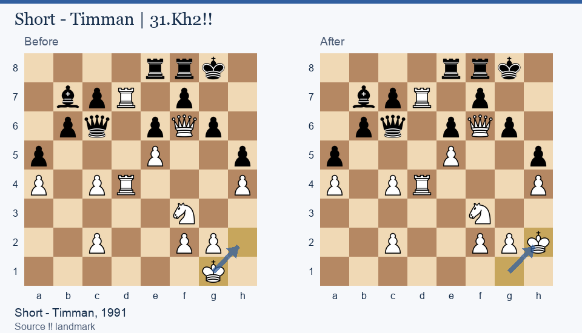

Fast: Dubious ?! → Dubious ?!. The engine-based error grade takes precedence.

Awarded and source-listed moves across all modes; Fast grades shown

| Move | Selected source mark | Previous Fast | New Fast |
| --- | --- | --- | --- |
| 13...e6 | ?! | Unmarked | Unmarked |
| 17.Bc4 | ! | Unmarked | Unmarked |
| 18.b3 | ! | Unmarked | Unmarked |
| 24.Rd8 | ! | Unmarked | Unmarked |
| 25...Bg7 | !? | Mistake ? | Mistake ? |
| 26.R8d7 | ! | Unmarked | Unmarked |
| 30.h4 | ! | Mistake ? | Mistake ? |
| 31.Kh2 | !! | Dubious ?! | Dubious ?! |
| 32.Kg3 | ! | Unmarked | Unmarked |
| 33.Kf4 | ! | Unmarked | Unmarked |
| 34.Kg5 | ! | Brilliant !! | Brilliant !! |

## What this can establish

The source registry and plan were committed before fresh analysis. Both classifiers saw the same baseline Stockfish 18 output; each retained its own normal provisional/confirmation/final behavior. Every position in all nine games was evaluated in all three modes. No model weights, thresholds or app rules were changed after results.

The nine games are deliberately famous, not a random sample. Opera and Fischer were already development examples. Training membership was not audited. Human! and!! judgments vary; this is a comparison with a fixed chosen set of annotations, not objective ground truth or a recreation of a private commercial classifier. No precision, false-positive rate or population accuracy is claimed.

Short–Timman tests quiet brilliance, not just sacrifices. Its inclusion and any misses stay in the denominator. Immortal18.Bd6?! is retained separately as a famous but questioned sacrifice. The results include every final award, even outside the selected annotation marks.

[Plan](PLAN.md) · [Data and reproduction](README.md) · [Full engine evidence](data/engine-runs.json) · [Viewer data](web/results.json) · [Artwork notices](THIRD_PARTY.md)
