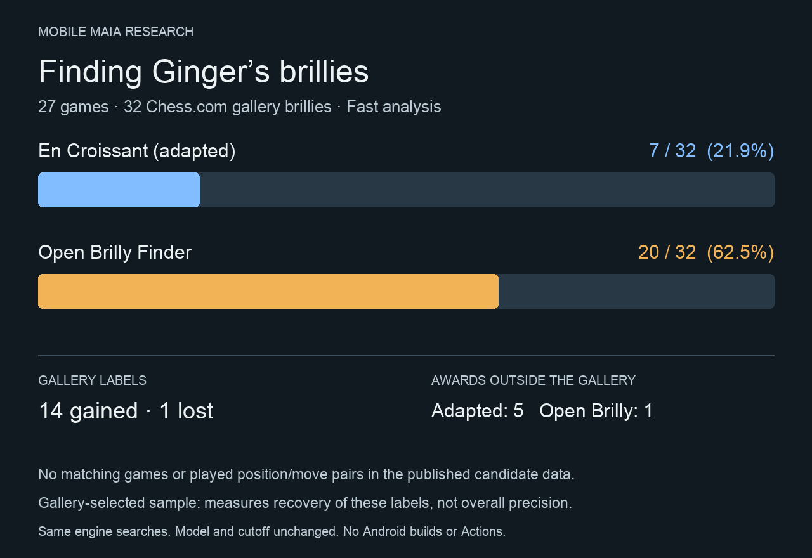

# Ginger: an independent brilliant-move comparison

On 27 Ginger_GM games outside the published development data, En Croissant (adapted) recovered **7 of 32** gallery Brilliants (21.9%). Open Brilly Finder recovered **20 of 32** (62.5%). That is **+13 matching Brilliants**.

| Fast analysis | En Croissant (adapted) | Open Brilly Finder |
|---|---:|---:|
| Gallery Brilliants found | 7 | 20 |
| Gallery Brilliants missed | 25 | 12 |
| All Brilliant awards on Ginger moves | 12 | 21 |
| Awards outside the captured gallery | 5 | 1 |

The new detector gained 14 gallery labels and lost 1 that the adapted En Croissant detector found.

## What the result means

The improvement survives outside the published development games: Open Brilly Finder recovers 13 more of the 32 gallery labels. Its 62.5% hit rate is lower than the 86.3% in the earlier development-heavy 42-game comparison, so that earlier rate should not be treated as a general expectation. This independent sample supports the planned 2.7 adoption, while showing that 12 gallery brillies are still missed.

One gallery brilly is lost: [14...Nxe4 against 98766789Maverick](https://www.chess.com/analysis/game/live/186807227802?move=27). The adapted En Croissant detector calls it Brilliant; Open Brilly Finder calls it Interesting. Its baseline model score is 0.6932, below the unchanged 0.8193 cutoff.

The one remaining outside-gallery award, [12.Nb5 against Blunder_Punisher01](https://www.chess.com/analysis/game/live/187353132044?move=22), is shared by both detectors. Open Brilly Finder introduces no new outside-gallery awards in this sample.

## What this tests

The earlier online comparison reused development games. This follow-up uses a frozen sample from another account. We checked all mainline position-and-move pairs against the published candidate table, not just game IDs. Three of the initial 30 games repeated training positions and were excluded entirely, without replacements. The retained 27 games have no matching games or candidate position-and-move pairs in that public data. Ginger does not appear as either player in its original 7,019-game gallery collection.

Both detectors used the actual Mobile Maia code and identical fresh Stockfish 18 searches: Fast, depth 12 / 500 ms, one thread, 64 MiB hash, two lines. Each retained its ordinary six-search-unit confirmation budget. The published model and 0.8193002847777424 cutoff were unchanged. We analyzed 1,864 positions and scored Ginger’s 922 moves.

This measures recovery of Chess.com’s captured gallery labels on games selected for containing brillies. It does not measure precision across ordinary games or all players. An award outside the gallery is a disagreement, not automatically a false positive. A fresh Game Review may produce different labels.

[Frozen plan](PLAN.md) · [Training-overlap audit](overlap-audit.json) · [All recorded results](summary.json) · [Native searches and decisions](engine-runs.json.gz) · [Visual move-by-move report](comparison.html)

## Every game

| Date | Game | Gallery !! | En Croissant (adapted) found | Open Brilly Finder found | Outside gallery: adapted / new |
|---|---|---:|---:|---:|---:|
| 2026/11/27 | [NechepurenkoRV – Ginger_GM](https://www.chess.com/game/live/188136844746) | 1 | 1 | 1 | 0 / 0 |
| 2026/11/24 | [Ginger_GM – Cayse](https://www.chess.com/game/live/189854753175) | 1 | 0 | 0 | 0 / 0 |
| 2026/11/24 | [AlexPapasimakopoulos – Ginger_GM](https://www.chess.com/game/live/189853553123) | 2 | 0 | 1 | 0 / 0 |
| 2026/11/24 | [kucing_72 – Ginger_GM](https://www.chess.com/game/live/187896748818) | 1 | 0 | 1 | 0 / 0 |
| 2026/11/18 | [Ginger_GM – Moradayoub1573](https://www.chess.com/game/live/187459649420) | 1 | 0 | 0 | 0 / 0 |
| 2026/11/18 | [Ginger_GM – sykvio](https://www.chess.com/game/live/187457958048) | 1 | 0 | 1 | 1 / 0 |
| 2026/11/16 | [Ginger_GM – Blunder_Punisher01](https://www.chess.com/game/live/187353132044) | 2 | 0 | 1 | 2 / 1 |
| 2026/11/16 | [Blunder_Punisher01 – Ginger_GM](https://www.chess.com/game/live/187352976104) | 4 | 1 | 3 | 0 / 0 |
| 2026/11/13 | [alpope – Ginger_GM](https://www.chess.com/game/live/187106742030) | 1 | 1 | 1 | 0 / 0 |
| 2026/11/13 | [Ginger_GM – Forgetmenow2k6](https://www.chess.com/game/live/187104408324) | 1 | 0 | 0 | 0 / 0 |
| 2026/11/12 | [Talcrifice – Ginger_GM](https://www.chess.com/game/live/187052146336) | 1 | 1 | 1 | 0 / 0 |
| 2026/11/10 | [rasmussvane – Ginger_GM](https://www.chess.com/game/live/188642299209) | 1 | 0 | 1 | 0 / 0 |
| 2026/11/10 | [Juliodiaz_2002 – Ginger_GM](https://www.chess.com/game/live/186895306980) | 1 | 0 | 1 | 0 / 0 |
| 2026/11/08 | [98766789Maverick – Ginger_GM](https://www.chess.com/game/live/186807227802) | 1 | 1 | 0 | 0 / 0 |
| 2026/11/08 | [Ginger_GM – MaximusDecimIV](https://www.chess.com/game/live/186804298306) | 1 | 1 | 1 | 1 / 0 |
| 2026/11/08 | [Ginger_GM – GetThePartyStarted](https://www.chess.com/game/live/186798917398) | 1 | 0 | 1 | 0 / 0 |
| 2026/11/08 | [AgentKimR – Ginger_GM](https://www.chess.com/game/live/186787690334) | 1 | 0 | 0 | 0 / 0 |
| 2026/11/08 | [Ginger_GM – AgentKimR](https://www.chess.com/game/live/186786230002) | 1 | 0 | 0 | 0 / 0 |
| 2026/11/08 | [Ginger_GM – GodzillaChessYoutube](https://www.chess.com/game/live/186771033900) | 1 | 1 | 1 | 0 / 0 |
| 2026/11/07 | [Ginger_GM – Qullanif](https://www.chess.com/game/live/186706231870) | 1 | 0 | 1 | 0 / 0 |
| 2026/11/07 | [Ginger_GM – MaevskiyNikolay](https://www.chess.com/game/live/186704873752) | 1 | 0 | 1 | 0 / 0 |
| 2026/11/07 | [6JoshuaKimmich – Ginger_GM](https://www.chess.com/game/live/186701606880) | 1 | 0 | 0 | 0 / 0 |
| 2026/11/07 | [Sanjeev_18 – Ginger_GM](https://www.chess.com/game/live/186700377930) | 1 | 0 | 1 | 0 / 0 |
| 2026/11/07 | [YegoryoCh – Ginger_GM](https://www.chess.com/game/live/186700239458) | 1 | 0 | 0 | 1 / 0 |
| 2026/11/06 | [Ginger_GM – Nasledstvo67](https://www.chess.com/game/live/186659807318) | 1 | 0 | 1 | 0 / 0 |
| 2026/11/05 | [GMG – Ginger_GM](https://www.chess.com/game/live/186573944216) | 1 | 0 | 0 | 0 / 0 |
| 2026/11/05 | [Ginger_GM – Tiraturyan_Chessmood1991](https://www.chess.com/game/live/186573774294) | 1 | 0 | 1 | 0 / 0 |

## Every reference move and additional award

“Outside gallery” means it was not among the frozen gallery cards for this sample. Both detector columns show the final app classification, after evidence checks.

| Game | Move | Captured gallery | En Croissant (adapted) | Open Brilly Finder |
|---|---|---|---|---|
| NechepurenkoRV – Ginger_GM | [38...Qd2](https://www.chess.com/analysis/game/live/188136844746?move=75) | Brilliant !! | brilliant | brilliant |
| Ginger_GM – Cayse | [35.Qxh5](https://www.chess.com/analysis/game/live/189854753175?move=68) | Brilliant !! | interesting | interesting |
| AlexPapasimakopoulos – Ginger_GM | [12...Nxe4](https://www.chess.com/analysis/game/live/189853553123?move=23) | Brilliant !! | good | brilliant |
| AlexPapasimakopoulos – Ginger_GM | [34...Rxf2+](https://www.chess.com/analysis/game/live/189853553123?move=67) | Brilliant !! | no annotation | no annotation |
| kucing_72 – Ginger_GM | [14...Nxd4](https://www.chess.com/analysis/game/live/187896748818?move=27) | Brilliant !! | interesting | brilliant |
| Ginger_GM – Moradayoub1573 | [27.Bxe7](https://www.chess.com/analysis/game/live/187459649420?move=52) | Brilliant !! | no annotation | no annotation |
| Ginger_GM – sykvio | [14.exf6](https://www.chess.com/analysis/game/live/187457958048?move=26) | Outside gallery | brilliant | interesting |
| Ginger_GM – sykvio | [18.Nd5](https://www.chess.com/analysis/game/live/187457958048?move=34) | Brilliant !! | no annotation | brilliant |
| Ginger_GM – Blunder_Punisher01 | [12.Nb5](https://www.chess.com/analysis/game/live/187353132044?move=22) | Outside gallery | brilliant | brilliant |
| Ginger_GM – Blunder_Punisher01 | [20.Nb4](https://www.chess.com/analysis/game/live/187353132044?move=38) | Brilliant !! | mistake | mistake |
| Ginger_GM – Blunder_Punisher01 | [22.Rxd7+](https://www.chess.com/analysis/game/live/187353132044?move=42) | Brilliant !! | interesting | brilliant |
| Ginger_GM – Blunder_Punisher01 | [23.Rd1+](https://www.chess.com/analysis/game/live/187353132044?move=44) | Outside gallery | brilliant | interesting |
| Blunder_Punisher01 – Ginger_GM | [13...Bxh2+](https://www.chess.com/analysis/game/live/187352976104?move=25) | Brilliant !! | brilliant | brilliant |
| Blunder_Punisher01 – Ginger_GM | [15...Bh2+](https://www.chess.com/analysis/game/live/187352976104?move=29) | Brilliant !! | interesting | brilliant |
| Blunder_Punisher01 – Ginger_GM | [16...Qe8](https://www.chess.com/analysis/game/live/187352976104?move=31) | Brilliant !! | interesting | interesting |
| Blunder_Punisher01 – Ginger_GM | [20...Rh1+](https://www.chess.com/analysis/game/live/187352976104?move=39) | Brilliant !! | interesting | brilliant |
| alpope – Ginger_GM | [29...Qa5](https://www.chess.com/analysis/game/live/187106742030?move=57) | Brilliant !! | brilliant | brilliant |
| Ginger_GM – Forgetmenow2k6 | [18.Ne4](https://www.chess.com/analysis/game/live/187104408324?move=34) | Brilliant !! | no annotation | no annotation |
| Talcrifice – Ginger_GM | [18...fxg3](https://www.chess.com/analysis/game/live/187052146336?move=35) | Brilliant !! | brilliant | brilliant |
| rasmussvane – Ginger_GM | [26...Rxf2](https://www.chess.com/analysis/game/live/188642299209?move=51) | Brilliant !! | interesting | brilliant |
| Juliodiaz_2002 – Ginger_GM | [21...Rxg5](https://www.chess.com/analysis/game/live/186895306980?move=41) | Brilliant !! | no annotation | brilliant |
| 98766789Maverick – Ginger_GM | [14...Nxe4](https://www.chess.com/analysis/game/live/186807227802?move=27) | Brilliant !! | brilliant | interesting |
| Ginger_GM – MaximusDecimIV | [18.Nxe4](https://www.chess.com/analysis/game/live/186804298306?move=34) | Brilliant !! | brilliant | brilliant |
| Ginger_GM – MaximusDecimIV | [24.Kd2](https://www.chess.com/analysis/game/live/186804298306?move=46) | Outside gallery | brilliant | interesting |
| Ginger_GM – GetThePartyStarted | [17.Nd6](https://www.chess.com/analysis/game/live/186798917398?move=32) | Brilliant !! | interesting | brilliant |
| AgentKimR – Ginger_GM | [14...Bg4](https://www.chess.com/analysis/game/live/186787690334?move=27) | Brilliant !! | interesting | interesting |
| Ginger_GM – AgentKimR | [26.Nf5](https://www.chess.com/analysis/game/live/186786230002?move=50) | Brilliant !! | no annotation | no annotation |
| Ginger_GM – GodzillaChessYoutube | [24.Nxc5](https://www.chess.com/analysis/game/live/186771033900?move=46) | Brilliant !! | brilliant | brilliant |
| Ginger_GM – Qullanif | [14.Nd5](https://www.chess.com/analysis/game/live/186706231870?move=26) | Brilliant !! | interesting | brilliant |
| Ginger_GM – MaevskiyNikolay | [28.Nh5](https://www.chess.com/analysis/game/live/186704873752?move=54) | Brilliant !! | interesting | brilliant |
| 6JoshuaKimmich – Ginger_GM | [6...a4](https://www.chess.com/analysis/game/live/186701606880?move=11) | Brilliant !! | interesting | interesting |
| Sanjeev_18 – Ginger_GM | [16...Nxf2](https://www.chess.com/analysis/game/live/186700377930?move=31) | Brilliant !! | interesting | brilliant |
| YegoryoCh – Ginger_GM | [16...Rxf3](https://www.chess.com/analysis/game/live/186700239458?move=31) | Brilliant !! | dubious | dubious |
| YegoryoCh – Ginger_GM | [19...Nxg4](https://www.chess.com/analysis/game/live/186700239458?move=37) | Outside gallery | brilliant | interesting |
| Ginger_GM – Nasledstvo67 | [19.Rxh5](https://www.chess.com/analysis/game/live/186659807318?move=36) | Brilliant !! | interesting | brilliant |
| GMG – Ginger_GM | [22...Nf4](https://www.chess.com/analysis/game/live/186573944216?move=43) | Brilliant !! | dubious | dubious |
| Ginger_GM – Tiraturyan_Chessmood1991 | [23.Qe7](https://www.chess.com/analysis/game/live/186573774294?move=44) | Brilliant !! | no annotation | brilliant |

## PGN downloads

These exports mark only Ginger’s Brilliant moves, matching the scoring scope.

- [En Croissant (adapted)](old-awards.pgn)
- [Open Brilly Finder](new-awards.pgn)
- [Captured gallery labels](gallery-labels.pgn)

No Android builds, GitHub Actions, LFS downloads or model training.

## Other analysis modes

The [Balanced and Thorough follow-up](modes/REPORT.md) tests the same frozen
sample and retains the original Fast results above. It includes every reference
move, completed search depths and raw model-score shifts.
