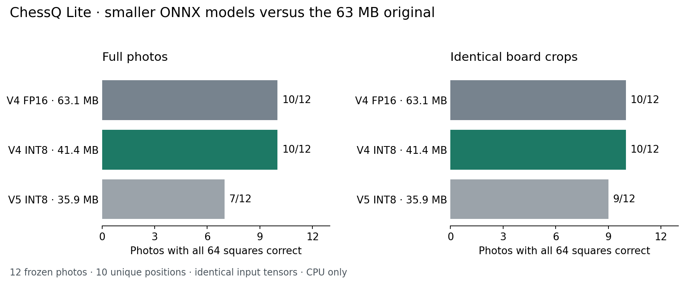
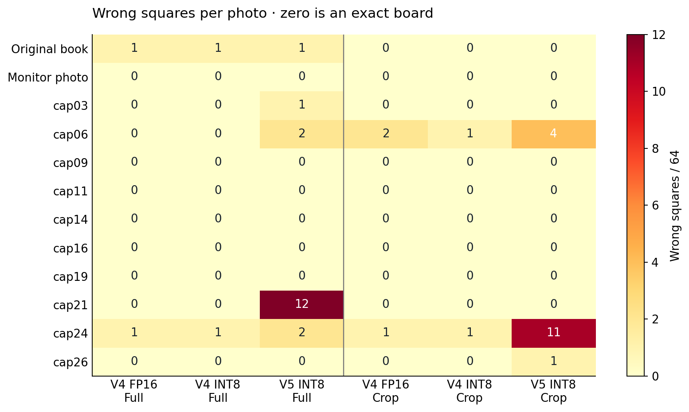
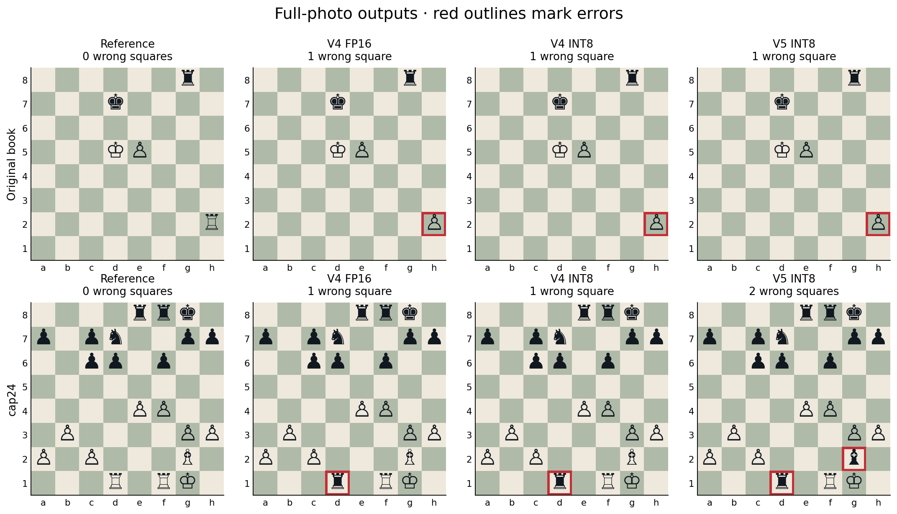
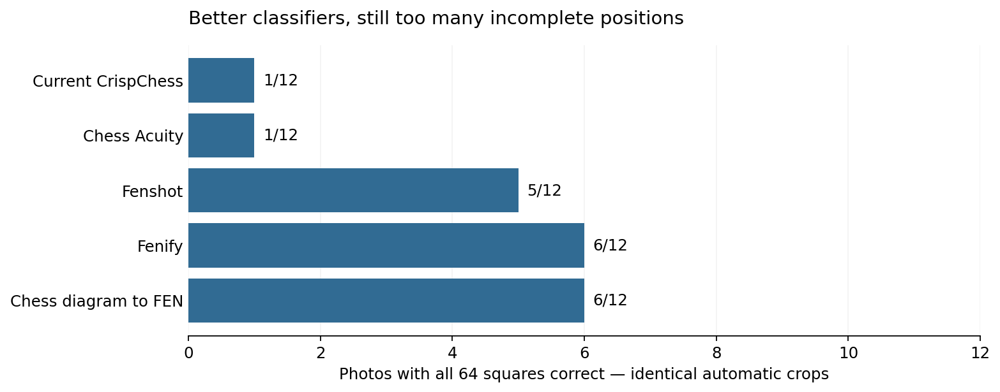
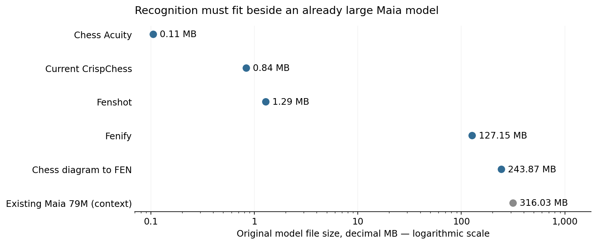
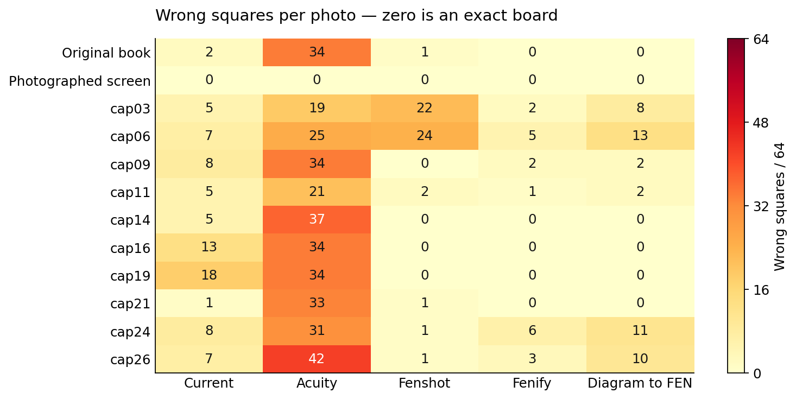
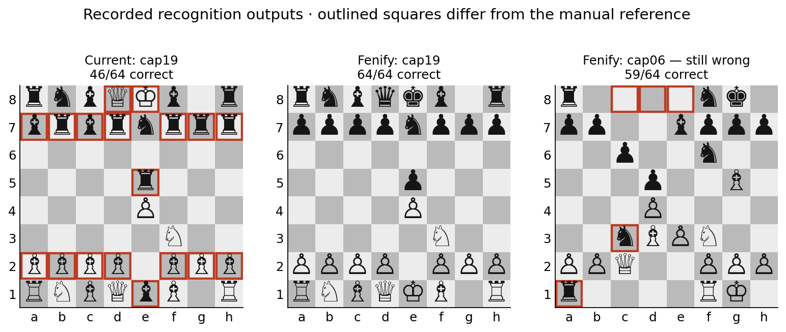

# Offline board recognition: acceptable V4 INT8 accuracy; release decision pending

**November 13, 2026 investigation · Updated November 15, 2026 · Mobile Maia research**

> **November 23, 2026 follow-up.** We trained our own 3.5 MB model and compared
> it with ChessQ Lite V4, Fenshot and Fenify on 88 new photos and 1,650 screen
> boards: [Open Board Scanner report](https://github.com/Dash1971/open-board-scanner/blob/main/REPORT.md). Its models are noncommercial,
> and inclusion in Mobile Maia is pending a licensing review. The findings
> below are unchanged.

We wanted an open, lightweight model that could turn a photograph of a printed
chess diagram or an on-screen board into an editable position, entirely offline.
The model and runtime needed to fit Mobile Maia's free-software distribution
requirements, including F-Droid, without a nonfree service or restricted model.

**We now consider ChessQ Lite V4 INT8's accuracy acceptable on the supplied test
set for the proposed scan-to-Board Editor workflow.** Its 41.4 MB ONNX file
matched the 63.1 MB V4 model on all twelve full-photo placements: ten complete
positions correct and two single-square mistakes. It also made one fewer square
error on the shared board crops. The smaller V5 INT8 model performed worse.

**We have not decided to restore or ship scanning.** APK size and the model's
noncommercial license remain product and distribution trade-offs to consider
before making that decision. Android performance and broader accuracy remain
unverified. The plan does not depend on obtaining a more permissive license.
Preview 2.6.0-beta.3 has withdrawn the earlier scanner; manual Board Editor,
FEN import, Analysis and Continue from here remain available.

The original November 13 screening found no candidate satisfying the combined
accuracy, small-footprint and unrestricted-license goals. The follow-up below
changes our accuracy assessment; the original results remain preserved afterward.

This is a project decision based on twelve photos, not a representative accuracy
guarantee, a verdict on upstream projects, or an official F-Droid assessment.

## November 15 follow-up: the smaller ONNX models

An [En Croissant discussion](https://github.com/franciscoBSalgueiro/en-croissant/discussions/1104)
led us to its [ChessQ integration](https://github.com/franciscoBSalgueiro/en-croissant/pull/1052).
We first tested its exact installed V4 FP16 weights, then the quantized ONNX
files used by Lichess. All three models received identical cached input tensors,
using the same upstream antialiased resize to 644 pixels and ImageNet
normalization. Full photos and the previous common 512-pixel crops were scored
as separate fixed routes; we did not choose a crop, rotation or model per photo
using its known answer. The V4 FP16 control reproduced all 24 earlier placements.

| Model | Original file size | Exact full photos / 12 | Wrong squares / 768 | Exact common crops / 12 | Wrong squares / 768 |
| --- | ---: | ---: | ---: | ---: | ---: |
| ChessQ Lite V4 FP16, En Croissant weights | 63.15 MB | 10 | 2 | 10 | 3 |
| **ChessQ Lite V4 INT8, ONNX** | **41.37 MB** | **10** | **2** | **10** | **2** |
| ChessQ Lite V5 INT8, ONNX | 35.91 MB | 7 | 18 | 9 | 16 |

V4 INT8 saves 21.78 MB, approximately 35%, against the tested FP16 file without
changing any full-photo placement on this set. Its two remaining full-photo
mistakes are the original book's h2 white rook read as a pawn and cap24's d1
white rook read as black. On cropped cap06, it removes a false pawn but still
adds a false rook. V5 introduces further errors: full-photo cap21 comes out
rotated 180 degrees with a predicted Black viewing direction, while that crop
is correct. Direction predictions were recorded, not used to choose a corrected
FEN from the known answer.

We find **V4 INT8 acceptable for further product consideration**. This accepts
the observed accuracy for an editable-position workflow, not every recognition
as correct. All twelve photos had already been examined in this investigation;
they cover ten positions, eleven book photos and one photo of a monitor. This
is not a new holdout set or a broad direct-screenshot/physical-board benchmark.

The models ran locally on a Mac ARM64 CPU with four threads. Mean inference
times were about 0.25 seconds for PyTorch V4 FP16, 0.49 seconds for ONNX V4 INT8,
and 0.47 seconds for ONNX V5 INT8. The different inference backends mean those
figures do not isolate the speed effect of quantization. We did not measure
Android latency, per-model phone memory or an integrated APK.

### APK size remains a decision

The [historical Preview beta.2 APK](https://github.com/Dash1971/maia-chess-android-preview/releases/tag/v2.6.0-beta.2)
was 456.79 MB. Reading only its ZIP index showed 101.01 MB of ARM32 and x86-64
native-library payload. Subtracting those entries gives an illustrative
ARM64-only estimate of 355.78 MB; adding the 41.37 MB model gives about
397.15 MB before model compression, ZIP alignment, integration/runtime changes
and removal of the old scanner asset. This is arithmetic from a historical
artifact, **not a built or qualified APK**, and not a size claim for beta.3.
The [archive measurements](data/chessq/apk-size-assessment.json) retain the basis.

ARM64-only packaging could offset the model's download/storage cost, but would
exclude ARM32-only and x86-64 devices unless we retain other distributions.
It would not offset scanner inference RAM. Architecture coverage, delivery
options, release verification and the actual integrated size must be weighed
before changing distribution; this report authorizes no packaging change.

### Evaluate the published license, without assuming an exception

The tested code/model releases use **PolyForm Noncommercial 1.0.0**. The
[author welcomes permitted noncommercial uses](https://chessq.org/about),
including Lichess. A project's FLOSS application code does not change the
separate model terms. Commercial restrictions also limit downstream reuse;
the [Open Source Definition](https://opensource.org/osd) requires freedom of
redistribution and use in business.

F-Droid's [inclusion policy](https://f-droid.org/en/docs/Inclusion_Policy/)
requires FLOSS applications while allowing some nonfree nonfunctional assets;
its [Non-Free Assets flag](https://f-droid.org/en/docs/Anti-Features/#NonFreeAssets)
covers some such assets. We have not obtained a maintainer determination for
these functional recognition weights. Neither automatic rejection nor acceptance
without an anti-feature has been established. Our preference for unrestricted
reuse and avoiding anti-features remains a trade-off to evaluate explicitly.

**No more permissive grant has been obtained for Mobile Maia, and the plan does
not depend on receiving one.** Lichess's public distribution uses the
noncommercial model terms; we have no evidence that a separate request was
made or refused. No author outreach was performed in this investigation.

Before a shipping decision, assess the existing terms and our distribution
goals, the actual APK/storage and device-support costs, and Android performance.
Broader unseen photos should establish how well this small-set result carries
over. Accuracy is acceptable for consideration; the overall shipping decision
remains open.

Recorded [predictions](data/chessq/predictions.json),
[recomputed metrics](data/chessq/metrics.json),
[per-photo table](data/chessq/per-photo.csv),
[model pins](data/chessq/model-pins.json),
[protocol](data/chessq/protocol.json) and
[runtime details](data/chessq/runtime.json) retain the follow-up evidence.
Both ONNX files were retrieved directly from Lichess over HTTPS and verified
against published hashes; no Git LFS downloads, photo uploads, Android builds
or GitHub Actions were used. Temporary models/environments were cleaned.

## Original November 13 comparison

### What we compared on November 13

This section preserves the original comparison. ChessQ was screened but not
benchmarked at that stage; its later measurements are in the follow-up above.

Twelve phone photos cover ten unique positions: an original book photo, a photo
of a chessboard displayed on a monitor, and ten additional book-diagram photos.
Two pairs in the additional set repeat positions. The first two photos had
already informed preprocessing work; the ten later photos exposed its failure
to generalize. This is a small, difficult personal test set, not a representative
benchmark of all books or screenshots.

For the model comparison, **every classifier received the same automatically
located, perspective-rectified board**. The frozen contour detector's best quad
was warped to 512 × 512 without its quality gate or contrast thresholding. Each
model then used its own upstream input preparation and class order. Inputs had
the same recorded orientation correction; scoring did not choose whichever
rotation best matched the answer. Expected placements were manually transcribed
before inference. A complete board counts only when all 64 squares agree.

These results isolate classification after a shared crop. **They are not
full-photo scanner success rates.** Some crops are themselves poor, especially
on curved pages, and were deliberately kept identical across models.

| Model | Original file size¹ | Exact boards / 12 | Wrong squares / 768 | License and source findings | Decision |
| --- | ---: | ---: | ---: | --- | --- |
| [Current CrispChess](https://github.com/CrispStrobe/CrispChess) | 0.84 MB | 1 | 79 | Weight-specific MIT grant; published training source. Existing app decoder retained. | Small enough; recognition insufficient. |
| [Chess Acuity](https://github.com/alexostar/chess-acuity-app) | 0.11 MB | 1 | 344 | GPL-3.0 project includes TFLite model and training/export code; documents openly licensed training artwork. | Very small; poor results on these printed diagrams. |
| [Fenshot](https://github.com/scoriiu/fenshot) | 1.29 MB | 5 | 52 | MIT package includes ONNX model and training pipeline. Training includes Chess.com CDN artwork, described as training-only input; not redistributed here. | Best small candidate tested; not reliable enough. |
| [Fenify](https://github.com/notnil/fenify) | 127.15 MB | 6 | 19 | MIT project; original release weights and training notebook available. No separate weight-specific license statement found; explicit confirmation needed before bundling. Some training data are private book scans. | Best classification result here; still only half the photos exact and a large addition. |
| [Chess diagram to FEN](https://github.com/tsoj/Chess_diagram_to_FEN) | 243.87 MB² | 6 | 46 | MIT project and training code. Separate weight/base-model/artwork provenance needs documentation before bundling. | Large; no accuracy advantage over Fenify on this set. |
| [ChessQ Lite / Lichess image import](https://chessq.org/about), initial screening | Not measured then | Not tested then | Not tested then | Author places published code and weights, including Lite, under PolyForm Noncommercial 1.0.0. | Not benchmarked on November 13; the November 15 follow-up now records acceptable V4 INT8 accuracy. |

¹ Decimal MB, measured original model files, not APK growth, peak RAM or an
optimized Android export. No compression/quantization savings are assumed.
² Position-classifier weights only; its other detection/orientation models
would add further size. Its full learned-detector pipeline was not tested.

The existing Preview Maia 79M ONNX file is **316,034,244 bytes (316.03 MB)**,
according to its [pinned LFS pointer](https://github.com/Dash1971/maia-chess-android-preview/blob/f4dcc31fdef0bc4b33cc30639bb4db39393930d8/assets/models/maia3-79m.onnx).
“79M” is the parameter-count name, not a 79 MB download. Its size was read from
metadata without downloading the weights. An additional 127–244 MB recognizer
is a material product cost for an offline app that already carries Maia.
We did not establish a numerical size cutoff; the requirement was a small
increment with dependable recognition, not merely any model that can run locally.

## Where the errors occurred

Fenify reduced the total wrong squares from 79 to 19 on common crops, but those
19 errors still affect six photos. Fenshot fixed several severe piece-type
confusions but was worse than the current model on two photos. An average
per-square score can conceal an unusable complete position, especially on a
sparse endgame board. We therefore prioritize exact complete boards and retain
every failure, rather than reporting only the best example or choosing a model
per photo using its known answer.

These boards are redrawn from recorded inference outputs. Outlines mark
disagreements with the manual reference. They are not generated illustrations of
an imagined successful scan. Raw photos and copyrighted book pages are not
republished; the [recorded placements and errors](data/predictions.json) and
[per-photo comparison CSV](data/per-photo.csv) are public.

## Full-photo detection was another problem

We also measured complete detection/preprocessing/classification routes on the
same twelve oriented photos. Do not mix this table with the classifier table.

| Full-photo route | Exact boards / 12 | No result / 12 | Interpretation |
| --- | ---: | ---: | --- |
| Current app algorithms, local CPU reproduction | 1 | 1 | The other ten returned incorrect placements. |
| Frozen contour/perspective/contrast prototype, current model | 2 | 3 | Fixed both original development photos; none of the ten additional photos was exact. |
| Fenshot upstream detection/classification route | 1 | 5 | Original book photo exact; none of the ten additional photos exact. Some failures were empty-board readings. |

The frozen prototype was not a successful app fix. Its preprocessing policy was
frozen before examining the ten additional photos; it then generalized poorly.
Additional contrast experiments did not establish a dependable fixed policy.
Fenshot's small classifier is promising on common crops, but swapping in its
entire detector was not a solution either. Applying the app's unchanged
rule-assisted decoder to Fenshot probabilities did not improve its exact-board
count on the common crops.

The local current-algorithm rerun uses the pinned model and Dart preprocessing/
decoder with CPU ONNX Runtime. It is not a byte-identical replay of the APK's
camera/decode inputs: the tester's original crop and native pixels were not
recorded. The phone screenshot of the original book result showed two errors,
whereas the shared JPEG's local baseline had one. We do not substitute the
local result for what the tester actually saw.

## Original license screening and F-Droid

Being offline does not make a model free software, and a permissive backbone
license does not override restrictions on fine-tuned weights. The
[ChessQ author's licensing statement](https://chessq.org/about) explicitly
includes ChessQ Lite in the noncommercial grant. Lichess's ability to use that
model as a nonprofit is not an unrestricted redistribution grant for our goal.

F-Droid's [inclusion policy](https://f-droid.org/en/docs/Inclusion_Policy/)
requires FLOSS applications and dependencies, suitable rights for assets, and
build transparency. MIT and GPL projects are viable starting points; a
repository license alone is not official F-Droid approval of a particular model
integration. We distinguish code, released weights, runtime and provenance.
Private or mixed training inputs are a provenance limitation here; we do not
claim they automatically determine the copyright or F-Droid classification of
the resulting weights.

Other leads were screened but not benchmarked:

| Lead | Finding | Why it did not resolve this investigation |
| --- | --- | --- |
| [ChessML](https://github.com/arlegotin/chessml/blob/main/LICENSE) | Repository license is CC BY-NC-ND 4.0. | Does not meet our unrestricted/FLOSS requirement. |
| [2d-chess-ocr](https://github.com/AndrewSpano/2d-chess-ocr) | Model-family and base-weight licenses need separate review. RF-DETR-2XL has a noncommercial base-model grant; that does not describe every offered variant. | Hosted LFS weights were not downloaded under the task's no-LFS constraint; no local results claimed. |
| Latest CrispChess weights | Same model blob as the pinned app model when checked. | No newer classifier weights to upgrade to. |

The conclusions concern the checked revisions and stated licenses on the study
date. No license exception was requested or obtained, and no official F-Droid
review of these alternatives was performed.

## Decision history and current status

On November 13 we shelved recognition because no screened candidate met the
combined goals. Preview beta.3 subsequently removed the original prototype.
On November 15 the ChessQ tests changed the accuracy conclusion: **V4 INT8 is
acceptable on this set**, with shipping still undecided pending APK-size,
licensing/distribution and Android trade-offs described above. V5 INT8 is not
preferred on these photos. Manual editor/FEN workflows remain available, and
the withdrawn scanner has not been restored by this research update.

## Evidence and limits

- [Recorded predictions and manual references](data/predictions.json),
  [recomputed metrics](data/metrics.json), and [per-photo CSV](data/per-photo.csv).
- [Source revisions, weight sizes and SHA-256 hashes](data/source-pins.json),
  [common-frame hashes/quads](data/frame-hashes.json), and
  [runtime versions](data/runtime-versions.json).
- [Verification and reproduction guide](README.md), including executed harness
  snapshots and upstream license notices. Public scoring/figure reproduction
  needs no model or network access. Repeating inference requires the private
  inputs and original weights; the public bundle is not a new public dataset.

All inference ran locally on a desktop CPU. No photos were uploaded to a
recognition service. No Android APKs, GitHub Actions runs or Git LFS downloads
were used for this investigation or its publication. Models and temporary
environments were cleaned after retaining compact evidence. Android export,
phone latency, peak memory and quantized-model quality were not measured.
