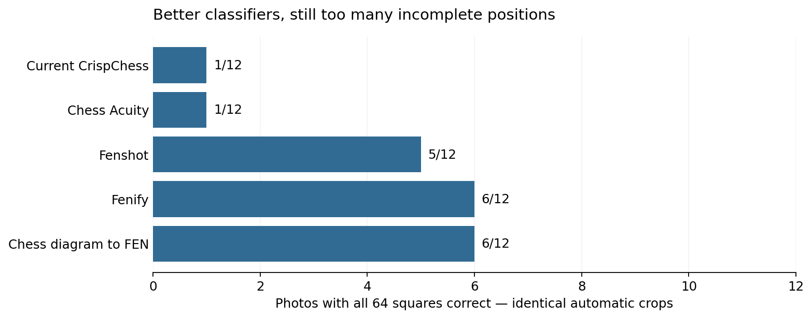
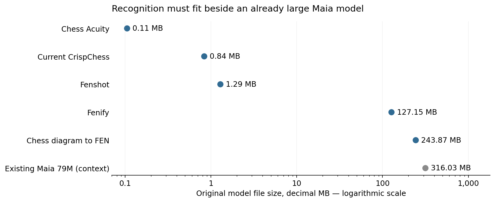
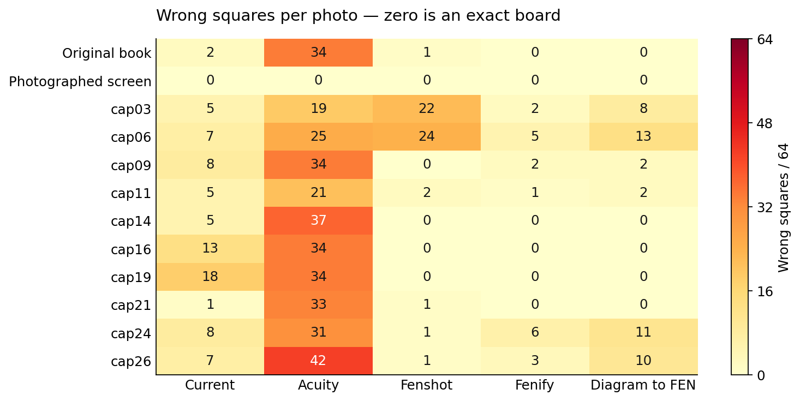
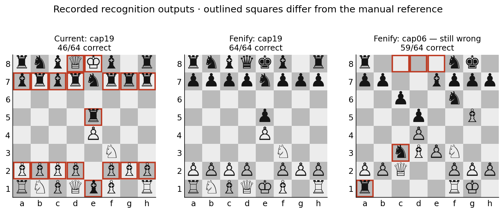

# Offline board recognition: no suitable lightweight model found

**13 November 2026 · Mobile Maia research · Plan shelved**

We wanted an open, lightweight model that could turn a photograph of a printed
chess diagram or an on-screen board into an editable position, entirely offline.
The model and runtime needed to fit Mobile Maia's free-software distribution
requirements, including F-Droid, without a nonfree service or restricted model.

**We did not find a candidate suitable enough to ship.** Small models were
unreliable on the supplied photos. Larger models improved classification, but
still produced incorrect positions and would add substantial weight alongside
Maia. ChessQ Lite, which powers Lichess's image import, has a noncommercial
licence and does not meet our unrestricted-model requirement. We have shelved
camera/image recognition and are preparing its removal from Preview. Manual
Board Editor, FEN import, Analysis and Continue from here remain useful without it.

This is the outcome of this investigation, not a claim that a suitable model
cannot exist, a verdict on upstream projects, or an official F-Droid assessment.

## What we compared

Twelve phone photos cover ten unique positions: an original book photo, a photo
of a chessboard displayed on a monitor, and ten additional book-diagram photos.
Two pairs in the additional set repeat positions. The first two photos had
already informed preprocessing work; the ten later photos exposed its failure
to generalize. This is a small, difficult personal test set, not a representative
benchmark of all books or screenshots.

For the model comparison, **every classifier received the same automatically
located, perspective-rectified board**. The frozen contour detector's best quad
was warped to 512 × 512 without its quality gate or contrast thresholding. Each
model then used its own upstream input preparation and class order. Inputs had
the same recorded orientation correction; scoring did not choose whichever
rotation best matched the answer. Expected placements were manually transcribed
before inference. A complete board counts only when all 64 squares agree.

These results isolate classification after a shared crop. **They are not
full-photo scanner success rates.** Some crops are themselves poor, especially
on curved pages, and were deliberately kept identical across models.

| Model | Original file size¹ | Exact boards / 12 | Wrong squares / 768 | Licence and source findings | Decision |
| --- | ---: | ---: | ---: | --- | --- |
| [Current CrispChess](https://github.com/CrispStrobe/CrispChess) | 0.84 MB | 1 | 79 | Weight-specific MIT grant; published training source. Existing app decoder retained. | Small enough; recognition insufficient. |
| [Chess Acuity](https://github.com/alexostar/chess-acuity-app) | 0.11 MB | 1 | 344 | GPL-3.0 project includes TFLite model and training/export code; documents openly licensed training artwork. | Very small; poor results on these printed diagrams. |
| [Fenshot](https://github.com/scoriiu/fenshot) | 1.29 MB | 5 | 52 | MIT package includes ONNX model and training pipeline. Training includes Chess.com CDN artwork, described as training-only input; not redistributed here. | Best small candidate tested; not reliable enough. |
| [Fenify](https://github.com/notnil/fenify) | 127.15 MB | 6 | 19 | MIT project; original release weights and training notebook available. No separate weight-specific licence statement found; explicit confirmation needed before bundling. Some training data are private book scans. | Best classification result here; still only half the photos exact and a large addition. |
| [Chess diagram to FEN](https://github.com/tsoj/Chess_diagram_to_FEN) | 243.87 MB² | 6 | 46 | MIT project and training code. Separate weight/base-model/artwork provenance needs documentation before bundling. | Large; no accuracy advantage over Fenify on this set. |
| [ChessQ Lite / Lichess image import](https://chessq.org/about) | Not measured | Not tested | Not tested | Author explicitly places published code and weights, including Lite, under PolyForm Noncommercial 1.0.0. | Excluded for licence restrictions; no local accuracy claim. |

¹ Decimal MB, measured original model files, not APK growth, peak RAM or an
optimized Android export. No compression/quantization savings are assumed.
² Position-classifier weights only; its other detection/orientation models
would add further size. Its full learned-detector pipeline was not tested.

The existing Preview Maia 79M ONNX file is **316,034,244 bytes (316.03 MB)**,
according to its [pinned LFS pointer](https://github.com/Dash1971/maia-chess-android-preview/blob/f4dcc31fdef0bc4b33cc30639bb4db39393930d8/assets/models/maia3-79m.onnx).
“79M” is the parameter-count name, not a 79 MB download. Its size was read from
metadata without downloading the weights. An additional 127–244 MB recognizer
is a material product cost for an offline app that already carries Maia.
We did not establish a numerical size cutoff; the requirement was a small
increment with dependable recognition, not merely any model that can run locally.

## Where the errors occurred

Fenify reduced the total wrong squares from 79 to 19 on common crops, but those
19 errors still affect six photos. Fenshot fixed several severe piece-type
confusions but was worse than the current model on two photos. An average
per-square score can conceal an unusable complete position, especially on a
sparse endgame board. We therefore prioritize exact complete boards and retain
every failure, rather than reporting only the best example or choosing a model
per photo using its known answer.

These boards are redrawn from recorded inference outputs. Outlines mark
disagreements with the manual reference. They are not generated illustrations of
an imagined successful scan. Raw photos and copyrighted book pages are not
republished; the [recorded placements and errors](data/predictions.json) and
[per-photo comparison CSV](data/per-photo.csv) are public.

## Full-photo detection was another problem

We also measured complete detection/preprocessing/classification routes on the
same twelve oriented photos. Do not mix this table with the classifier table.

| Full-photo route | Exact boards / 12 | No result / 12 | Interpretation |
| --- | ---: | ---: | --- |
| Current app algorithms, local CPU reproduction | 1 | 1 | The other ten returned incorrect placements. |
| Frozen contour/perspective/contrast prototype, current model | 2 | 3 | Fixed both original development photos; none of the ten additional photos was exact. |
| Fenshot upstream detection/classification route | 1 | 5 | Original book photo exact; none of the ten additional photos exact. Some failures were empty-board readings. |

The frozen prototype was not a successful app fix. Its preprocessing policy was
frozen before examining the ten additional photos; it then generalized poorly.
Additional contrast experiments did not establish a dependable fixed policy.
Fenshot's small classifier is promising on common crops, but swapping in its
entire detector was not a solution either. Applying the app's unchanged
rule-assisted decoder to Fenshot probabilities did not improve its exact-board
count on the common crops.

The local current-algorithm rerun uses the pinned model and Dart preprocessing/
decoder with CPU ONNX Runtime. It is not a byte-identical replay of the APK's
camera/decode inputs: the tester's original crop and native pixels were not
recorded. The phone screenshot of the original book result showed two errors,
whereas the shared JPEG's local baseline had one. We do not substitute the
local result for what the tester actually saw.

## Licence screening and F-Droid

Being offline does not make a model free software, and a permissive backbone
licence does not override restrictions on fine-tuned weights. The
[ChessQ author's licensing statement](https://chessq.org/about) explicitly
includes ChessQ Lite in the noncommercial grant. Lichess's ability to use that
model as a nonprofit is not an unrestricted redistribution grant for our goal.

F-Droid's [inclusion policy](https://f-droid.org/en/docs/Inclusion_Policy/)
requires FLOSS applications and dependencies, suitable rights for assets, and
build transparency. MIT and GPL projects are viable starting points; a
repository licence alone is not official F-Droid approval of a particular model
integration. We distinguish code, released weights, runtime and provenance.
Private or mixed training inputs are a provenance limitation here; we do not
claim they automatically determine the copyright or F-Droid classification of
the resulting weights.

Other leads were screened but not benchmarked:

| Lead | Finding | Why it did not resolve this investigation |
| --- | --- | --- |
| [ChessML](https://github.com/arlegotin/chessml/blob/main/LICENSE) | Repository licence is CC BY-NC-ND 4.0. | Does not meet our unrestricted/FLOSS requirement. |
| [2d-chess-ocr](https://github.com/AndrewSpano/2d-chess-ocr) | Model-family and base-weight licences need separate review. RF-DETR-2XL has a noncommercial base-model grant; that does not describe every offered variant. | Hosted LFS weights were not downloaded under the task's no-LFS constraint; no local results claimed. |
| Latest CrispChess weights | Same model blob as the pinned app model when checked. | No newer classifier weights to upgrade to. |

The conclusions concern the checked revisions and stated licences on the study
date. No licence exception was requested or obtained, and no official F-Droid
review of these alternatives was performed.

## Decision

**Shelve offline camera, screenshot and printed-diagram recognition for now.**
Keep the existing manual editor and FEN workflows, remove the exposed scan/import
entry points and their unused implementation/model, and avoid promising reliable
recognition from this prototype. Already published APKs remain historical
artifacts until a later release includes the removal.

Reconsider when a candidate combines an unrestricted, documented weight grant,
a small mobile footprint, and convincing exact-position results on independent
phone photos, including hatched diagrams and curved pages. The present work
does not prove that quantization, retraining or a stronger geometry model could
never succeed; those possibilities were not validated as a shipping solution.

## Evidence and limits

- [Recorded predictions and manual references](data/predictions.json),
  [recomputed metrics](data/metrics.json), and [per-photo CSV](data/per-photo.csv).
- [Source revisions, weight sizes and SHA-256 hashes](data/source-pins.json),
  [common-frame hashes/quads](data/frame-hashes.json), and
  [runtime versions](data/runtime-versions.json).
- [Verification and reproduction guide](README.md), including executed harness
  snapshots and upstream licence notices. Public scoring/figure reproduction
  needs no model or network access. Repeating inference requires the private
  inputs and original weights; the public bundle is not a new public dataset.

All inference ran locally on a desktop CPU. No photos were uploaded to a
recognition service. No Android APKs, GitHub Actions runs or Git LFS downloads
were used for this investigation or its publication. Models and temporary
environments were cleaned after retaining compact evidence. Android export,
phone latency, peak memory and quantized-model quality were not measured.
