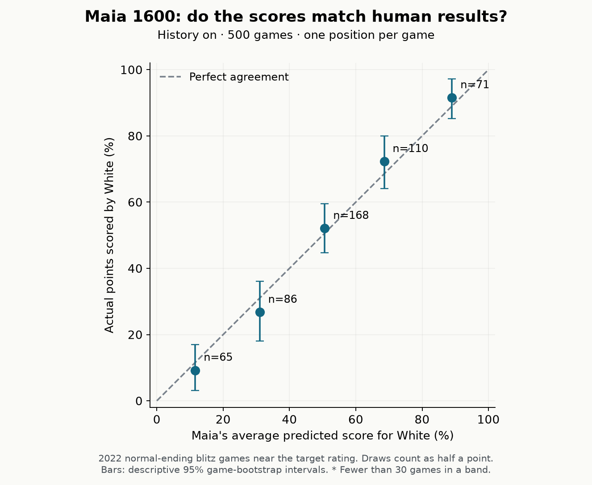
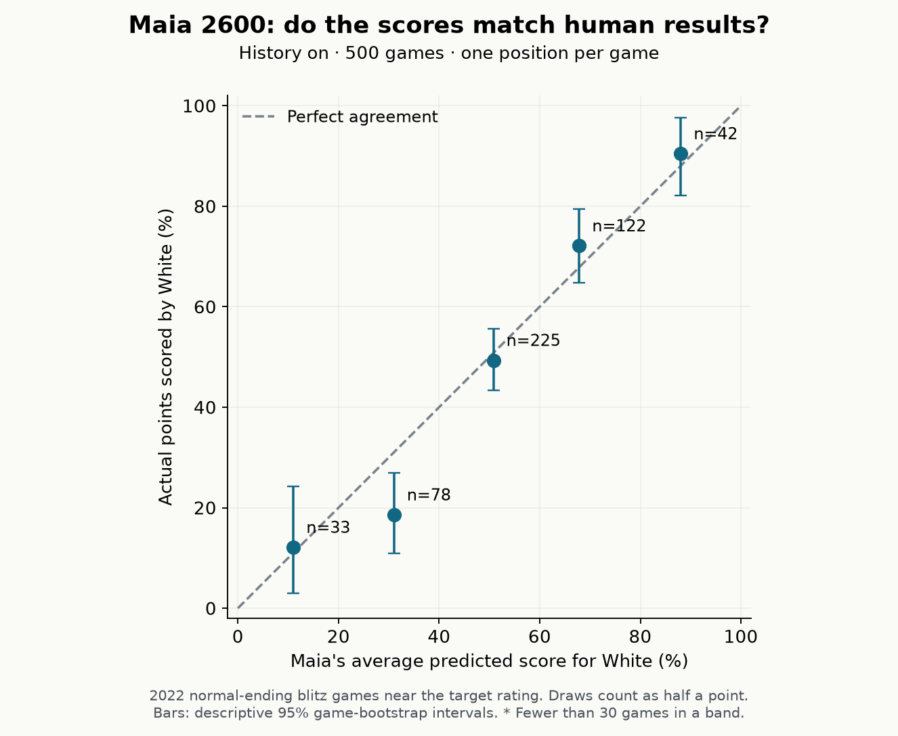

# Detailed results and methods

[← Back to the visual guide](REPORT.md)

**27 October 2026 · Maia-3 79M · rating inputs 1600 and 2600**

**Useful as a rough guide to human results; unreliable as a precise, smoothly
changing meter.** That is the main finding of this study. Maia's forecasts
contained useful information at both ratings, but its evaluations sometimes
disagreed substantially between a position and its possible continuations.

A score of 60% means an estimated **60 points per 100 games**, counting a win as
1 and a draw as ½. It does not mean exactly 60 wins. It is also separate from the
probability that Maia predicts a particular move will be played.

## What we checked

- **Human results:** 500 normal-ending games near 1600 and 500 near 2600, with
  one randomly selected eligible position per game. Both players were within
  100 rating points of the target. Positions were after the first ten moves
  and before either reconstructed clock fell below 30 seconds.
- **All time-forfeit games were excluded.** The original 225 high-rating games
  were supplemented with 275 more, using the same rating and clock filters.
  No rating band was widened.
- **Consistency:** 100 positions, half from each cohort, tested at both model
  ratings. We evaluated every legal move and compared its probability-weighted
  resulting score with the original score: 6,606 child evaluations in total.
- **History on** was the main configuration. The human-result check was also
  repeated on exactly the same positions with history off.

Each stage’s selection rules were fixed before its predictions. The expansion
was requested after the initial results were inspected; it was not a single
untouched preregistered sample. Original predictions and the 100-position
consistency sample were preserved unchanged. The earlier Rd1 example
was kept separate. No app changes, strength tournament or Stockfish evaluation
were involved. [Protocol](PROTOCOL.md) · [Evidence and reproduction](README.md)

## 1. The scores contain useful information about human results

| Rating | Games | Squared prediction error | Always-50% error | Error reduction |
|---|---:|---:|---:|---:|
| 1600 | 500 | 0.1703 | 0.2400 | **29.0%** |
| 2600 | 500 | 0.1739 | 0.2235 | **22.2%** |

Lower error is better. These reductions compare Maia with always predicting an
even score on the same games; **they are not percentages of correctly predicted
winners**. The paired 95% bootstrap intervals support lower error than that
baseline at both ratings. Different game mixes mean the reductions do not establish
that one rating is intrinsically more reliable than the other.

The charts below ask a more direct question: **when Maia gives a particular
score, do humans actually score about that much?** Each point groups predictions
into a fixed range. The diagonal is perfect agreement; bars show sampling
uncertainty. All percentages describe White, even when Black is favoured.

### At 1600: broadly sensible across the sampled ranges

For example, in the 60–80% prediction band Maia averaged **68.6%**; White actually
scored **72.3%**, across 110 games. In the 40–60% band it predicted **50.6%** and
White scored **52.1%**, across 168 games. The five band averages were within
about 1–4 percentage points of the recorded outcomes, although their uncertainty
intervals are wider. This is encouraging evidence, not proof of exact calibration.

### At 2600: the larger sample confirms one noticeable mismatch

| White forecast band | Games | Average forecast | Actual White score |
|---|---:|---:|---:|
| 0–20% | 33 | 11.1% | 12.1% |
| 20–40% | 78 | **31.0%** | **18.6%** |
| 40–60% | 225 | 50.8% | 49.3% |
| 60–80% | 122 | 67.9% | 72.1% |
| 80–100% | 42 | 88.1% | 90.5% |

The 20–40% band is the clearest mismatch: Maia overestimated White’s score
by **12.5 percentage points**. Its descriptive 95% bootstrap interval for the
gap is **4.0–20.3 points**. This group grew from 26 to 78 games; the mismatch
remained. It is evidence of a weakness in this sampled range, not a correction
factor to apply to every individual position. The other four band averages
were within about 1–4 points of outcomes. All five now contain at least 30 games.

Across all positions, forecast and actual White averages were **51.6% versus
52.2% at 1600**, and **52.4% versus 51.1% at 2600**. These overall averages can
hide errors in opposite directions, which is why the grouped charts matter.

### What changed when we added 275 high-rating games?

| 2600 collection stage | Games | Average forecast | Actual White score | Squared error | Always-50% error |
|---|---:|---:|---:|---:|---:|
| Original | 225 | 55.4% | 54.9% | 0.1717 | 0.2200 |
| Added | 275 | 50.0% | 48.0% | 0.1757 | 0.2264 |
| Combined | 500 | 52.4% | 51.1% | 0.1739 | 0.2235 |

Both stages support the broad usefulness of the forecast. The added games
have a different outcome mix; the expansion is disclosed rather than presented
as an independent replication. [Stage-by-stage data](data/expansion-comparison.json).

## 2. Individual-position estimates can be inconsistent

For this test, we took each legal move's predicted probability, multiplied it by
White's predicted score after that move, and added the results. If the move and
outcome predictions formed one perfectly coherent forecast, that average would
match the original score. Maia predicts them through separate outputs, so exact
agreement is not guaranteed.

| Consistency measure, same 100 positions | M1600 | M2600 |
|---|---:|---:|
| Typical disagreement (median absolute gap) | **3.6 points** | **3.8 points** |
| Disagreement above 5 percentage points | **39/100** | **41/100** |
| Disagreement above 10 percentage points | **9/100** | **15/100** |
| Largest observed disagreement | **28.0 points** | **42.2 points** |

The 95% intervals for the above-10-point rate were approximately **4–15%** at
1600 and **9–22%** at 2600. These overlapping ranges do not establish that 2600
is worse, but the higher rating clearly does not guarantee smoother or more
consistent estimates. The two source cohorts show the same broad issue; their
separate numbers are in [the results](data/summary.json).

A large gap does not identify which forecast is wrong. The weighted continuation
score is another model estimate, not the true human scoring chance. Conversely,
a small gap would not prove accuracy.

The motivating Rd1 example illustrates this distinction. Its original White
score and weighted continuation score were **46.26% versus 30.50% at 1600**, but
**41.55% versus 38.76% at 2600**. That particular example made 1600 look much less
consistent; the broader sample shows that large disagreements can occur at
both ratings. The example is excluded from every headline statistic above; its
[full earlier calculation](data/known-case-consistency.json) is retained separately.

## 3. History did not clearly change outcome-prediction reliability here

| Rating | Error with history on | Error with history off |
|---|---:|---:|
| 1600 | 0.1703 | 0.1714 |
| 2600 | 0.1739 | 0.1755 |

The paired differences were small, and their uncertainty intervals included zero
at both ratings. This study gives **no clear reason to switch history mode for
the purpose of making the score more trustworthy**. It does not repeat the
separate research on move choice, openings or playing strength. The full
continuation-consistency test was history-on only.

## Practical conclusion

- **Use it for a broad indication of human scoring chances.** The human-result
  check supports that use at both ratings.
- **Do not treat 58% versus 61% as a precise measurement**, or assume a sudden
  change after a move measures that move's quality. Finding a good move can
  legitimately improve scoring chances, and the model can also be inconsistent.
- **Do not assume M2600 is automatically the more trustworthy score display.**
  This study does not establish a reliability ranking between the settings.
- **Keep its meaning separate from Stockfish and move probabilities.** It is a
  learned forecast of game score, not perfect-play analysis or move quality.

A concise description for users would be: **“An approximate forecast of human
game score. Useful for the overall picture; individual estimates can jump.”**
This is a research recommendation, not an application change.

## What this study cannot establish

These are near-rating Lichess blitz games, mostly sampled in moves 11–40, not
FIDE ratings, classical games, arbitrary constructed puzzles or phone-runtime
measurements. Excluding eventual time forfeits deliberately narrows the result
to normal-ending games. Ratings within ±100 and fixed equal model inputs are an
approximation. One position per game avoids counting a long game many times,
but unknown repeated players may introduce dependence.

The added 275 games comprise all 121 eligible games from the pinned ALLIE
monthly validation files and 154 games selected by hash from a pool of 304
eligible games in official Lichess archives. We read the first 8 MiB of each
2022 monthly compressed archive, so those raw games concentrate at the start
of each month. This is not a uniform sample of all 2022 high-rating play. Full
game IDs and move sequences were deduplicated against the source pools.

The 2022 source predates Maia's declared January 2023–July 2025 training window,
but ALLIE is an established upstream evaluation benchmark, not a new untouched
holdout. Position overlap across years cannot be ruled out. See the
[pinned sources and provenance](README.md#source-provenance-and-attribution).

The samples support broad conclusions at both ratings; they do not certify
accuracy to a few percentage points. Bootstrap intervals are descriptive, and
isolated small groups should not be treated as definitive findings.

[Complete numerical summary](data/summary.json) ·
[Independent audit](audit.json) · [Reproduction guide](README.md)
