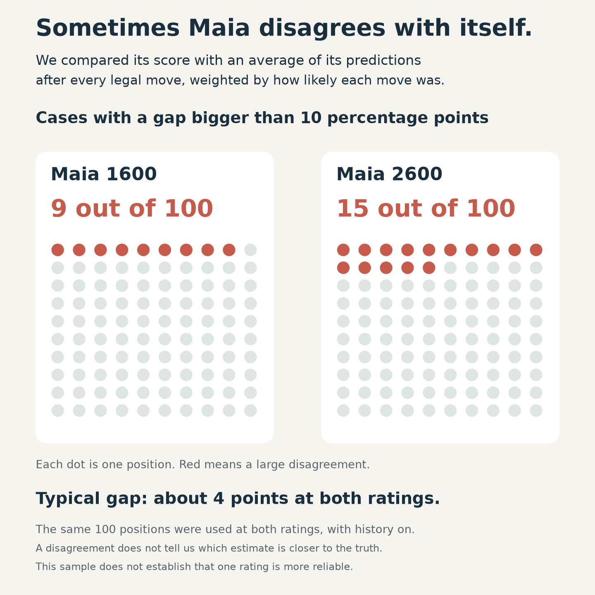

# Can you trust Maia’s score?

**Yes, for the overall picture. Be cautious with the exact number.**

We checked **725 human games** and tested how consistently Maia evaluated
**100 positions**. All time-forfeit games were excluded.

> **What does “White 60%” mean?**
> Maia expects White to score about **60 points per 100 games**.
> A win earns 1 point; a draw earns ½. It does **not** mean 60 wins.

## Does the score match what happens in real games?

**Broadly, yes.** In these games, higher scores generally went with better
results for White. Both ratings were more useful than simply saying “50%”
every time.

Read the bars in pairs: **blue is Maia’s forecast; green is what the players
actually scored.** Close bars mean the forecast was close for that group.

The same general pattern appears at 2600, but we have fewer games. The shaded
rows below need particular caution: **small groups leave more room for chance.**

## Can an individual score still be misleading?

**Yes. Maia can give answers that don’t quite fit together.**

We compared its original score with a second estimate built from **all possible
next moves**, allowing for how likely it thought each move was. Here’s how often
those two estimates differed by more than 10 points:

These dots count **disagreements between forecasts**, not bad moves or proven
wrong predictions. The results do not establish that 2600 is worse—or that it
is automatically more trustworthy.

## How I’d use it

- **Read the overall picture:** roughly equal, one side favoured, or a strong advantage.
- **Treat small changes gently.** A change from 58% to 61% is not a precise measurement of improvement.
- **Check the moves when the score jumps.** Finding a good move can genuinely improve human chances; the model can also be inconsistent.
- **Choose history mode for how you want Maia to play.** Turning it on or off made no clear difference to score reliability in this study.

**Useful guidance, with room for doubt.** That’s the right level of confidence
for this display—not a promise about how a particular game will finish.

---

*This was a small study of normal-ending online blitz games near 1600 and 2600.
It supports broad conclusions, not accuracy to a few percentage points.*

[Detailed results, original charts and limitations →](APPENDIX.md) ·
[Data, methods and reproduction →](README.md)
