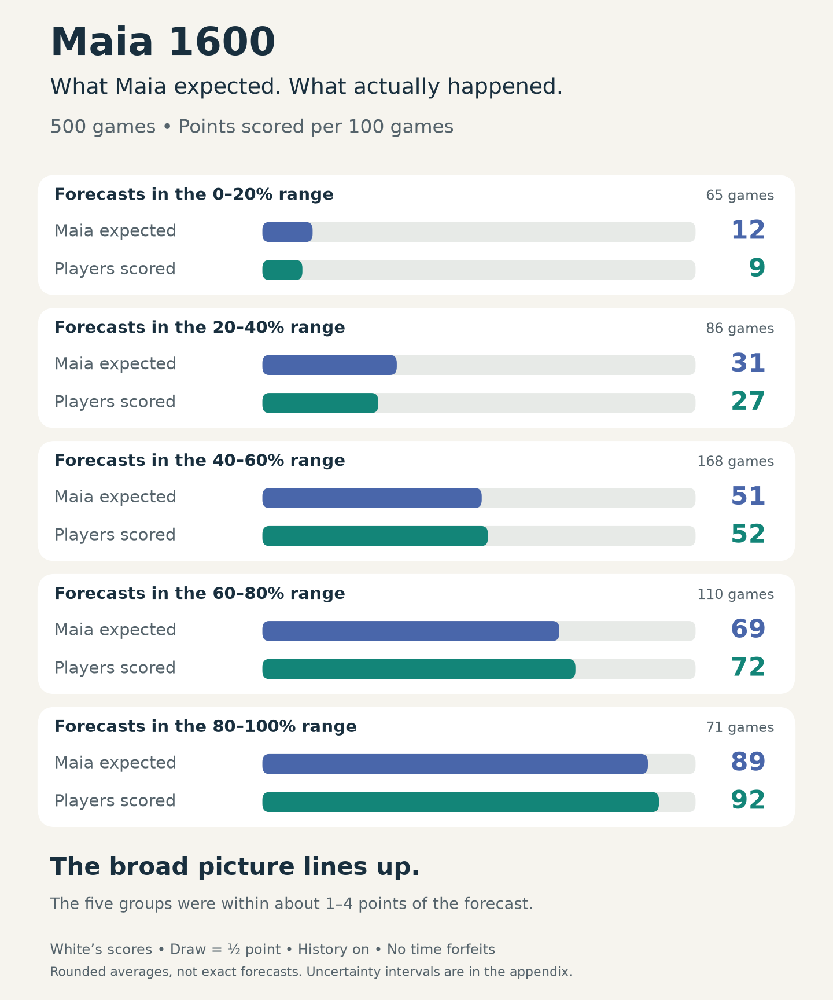
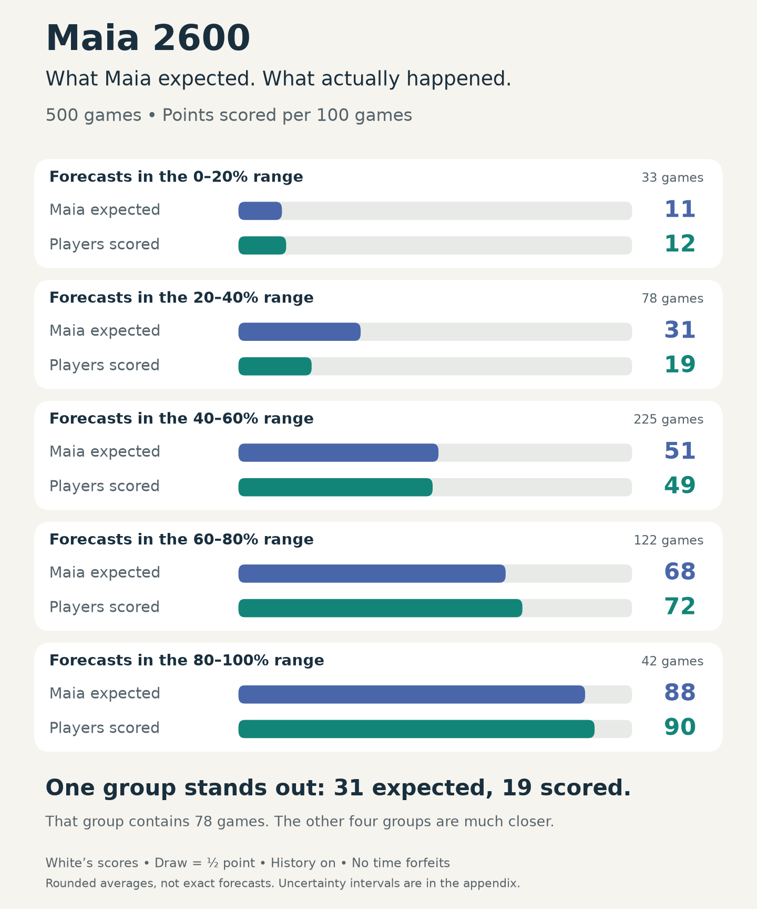
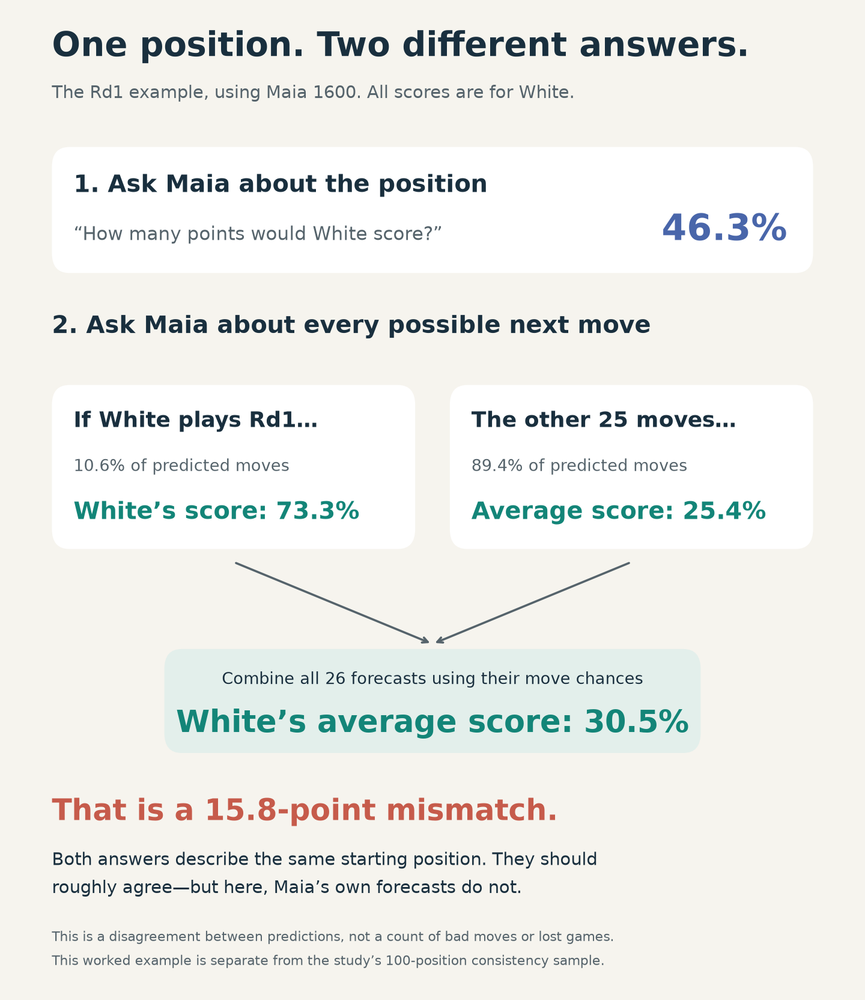

# Can you trust Maia’s score?

**Yes, for the overall picture. Be cautious with the exact number.**

We checked **1,000 human games—500 near each rating—** and tested how consistently Maia evaluated
**100 positions**. All time-forfeit games were excluded.

> **What does “White 60%” mean?**
> Maia expects White to score about **60 points per 100 games**.
> A win earns 1 point; a draw earns ½. It does **not** mean 60 wins.

## Does the score match what happens in real games?

**Broadly, yes.** In these games, higher scores generally went with better
results for White. Both ratings were more useful than simply saying “50%”
every time.

Read the bars in pairs: **blue is Maia’s forecast; green is what the players
actually scored.** Close bars mean the forecast was close for that group.

The 2600 check now also uses **500 games**. Every row shows its game count;
**One group stands out:** forecasts averaging **31%** were followed by just
**19 points per 100 games**, across 78 games. Maia was too optimistic about
White in that group. The other four groups were within about 1–4 points.
Uncertainty intervals and source details are in the appendix.

## What did we mean by “Maia disagrees with itself”?

**We asked about the same position in two ways.** Here is the position from
the game that prompted this study:

The **46.3% and 30.5% are both Maia’s predictions**. Neither is an observed game
result. The gap tells us its answers do not fit together—not which answer is right.

The calculation is simply **10.6% × 73.3 + 89.4% × 25.4 ≈ 30.5**.
Rd1 raises White’s chances, but Maia expects White to choose it only about one
time in ten at 1600. Averaging over the other moves is what matters here.
At 2600, this same example was much closer: **41.6% directly versus 38.8%
after averaging**. A jump after one move alone is not evidence of inconsistency.

We repeated that check on **100 positions**. Gaps larger than 10 percentage points
appeared in **9 positions at 1600** and **15 at 2600**. Those are counts of
mismatched forecasts, **not bad moves, lost games, or how often Maia predicted
the wrong winner**. The detailed check remains in the appendix.

## How I’d use it

- **Read the overall picture:** roughly equal, one side favoured, or a strong advantage.
- **Treat small changes gently.** A change from 58% to 61% is not a precise measurement of improvement.
- **Check the moves when the score jumps.** Finding a good move can genuinely improve human chances; the model can also be inconsistent.
- **Choose history mode for how you want Maia to play.** Turning it on or off made no clear difference to score reliability in this study.

**Useful guidance, with room for doubt.** That’s the right level of confidence
for this display—not a promise about how a particular game will finish.

---

*Tested on normal-ending online blitz games near 1600 and 2600. The percentages
remain approximate forecasts, not guarantees about individual games.*

[Detailed results, original charts and limitations →](APPENDIX.md) ·
[Data, methods and reproduction →](README.md)
